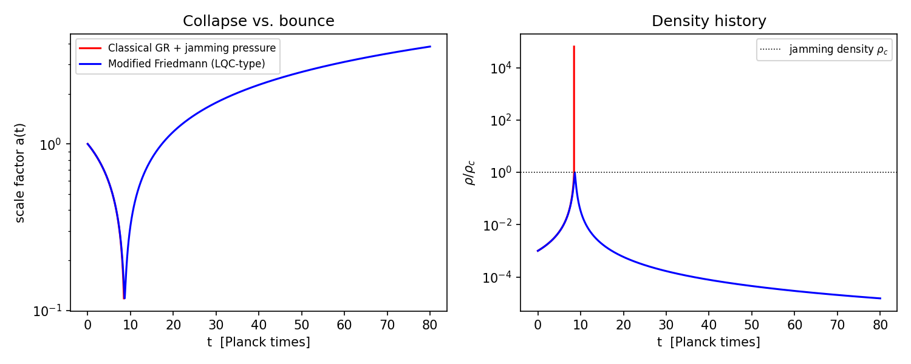
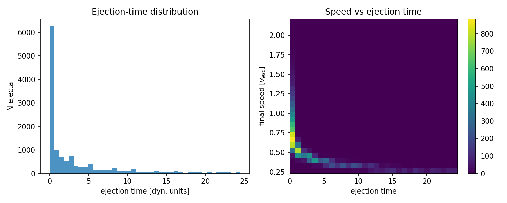
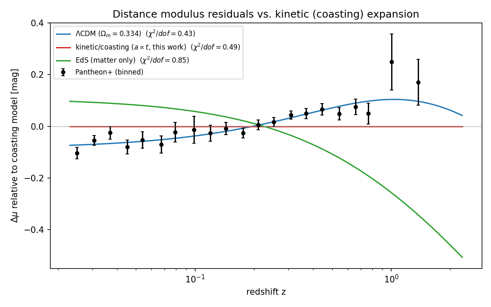
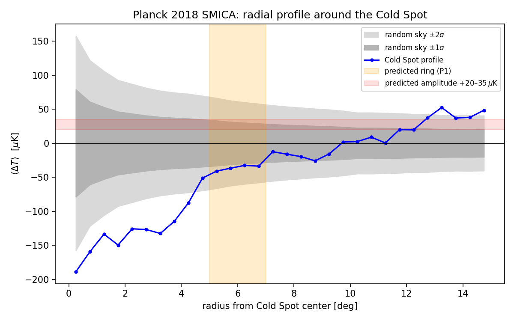
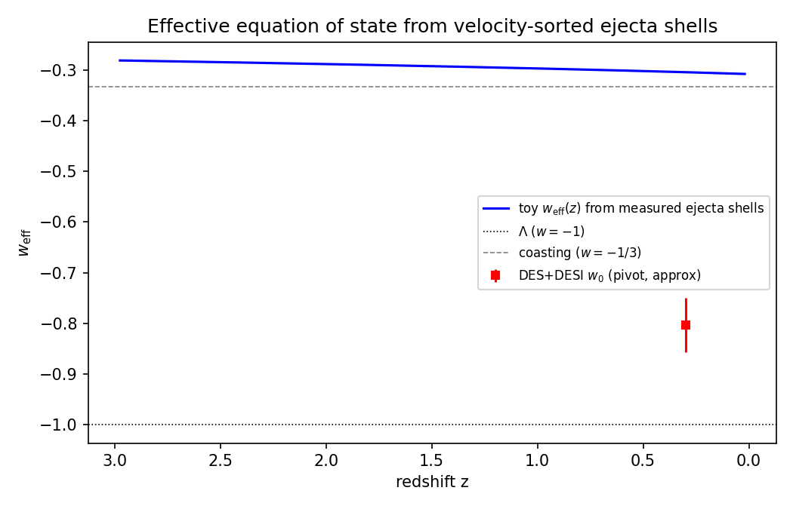

**Tóm tắt.** Vũ trụ là một tập hợp các vòng đồng tâm gồm những relic khối lượng Planck giống hệt nhau, tuân theo cơ học khác nhau ở mỗi vòng; chúng ta sống trong vòng trong cùng, Kernel 0,0,0, vòng duy nhất có ánh sáng: Quả Táo Lớn (the Big Apple). Vật chất tối không cần hạt mới: đó là các relic khối lượng Planck còn sống sót sau quá trình nghiền trong Kernel 0,0,0 — phần vết $f = T_{\text{eq}}/T_{\text{conv}}$ còn lại khi các vụ hợp nhất relic, vốn biến khối lượng relic thành ánh sáng, không còn theo kịp sự giãn nở — tức là vật chất hấp dẫn thông thường, vô hình đối với mọi máy dò không dựa trên hấp dẫn, nên kết quả rỗng suốt bốn mươi năm của các cuộc tìm kiếm trực tiếp trở thành một dự đoán (P5 (Không có hạt DM (*No Particle DM*))) và một phát hiện hạt được xác nhận sẽ bác bỏ giả thuyết cốt lõi. Năng lượng tối *không* được loại bỏ: không có cách sắp xếp vật chất phóng ra hay các vũ trụ láng giềng nào có thể làm giãn nở tăng tốc, và gia tốc được quy cho một sức căng không đổi của không gian mà khuôn khổ này không suy ra được giá trị. Lạm phát vũ trụ — "lạm phát hài hước (comic inflation)" trong vốn từ làm việc của chúng tôi — bị loại bỏ với tư cách một *cơ chế*: không có inflaton, không có lăn chậm; một cú nảy cầu cứng không kỳ dị thay thế kỳ dị ban đầu và tránh được định lý Borde–Guth–Vilenkin, nhưng các vấn đề chân trời và độ phẳng vẫn còn bỏ ngỏ và độ nghiêng đỏ chỉ được khớp theo số liệu. Các vòng đến trước (Mục 3, H8 (Những Vòng Quý Giá – Luyện Ngục của Dante (*Precious Rings – Dante's Purgatory*))): chúng là các chuyển pha của một vật liệu duy nhất, như các gián đoạn địa chấn của Trái Đất, và một mô hình vỏ bảo toàn năng lượng cho cú bật lại cho thấy thứ tự mà các vòng cần — phần bên trong được giữ bằng áp suất nằm dưới phần bên ngoài chuyển động tự do — với tiếp xúc giới hạn lượng phóng ra ở khoảng $60\%$ và mức $88\%$ chỉ đạt được bởi vật chất chuyển động tự do — nhưng không có cấu trúc ba dải và không có bán kính vòng cụ thể nào. Bên dưới các vòng là cú nảy (Mục 4, H1 (Nảy – Cú Nổ Hồ Bi-a Lớn (*Bounce – The Big Pool Bang*))): một tập hợp kẹt cứng các relic khối lượng Planck ($\sim\!10^{60}$–$10^{61}$ relic sống sót trong mỗi thể tích Hubble hiện nay), được coi như các cầu cứng hiệu dụng,^[Mã nguồn, hình vẽ, hướng dẫn xây dựng và liên kết tải xuống cho mọi bộ dữ liệu được dùng: https://github.com/AIMFIRST-VN/big001] bật lại theo một phương trình Friedmann hiệu chỉnh kiểu lượng tử hóa hấp dẫn vòng (loop-quantum-cosmology) với mật độ tới hạn được phỏng đoán là mật độ kẹt cứng; các mô phỏng $N$ vật mô hình với phân bố cú đá hỗn loạn phóng ra $88\% \pm 4\%$ khối lượng với sự phân loại vận tốc rõ ràng — khối lượng của các vòng tối. Vụ Nổ Lớn nóng chính là Kernel 0,0,0 (Mục 5): phần sống sót là một điều kiện nhất quán mà kênh hợp nhất-rồi-bay hơi phải đáp ứng, không phải một kết quả suy ra, và tiết diện hợp nhất hình học trượt nó tới 28 bậc độ lớn, bài toán mở hàng đầu. Phần bên trong của lõi được *giả định* là FLRW đồng nhất với rìa nằm ngoài chân trời; hệ các vòng là một đám mây hữu hạn có tâm mà vẫn *không có cơ chế nảy* ($\sim\!10^{40}$ bên trong bán kính Schwarzschild của chính nó). Giãn nở quán tính (coasting) bị Pantheon+ ($\Delta\chi^2 \approx 84$) và DES-SN5YR ($\Delta\chi^2 \approx 131$) không ủng hộ, một nón sáng LTB tương đối tính xuyên qua vật chất phóng ra bị giảm tốc ($q_0^{\text{eff}} = +0.16$), và một cổng Sunyaev–Zel'dovich động học giới hạn mọi biên dạng phóng ra ở mức $\sim\!1\%$ năng lượng tối quan sát được, vì vậy chúng tôi chọn khuôn khổ này *cộng với một sức căng không đổi của không gian* ($w=-1$; Mục 6). Bên trong một lõi đồng nhất, lớp phủ (mantle) và vỏ (shell) cầu không tác dụng lực nào, nên vị trí của chúng ta, H5 (Vị trí của ta – Nemo ở đâu (*Our Position – Where Is Nemo*); Mục 7), chính là giả thuyết không của $\Lambda$CDM — lưỡng cực lệch tâm sau khi trừ cấu trúc vẫn nằm trong ngưỡng mô phỏng $\approx 2.5$ Mpc, cũng như vậy — trong khi lõi phẳng đến vài phần trăm về nhiệt độ nguyên thủy và tỉ lệ vật chất tối-trên-baryon, điều mà građien xuyên tâm của chính mô hình phải tuân theo (P12 (Građien Lõi (*Kernel Gradient*))). Một vòng nóng của Cold Spot dự đoán ở $5°$–$7°$ không có mặt trong dữ liệu Planck 2018; một vũ trụ láng giềng nằm ngoài chân trời hạt của chúng ta chỉ có thể in lên một thế điều kiện ban đầu (Sachs–Wolfe), mà đối với Cold Spot ấn định khối lượng nguồn $M_2 \approx 10^{48}$ kg ($+0.6/-0.4$ dex) cách bề mặt tán xạ cuối $1$–$2.5$ Gly với vận tốc cục bộ cảm ứng $\lesssim 1$ km s$^{-1}$. Chúng tôi tổ chức các tuyên bố thành tám giả thuyết — H8 (Những Vòng Quý Giá – Luyện Ngục của Dante (*Precious Rings – Dante's Purgatory*)), H1 (Nảy – Cú Nổ Hồ Bi-a Lớn (*Bounce – The Big Pool Bang*)), H5 (Vị trí của ta – Nemo ở đâu (*Our Position – Where Is Nemo*)), H2 (Xoáy – Con Mắt Lạnh của Sauron (*Vortex – The Cold Eye of Sauron*)), H3 (Láng giềng – Đa vũ trụ Big Pool Bang 2 (*Neighbour – Big Pool Bang Multiverse 2*)), H4 (Quần thể – Phông Nền Hài Hước Tối (*Population – The Dark Comic Background*)), H6 (Vị trí láng giềng (*Neighbour Location*)) và H7 (Mô hình Hồ bi-a (*Pool Model*)) — mỗi giả thuyết có các tiêu chí bác bỏ tường minh được tập hợp trong một bảng, liệt kê mười ba dự đoán (P1 (Vòng phân cực (*Polarization Ring*))–P13 (Không có lỗ đen nguyên thủy (*No Primordial Holes*))) cùng các thiết bị cần thiết, và nêu các vấn đề chưa giải quyết: khoảng cách tiết diện hợp nhất, sinh baryon, tính đồng nhất được giả định của lõi, cấu trúc nhân quả của cú nảy, công thức tương đối tính của sự phóng ra, các vấn đề chân trời và độ phẳng, và lịch sử giãn nở.

## **1. Giới thiệu: Ba câu hỏi**

Bức tranh là một quả táo — Quả Táo Lớn. Một loại bi duy nhất, relic khối lượng Planck, lấp đầy một quả cầu kẹt cứng; quả cầu bật lại, và cú bật lại phân loại các viên bi thành những vòng đồng tâm theo một con số duy nhất của mỗi viên, cú đá của nó so với vận tốc thoát. Các vòng không làm từ những chất khác nhau; chúng là cùng một chất dưới những cơ học khác nhau — kẹt cứng, rồi va chạm, rồi không va chạm, rồi một bức tường — như các gián đoạn địa chấn của Trái Đất là một loại đá dưới các áp suất khác nhau. Một quả táo có ba loại mô khác nhau, và giả thuyết là cú bật lại tạo ra chúng (Mục 3.2 ghi lại một mô hình chất lưu đầu tiên mà sự xác nhận bề ngoài cho điều này là một giả tượng; Mục 3.3 ghi lại mô hình có kiểm soát): lõi với các hạt giống là Kernel 0,0,0, vòng trong cùng, nơi các viên bi rơi ngược lại va chạm và nghiền nhau thành ánh sáng, để lại các relic sống sót làm hạt giống trong đó — vòng duy nhất có ánh sáng, và là nơi chúng ta sống; phần thịt là lớp phủ tối; và lớp vỏ mỏng, bong ra đầu tiên, là bầu khí quyển mà sóng giải tải giải phóng đầu tiên và nhanh nhất, lớp vỏ tối của vật chất phóng ra đã được phân loại. Ngoài lớp vỏ là một ranh giới, và ngoài đó có thể có các vụ nổ khác. Bài báo được tổ chức quanh ba câu hỏi về quả táo này.

1. **Mô hình hoạt động như thế nào?** Một sự kết tinh chân không bậc nhất kẹt cứng thành trạng thái cầu cứng; một cú nảy kiểu lượng tử hóa hấp dẫn vòng làm nó bật lại; cú bật lại phân loại các relic theo tốc độ thành các vòng (Mục 3–4): H8 (Những Vòng Quý Giá – Luyện Ngục của Dante (*Precious Rings – Dante's Purgatory*)) cho các vòng, H1 (Nảy – Cú Nổ Hồ Bi-a Lớn (*Bounce – The Big Pool Bang*)) cho cú nảy bên dưới chúng. Các relic rơi ngược lại tạo thành Kernel 0,0,0, nơi các va chạm nghiền khối lượng relic thành ánh sáng cho đến khi các vụ hợp nhất không còn theo kịp sự giãn nở: ánh sáng đó là Vụ Nổ Lớn nóng, và vết lạnh của các relic sống sót là vật chất tối của chúng ta, không có hạt mới (Mục 5). Phần $88\% \pm 4\%$ mà cú bật lại mô hình phóng ra là các vòng tối bên ngoài. Động học của cú bật lại *không* tái tạo được gia tốc vũ trụ, nên lịch sử giãn nở được chọn là khuôn khổ này cộng với một sức căng không đổi của không gian mà giá trị không được suy ra (Mục 6); và phép tính chuyển đổi phải tái tạo phần sống sót vẫn chưa được thực hiện (Mục 13).

2. **Chúng ta ở đâu?** Trong Kernel 0,0,0, tại hoặc gần tâm của nó, theo H8 (Những Vòng Quý Giá – Luyện Ngục của Dante (*Precious Rings – Dante's Purgatory*)); H5 (Vị trí của ta – Nemo ở đâu (*Our Position – Where Is Nemo*); Mục 7) kiểm tra vị trí đó. Bên trong một lõi đồng nhất, lớp phủ và vỏ cầu không tác dụng lực nào, nên vị trí này dự đoán đúng những gì $\Lambda$CDM dự đoán: một giả thuyết không về tâm bị dịch chuyển và một dòng chảy khối được giải thích bằng các vật hút cục bộ. Câu trả lời hiện tại của chúng tôi: phép thử tâm bị dịch chuyển cho kết quả không trong phạm vi vài Mpc, và sự bất đối xứng bán cầu được gán cho một láng giềng bên ngoài thì tốt hơn là cho độ lệch tâm của chính chúng ta. Một công cụ thứ hai, građien xuyên tâm của quá trình nghiền (P12 (Građien Lõi (*Kernel Gradient*)); Mục 5.4), phẳng đến vài phần trăm trên thể tích quan sát được.

3. **Vụ nổ lớn thứ hai ở đâu?** Ngoài vòng biên. Một Big Pool Bang láng giềng nằm ngoài chân trời hạt của chúng ta chỉ có thể in lên bề mặt tán xạ cuối thông qua thế mà nó đóng góp vào các điều kiện ban đầu — một vết Sachs–Wolfe với đuôi đa cực thấp. Cold Spot tại $(l,b) = (203°, -56°)$ là ứng viên, được xử lý theo H2 (Xoáy – Con Mắt Lạnh của Sauron (*Vortex – The Cold Eye of Sauron*)), H3 (Láng giềng – Đa vũ trụ Big Pool Bang 2 (*Neighbour – Big Pool Bang Multiverse 2*)) và H6 (Vị trí láng giềng (*Neighbour Location*)) trong Mục 8–10: hướng biết với độ chính xác $\pm 3°$, khoảng cách comoving $1$–$2.5$ Gly ngoài bề mặt tán xạ cuối, khối lượng $M_2 \approx 10^{48}$ kg trong phạm vi $+0.6/-0.4$ dex, và một phép thử mode xoáy, P8 (Kiểm tra curl (*Curl Test*)), đã được đăng ký trước. Tám vết cực trị của bản đồ Planck là danh sách ứng viên cho một quần thể các láng giềng như vậy, H4 (Quần thể – Phông Nền Hài Hước Tối (*Population – The Dark Comic Background*)) và H7 (Mô hình Hồ bi-a (*Pool Model*)), được xử lý trong Mục 11.

Bài báo trả lời các câu hỏi theo thứ tự đó: Mục 2 là giả thiết cầu cứng và số lượng relic; Mục 3 là các vòng, cấu trúc âm học của chúng và một mô hình thủy động lực của cú bật lại; Mục 4 là cú nảy và sự phân loại vận tốc; Mục 5 là Kernel 0,0,0 như Vụ Nổ Lớn nóng, các kiểm tra nhất quán và cấu trúc xuyên tâm của lõi; Mục 6 là hình học theo từng vòng và lịch sử giãn nở; Mục 7 là vị trí của chúng ta; Mục 8–11 là Cold Spot, láng giềng, vị trí của nó và quần thể; Mục 12 là mười ba dự đoán và bảng bác bỏ; Mục 13 là các vấn đề mở. Phụ lục A ghi lại các kết quả rỗng mang tính thăm dò, Phụ lục B một kiểm tra mạng tinh thể, Phụ lục C các phép thử bắt chước động học và độ trôi $w(z)$, Phụ lục D các chi tiết phóng ra $N$ vật.

## **2. Relic khối lượng Planck như các cầu cứng hiệu dụng**

Vũ trụ học chuẩn dựa vào lạm phát trường vô hướng để giải thích vì sao vũ trụ quan sát được phẳng, đẳng hướng và đồng đều nhiệt, với cái giá là điều chỉnh tinh vi và các định lý kỳ dị (Borde, Guth & Vilenkin 2003). **Lý thuyết Big Pool Bangs** là một giải pháp thay thế cơ học dựa trên động lực học chuyển pha bậc nhất. Không gian bắt đầu trong một chân không giả với $\rho_{\text{vac}} \sim \rho_P$. Các thăng giáng lượng tử kích hoạt một chuyển pha **kết tinh chân không** hình thành mầm tại nhiều điểm: các bong bóng pha đã chuyển đổi lớn lên, va chạm và hợp nhất, và "vụ nổ" là sự thấm của chúng thành một trạng thái kẹt cứng duy nhất.

**Giả thiết cầu cứng.** Với một hạt khối lượng $m$, bước sóng Compton rút gọn $\hbar/mc$ và bán kính Schwarzschild $2Gm/c^2$ trùng nhau tại $m \approx m_P$, nơi cả hai bằng $\sim\!\ell_P = 1.616\times10^{-35}$ m, chế độ mà trong đó cả lý thuyết trường lượng tử lẫn thuyết tương đối rộng cổ điển đều không đúng riêng rẽ. **Chúng tôi chấp nhận, như một giả thiết mô hình hóa chứ không phải một phép suy ra, rằng các relic Planck có kích thước không gian tối thiểu $\sim\!\ell_P$ mà không tương tác nào có thể nén được**, và coi chúng như các cầu cứng không nén được hiệu dụng. Giả thiết được đánh giá qua hiện tượng luận mà nó sinh ra (Mục 3–11); sự biện minh vi mô của nó là một vấn đề mở (Mục 13); các bức tranh vật chất ngưng tụ của chân không (Volovik 2003) và hấp dẫn tương tự trong chất lưu (Barceló, Liberati & Visser 2011) là những tiền lệ gần nhất để coi nó như một môi trường. Đối tượng gần nhất trong tài liệu hấp dẫn lượng tử là tàn dư lỗ trắng của hấp dẫn vòng (Bianchi et al. 2018; Rovelli & Vidotto 2018): một lỗ đen đã bay hơi Hawking xuống đến khối lượng Planck xuyên hầm thành một lỗ trắng khối lượng Planck sống lâu, ở đó được đề xuất làm ứng viên vật chất tối. Chúng tôi lấy nó làm vi mô học ứng viên của relic, cùng với hai đồng hồ của nó — sự bay hơi của một cụm $N$ relic trong $\sim N^3\,t_P$ và thời gian sống của tàn dư $\sim N^4\,t_P$ — và lưu ý rằng thời gian nảy sao Planck $\sim N^2\,t_P$ của Rovelli & Vidotto (2014), được dùng trong Mục 3.1 cho các vụ nổ con, là ước lượng sớm hơn, ngắn hơn mà công trình sau này thay thế.

**Số lượng relic.** Vì hình học lượng tử cấm các mật độ vô hạn cục bộ hóa, năng lượng kết tinh thành các **relic khối lượng Planck** bất khả quy ($m_P \approx 21.8\,\mu$g). Chúng tôi đếm *các relic sống sót, trong mỗi thể tích Hubble hiện nay, ngày nay*: $N \approx 10^{60}$–$10^{61}$ relic, khối lượng $M_1 = N m_P \approx 2.2\times10^{52}$ kg ở đầu thấp (cấp độ lớn; khối lượng vật chất của vũ trụ *quan sát được* là $\sim\!1.5\times10^{53}$ kg). Đây là số sống sót, không phải tổng số. Theo H8 (Những Vòng Quý Giá – Luyện Ngục của Dante (*Precious Rings – Dante's Purgatory*)) các relic sống sót là phần $f = T_{\text{eq}}/T_{\text{conv}}$ của các relic có mặt trong thể tích Hubble comoving tại cú nảy (Mục 5), nên số lượng tại cú nảy là $N/f \approx 10^{88}$ đối với chuyển đổi ở thang Planck (ít hơn đối với $T_{\text{conv}}$ thấp hơn), và vùng comoving trở thành một thể tích Hubble hiện nay trải dài, ở mật độ của cú nảy, $\sim\!3\times10^{29}$ mảng nhân quả (kích thước Planck) theo mỗi chiều. Trong Hình học A (Mục 4) mảng kẹt cứng nằm ngoài chân trời, nên tổng số và khối lượng của nó không bị quan sát giới hạn; trong Hình học B chúng là khối lượng của một đám mây hữu hạn. Các relic làm bão hòa thể tích cục bộ đến giới hạn đóng gói ngẫu nhiên chặt $\eta_{\text{rcp}} \approx 0.64$, và với $\rho_P = m_P/\ell_P^3 = 5.2\times10^{96}$ kg m$^{-3}$ mật độ kẹt cứng là $\rho_c = \eta_{\text{rcp}}\rho_P$. Bán kính Schwarzschild của ngay cả khối lượng sống sót là $3.3\times10^{25}$ m, lớn hơn bốn mươi bậc so với kích thước kẹt cứng của nó ($\sim\!10^{-15}$ m), nên một quả cầu hữu hạn có khối lượng và mật độ này sẽ là một lỗ đen, không phải một mảng nảy. Cú nảy của Mục 4 chỉ có ý nghĩa nếu mảng kẹt cứng là toàn bộ vũ trụ (hoặc một vũ trụ nằm ngoài chân trời) được mô tả bởi một mêtric kiểu FLRW đồng nhất, mà đối với nó không tồn tại hình học Schwarzschild bên ngoài (Hình học A); cách đọc đám mây hữu hạn (Hình học B) phải đối mặt trực tiếp với vấn đề mặt bị bẫy này. Chúng tôi dùng $\rho_c$, không phải bán kính kẹt cứng, làm tham số vật lý.

*Dòng thời gian kết tinh.* Các thành bong bóng lan truyền ở $\leq c$, nên việc thấm qua $\sim\!3\times10^{29}$ mảng nhân quả theo mỗi chiều mất ít nhất $3\times10^{29}\,t_P \approx 1.6\times10^{-14}$ s chia cho số vị trí tạo mầm trên mỗi chiều dài giao nhau; mọi mật độ tạo mầm đủ thưa để cho thống kê hợp nhất không tầm thường đều hàm ý thời gian lắp ráp lớn hơn $t_P$ nhiều bậc, mà tính nhất quán của nó với việc tránh mặt bị bẫy (Mục 4) còn bỏ ngỏ.

*Sự tạo mầm như nguồn gốc của phổ cú đá.* Tính ngẫu nhiên của lịch sử hợp nhất được lõi kẹt cứng kế thừa như sự hỗn loạn nội tại, một nguồn ứng viên cho phổ cú đá ngẫu nhiên mà Mục 4 đòi hỏi như một đầu vào — với điều kiện cấu trúc vận tốc thời kỳ tạo mầm tồn tại qua kỷ nguyên kẹt cứng thay vì nhiệt hóa. Một mô phỏng tạo mầm-và-hợp nhất Poisson tái tạo phân bố cú đá Maxwell (hệ số biến thiên tốc độ $0.41$–$0.42$), phần lớn là hệ quả của định lý giới hạn trung tâm; thống kê không tầm thường là tỉ số kết hợp-trên-tán xạ $\sigma_{\text{rel}}$. Tạo mầm Poisson bị chi phối bởi hỗn loạn ($\sigma/\langle v_r\rangle \approx 5$–$8$); một mô hình *thác* — một bong bóng mầm duy nhất mà thành của nó xúc tác cho sự tạo mầm tiếp theo, bị dừng bởi một phản hồi kẹt cứng tại $\eta \approx 0.64$ — cho $\sigma_{\text{rel}} = 0.65$–$0.78$, vững chắc trên một dải $4\times$ của khoảng cách kích hoạt. Ba lưu ý chặn chuỗi suy luận: trường cú đá đuôi nặng hơn của thác chưa được đưa qua quy trình $N$ vật; mô hình giữ lại các lựa chọn cấu trúc (khoảng cách kích hoạt, độ trễ tạo mầm, trọng số diện tích thành, sự dừng $\eta = 0.64$); và hiệu suất động lượng của thành được giả định là phổ quát, trong khi nó phụ thuộc mô hình và thường nhỏ (Espinosa et al. 2010). Các va chạm bong bóng trong mọi chuyển pha bậc nhất cũng phát sinh một phông nền sóng hấp dẫn ngẫu nhiên có đỉnh ở thang chuyển pha; đây là một dự đoán chung của H1 (Nảy – Cú Nổ Hồ Bi-a Lớn (*Bounce – The Big Pool Bang*)), được liệt kê là P3 (Nền sóng hấp dẫn chuyển pha (*Transition GW Background*)), không phải của bất kỳ láng giềng nào.

**Bước đầu tiên (Sóng Ma Thần Kỳ; Holy Moly Ghost Waves): sự tạo mầm như một thăng giáng dị thường.** Thác ở trên cần một bong bóng mầm và chưa bao giờ nói nó đến từ đâu. Chân không giả phân rã khi một thăng giáng trong một vùng đưa trường qua hàng rào: trong bức tranh nhiệt đó là một sự kiện đuôi trong đó nhiều mode cộng lại ở một chỗ, cùng thống kê khiến một con sóng trong mười nghìn con sóng biển là sóng dị thường (rogue wave); giới hạn nhiệt độ không là instanton Coleman–De Luccia. Tốc độ trên một đơn vị thể tích không-thời gian là $\Gamma \sim \ell_P^{-4}\,e^{-S}$ với $S$ là tác dụng nảy. Phép đếm ấn định $S$: một mảng kích thước $L$ chờ khoảng $L/c$ cho mầm đầu tiên của nó, nên số mầm kỳ vọng trong thời gian đó là $(L/\ell_P)^4 e^{-S}$, và *đúng một* mầm đòi hỏi $S \approx 4\ln(L/\ell_P)$ — $S \approx 184$ với $L = 10^{20}\,\ell_P$ và $S \approx 270$–$280$ với một ô cỡ thể tích Hubble hiện nay tại cú nảy (Mục 11f). Đây là xác suất sóng dị thường, $10^{-80}$ đến $10^{-120}$ trên mỗi thể tích 4 chiều Planck — và phép tương tự với biển là nghĩa đen: thống kê của các lệch cực trị của một trường ngẫu nhiên là của Rice (1944, 1945) và Longuet-Higgins (1957) cho mặt biển ngẫu nhiên, nơi mà lý thuyết đỉnh của cấu trúc vũ trụ (Bardeen et al. 1986) đã lấy chúng — và chúng không phải điều chỉnh tinh vi: trong công thức thành mỏng $S = 27\pi^2\sigma^4/(2\epsilon^3)$ với $\epsilon \approx \rho_P$, chúng tương ứng với sức căng thành $\sigma \approx 1.1$–$1.2\,M_P^3$, giá trị Planck tự nhiên. Vị trí của mầm là gốc của Kernel 0,0,0 (Mục 3). Cái khó là thời gian chờ: $L/c$ là $10^{20}$–$10^{29}\,t_P$, và một chân không giả có phương trình trạng thái của hằng số vũ trụ sẽ giãn nở theo $e^{10^{20}}$ hoặc hơn trong thời gian đó. Vì vậy khuôn khổ đòi hỏi trạng thái trước kết tinh mang mật độ năng lượng Planck *mà không có* áp suất âm thúc đẩy giãn nở — gần với một chất rắn kẹt cứng hơn là không gian de Sitter — hoặc nếu không thì sự tạo mầm phải tức thời ở mọi nơi ($S \to 0$), đó là trường hợp Poisson của Mục 2 không cho cú đá kết hợp và không có tâm. Phương trình trạng thái ban đầu không phải $\Lambda$ này là một giả định mới và được liệt kê trong Mục 13.

## **3. H8 (Những Vòng Quý Giá – Luyện Ngục của Dante (*Precious Rings – Dante's Purgatory*)): Quả Táo Lớn**

**Động cơ.** Một cú nảy đồng nhất đơn lẻ không thể vừa là cú bật lại của các relic kẹt cứng mà vật chất phóng ra là vật chất tối, vừa là nguồn của một kỷ nguyên bức xạ để lại các relic lạnh ở thời điểm cân bằng vật chất–bức xạ: nếu mọi relic chia sẻ một lịch sử, vật chất phóng ra sẽ nóng ở thời điểm cân bằng với mọi hệ số Lorentz phóng ra (Mục 5). H8 (Những Vòng Quý Giá – Luyện Ngục của Dante (*Precious Rings – Dante's Purgatory*)) giải quyết mâu thuẫn bằng *vị trí*. Các relic giống hệt nhau, nhưng chúng không chia sẻ một lịch sử: cú đá mà mỗi relic nhận được so với vận tốc thoát cục bộ, $f = v/v_{\text{esc}}$ — con số duy nhất mà cú bật lại gán cho mọi relic (Mục 4, Hình 2) — phân loại chúng thành các vòng đồng tâm, và cơ học khác nhau từ vòng này sang vòng khác vì mật độ, tốc độ va chạm và năng lượng liên kết khác nhau. Luyện Ngục của Dante là bức tranh: một ngọn núi, một loại linh hồn, và một luật khác trên mỗi bậc thềm. Quả Táo Lớn là hình dạng: một lõi với các hạt giống, phần thịt, và lớp vỏ bong ra đầu tiên. Bảng 1 là tấm bản đồ.

**Bảng 1. H8 (Những Vòng Quý Giá – Luyện Ngục của Dante (*Precious Rings – Dante's Purgatory*)): các vòng, cơ học của chúng và công cụ của chúng ta cho mỗi vòng.**

| Vòng | Ai ở đó | Cơ học | Trạng thái | Trở thành | Công cụ của chúng ta |
| :---- | :---- | :---- | :---- | :---- | :---- |
| Kernel 0,0,0 (lõi với các hạt giống) | Các relic không được sóng giải tải giải phóng ($f$ thấp hơn $1$ nhiều) | Va chạm: hợp nhất, bay hơi, nhiệt hóa, động lực học chất lưu bức xạ | Ánh sáng cộng một vết relic sống sót | Vụ Nổ Lớn nóng mà ta đang sống trong đó: CMB, heli, baryon, và vật chất tối lạnh của chúng ta như những relic sống sót sau quá trình nghiền | Mọi thứ ta quan sát |
| Lớp phủ (phần thịt) | Các relic bay lên và rơi ngược lại muộn, hoặc bị liên kết biên ($f \approx 1$) | Hấp dẫn, va chạm yếu, được trộn bởi nhiều quỹ đạo | Khí relic lạnh, không có ánh sáng | Một vùng đệm tối không còn nhớ hình học ban đầu | Quyết định Kernel 0,0,0 có rìa hay không, và độ lệch H5 (Vị trí của ta – Nemo ở đâu (*Our Position – Where Is Nemo*)) sẽ hiện ra thế nào |
| Vỏ (lớp vỏ ngoài) | Vật chất phóng ra nhanh ($88\%$, $f > 1$), được giải phóng đầu tiên | Chuyển động tự do không va chạm, nhanh nhất đi xa nhất | Tối, được phân loại vận tốc cục bộ | Các vòng tối quanh ta; vòng duy nhất giữ hình học và spin ban đầu | Nằm ngoài chân trời của ta trừ qua các dấu ấn điều kiện ban đầu |
| Ranh giới và xa hơn | Các bức tường tới những vụ nổ láng giềng | Vật lý bong bóng chân không (Coleman & De Luccia 1980) | Không phải vật chất | Dấu ấn Cold Spot, đuôi đa cực thấp | H3 (Láng giềng – Đa vũ trụ Big Pool Bang 2 (*Neighbour – Big Pool Bang Multiverse 2*)), H6 (Vị trí láng giềng (*Neighbour Location*)), P8 (Kiểm tra curl (*Curl Test*)), P9 (Đuôi ℓ thấp (*Low-$\ell$ Tail*)) |

**Chúng ta sống trong Kernel 0,0,0.** Vụ Nổ Lớn nóng là Kernel 0,0,0: vòng trong đó các va chạm nghiền khối lượng relic thành ánh sáng và để lại một vết lạnh các relic sống sót, vật chất tối của chúng ta (Mục 5). Phần phóng ra $88\% \pm 4\%$ của cú bật lại mô hình (Mục 4) là khối lượng của *các vòng tối quanh Kernel 0,0,0* — lớp vỏ — không phải vật chất trong các thiên hà của chúng ta; bên trong Kernel 0,0,0 tỉ số vật chất tối-trên-baryon, $5.4$, được ấn định bởi phần sống sót cùng với sinh baryon, vẫn còn bỏ ngỏ (Mục 13). P5 (Không có hạt DM (*No Particle DM*)) không đổi — các relic sống sót là cùng những đối tượng với vật chất phóng ra.

**Người quan sát sống trong các lõi.** Chỉ Kernel 0,0,0 có ánh sáng. Một người quan sát trong lớp vỏ sẽ không thấy CMB, không thấy ngôi sao, và hoàn toàn không có lịch sử nhiệt — Dante đảo ngược: chúng ta ở trong vòng trong cùng, vòng duy nhất có ánh sáng, và đó là lý do chúng ta có mặt ở đây để đặt câu hỏi.

**Građien kết hợp.** Phụ lục A ghi lại, như một giả thuyết chưa được kiểm tra, rằng chỉ vật chất phóng ra sớm nhất và nhanh nhất mới bảo toàn các tương quan hình học trong khi mọi thứ chậm hơn bị ngẫu nhiên hóa bởi sự thư giãn dữ dội. H8 (Những Vòng Quý Giá – Luyện Ngục của Dante (*Precious Rings – Dante's Purgatory*)) biến điều đó thành phát biểu của nó: chuyển động tự do bảo toàn hình học và spin ban đầu trong lớp vỏ; các va chạm trong Kernel 0,0,0 và sự trộn quỹ đạo trong lớp phủ xóa chúng. Lớp vỏ là vòng duy nhất nhớ vụ nổ bắt đầu thế nào, và nó là vòng mà chúng ta không thể thấy.

**Hình học theo vòng.** Hai cách đọc hình học của cú bật lại được định nghĩa trong Mục 4: Hình học A (FLRW đồng nhất, không tâm, không bên ngoài) và Hình học B (một đám mây hữu hạn có tâm mà thứ tự xuyên tâm còn tồn tại). H8 (Những Vòng Quý Giá – Luyện Ngục của Dante (*Precious Rings – Dante's Purgatory*)) gán chúng theo vị trí, một lần duy nhất: phần bên trong lõi được *giả định* là FLRW đồng nhất với rìa nằm ngoài chân trời (đây là một giả định, không phải phép suy ra — Mục 13, mục 4(c)); toàn bộ hệ các vòng là Hình học B. Mọi quan sát của chúng ta được thực hiện bên trong Kernel 0,0,0, nên các so sánh của Mục 6 kiểm tra Hình học A được giả định, và H5 (Vị trí của ta – Nemo ở đâu (*Our Position – Where Is Nemo*); Mục 7) kiểm tra vị trí của chúng ta tại hoặc gần tâm của lõi.

### **3.1 Cấu trúc âm học của các vòng**

Các vòng là các chuyển pha của một vật liệu. Các gián đoạn 410 km và 660 km của Trái Đất và ranh giới lõi–lớp phủ là những thay đổi pha của một loại đá dưới áp suất, và địa chấn học vẽ bản đồ chúng vì âm thanh đi qua chúng với tốc độ khác nhau và phản xạ tại độ tương phản. Quả Táo Lớn có cùng cấu trúc với một vật liệu: kẹt cứng (trạng thái trước cú nảy, áp suất phân kỳ tại $\eta = 0.64$), rồi một khí va chạm (Kernel 0,0,0, nơi các relic dày đặc đến mức chúng hợp nhất và các sản phẩm hợp nhất bay hơi), rồi một khí không va chạm (lớp phủ và lớp vỏ), rồi một bức tường (ranh giới). Mỗi vòng có tốc độ âm riêng: $c/\sqrt{3}$ trong lõi một khi sự chuyển đổi đã biến nó thành chất lưu bức xạ; độ phân tán vận tốc của relic trong lớp phủ, nơi lực hồi phục duy nhất là hấp dẫn. Trong lớp vỏ hoàn toàn không có lực hồi phục — các relic chuyển động tự do không mang âm thanh — nên lớp vỏ chết về âm học. Tại ranh giới lực hồi phục là sức căng thành.

Hệ quả giống như trong địa chấn học: sóng từ lõi *phản xạ* tại rìa lõi–lớp phủ, nơi một chất lưu bức xạ gặp một khí không áp suất và độ tương phản trở kháng là toàn phần. Lịch sử âm học của lõi do đó bị giới hạn trong lõi — mô hình của Mục 3.2 cho thấy các sóng phản xạ nén lại lõi nhiều lần — và nếu rìa của lõi nằm trong chân trời của chúng ta, các sóng âm nguyên thủy đến được nó trước khi tán xạ cuối sẽ quay lại và in một tiếng vang hình vòng lên CMB ở thang góc của rìa, một đặc trưng có tâm và bán kính ưu tiên không giống các đỉnh âm học đẳng hướng thống kê. Không thấy gì cả. Hoặc rìa nằm ngoài chân trời, như H8 (Những Vòng Quý Giá – Luyện Ngục của Dante (*Precious Rings – Dante's Purgatory*)) giả định, hoặc nó không có độ tương phản trở kháng và không phải một rìa theo nghĩa âm học; một tiếng vang có tâm được phát hiện sẽ bác bỏ giả định, và chúng tôi liệt kê nó là tiêu chí bác bỏ (v) bên dưới. Cách đọc âm học có thêm hai dấu hiệu nữa, đều có tiền lệ. *Khúc xạ.* Một sóng đi qua một lớp có tốc độ âm thay đổi đến nơi với các đỉnh bị dịch chuyển, và phiên bản vũ trụ đã được đo: neutrino chuyển động tự do qua plasma làm dịch pha của các đỉnh âm học (Bashinsky & Seljak 2004; Baumann et al. 2016), và Baumann et al. (2019) đã phát hiện sự dịch đó trong các dao động âm baryon của BOSS. Một ranh giới vòng sẽ in một độ dịch pha biến thiên theo thang thay vì độ dịch không đổi mà neutrino cho; một pha phụ thuộc thang trong các điều hòa BAO vượt quá giá trị neutrino là phép thử khúc xạ. *Vùng bóng.* Lõi Trái Đất tạo một bóng sóng P giữa $104°$ và $140°$ tính từ động đất; một lõi phân lớp sẽ tạo một vùng bóng theo thang, một dải tần số có công suất bị triệt tiêu. Và một tiếng vang thứ hai ở chu kỳ không liên quan đến chân trời âm thanh thời kỳ kéo (drag epoch) (Hu & Sugiyama 1996; âm thanh hóa thạch của Peebles & Yu 1970 và Eisenstein et al. 2005) sẽ là tiếng vọng của một lần băng qua vòng, điều mà không có gì trong bức tranh chuẩn tạo ra; một cuộc tìm kiếm nó trong phổ BOSS, với các ngưỡng cố định trước, được báo cáo trong Mục 3.3. Bất cứ gì được in lên một cách nhân quả trước tổng hợp hạt nhân hiện nay nhỏ hơn một parsec, nên đây là những tìm kiếm dấu vân tay trong các điều kiện ban đầu, không phải tìm các sóng đã đi qua.

**Bảng 2. Các lớp trong thời gian và không gian: phân bố sóng định tuổi cho cái gì, với cú nảy bật là thời điểm không (các tỉ lệ thời kỳ bức xạ; kích thước comoving tính cho vũ trụ hôm nay; góc tại khoảng cách tán xạ cuối cùng).**

| Lớp hoặc sự kiện | Thời gian sau nảy bật | Kích thước lúc đó | Kích thước hôm nay (comoving) | Góc trên bầu trời |
|---|---|---|---|---|
| Nảy bật, mật độ Planck | $5\times10^{-44}$ s | $3\times10^{-35}$ m | $0.6$ mm | $10^{-28}$ deg |
| Pha tiếp xúc của Lõi kết thúc (cỡ $10^{-24}$ s; chưa suy ra) | $10^{-24}$ s | $6\times10^{-16}$ m | $2600$ km | $10^{-19}$ deg |
| Điện yếu | $10^{-11}$ s | $6$ mm | $8\times10^{12}$ m | $10^{-12}$ deg |
| Quark–hadron | $10^{-5}$ s | $6$ km | $0.3$ pc | $10^{-9}$ deg |
| Tổng hợp hạt nhân | $1$ s | $2$ giây ánh sáng | $84$ pc | $10^{-7}$ deg |
| Cân bằng: đỉnh của con sóng lừng | $51{,}000$ năm | $31$ kpc | chân trời $106$ Mpc; bước sóng đỉnh $555$ Mpc | $0.4°$–$2.3°$ |
| Kỷ nguyên kéo: âm thanh ngừng | $380{,}000$ năm | $139$ kpc | $147$ Mpc | $0.6°$ |
| Tán xạ cuối cùng | $372{,}000$ năm | chân trời $280$ Mpc | $280$ Mpc | $1.15°$ |
| Đuôi tắt dần Silk | $10^5$ năm cuối trước đó | $10$ kpc | $10$ Mpc | $2.5'$ |
| Quả cầu tàn dư lạnh (chỉ khối lượng nghỉ, Mục 3.1) | bây giờ | $10^{-15}$ m | một điểm | không có |

Mọi thứ phía trên hàng tổng hợp hạt nhân hôm nay đều nhỏ hơn một parsec và vô hình với mọi cuộc khảo sát; các cuộc khảo sát đọc bốn hàng cuối, và tuổi ở Mục 6 là ngày giờ của cơn bão đọc được từ chúng.

**Các thiên thể phân tầng như phép tương tự.** Mặt Trời là vật thể gần nhất được phân tầng theo cách giống các vòng: theo chế độ vận chuyển, không phải theo vật liệu. Bảy lớp quy ước của nó — lõi (nhiệt hạch), vùng bức xạ (khuếch tán photon), tachocline (một lớp trượt), vùng đối lưu (chuyển động khối), quang cầu (nơi ánh sáng thoát ra), sắc cầu và vòng nhật hoa (mỏng, không va chạm, có từ tính), và gió Mặt Trời (vật chất thoát hẳn ra ngoài) — là một plasma duy nhất dưới bảy quá trình chi phối khác nhau, và các ranh giới bên trong được xác định bằng địa chấn học Mặt Trời, tức là bằng cách âm thanh phản xạ và khúc xạ tại chúng, chính là phương pháp mà Mục 3.1 viện dẫn cho rìa của lõi. Mặt Trời cũng đưa ra một lời cảnh báo cho P12 (Građien Lõi (*Kernel Gradient*)): vòng nhật hoa nóng hơn quang cầu bên dưới nó một trăm lần, được đốt nóng bởi sóng và tái kết nối từ chứ không phải bởi sự gần lõi, nên "xa hơn" chỉ lạnh hơn nếu không vòng nào có nguồn nhiệt riêng. Siêu tân tinh sụp đổ lõi là phép tương tự *động lực học* gần hơn: sự sụp đổ dừng lại khi lõi đạt mật độ hạt nhân và vật chất hạt nhân trở nên không nén được — một chuyển pha kẹt cứng theo nghĩa của Mục 2 — cú bật lại phóng ra một sóng xung kích hất tung phần lớn ngôi sao, và một tàn dư đặc cỡ một phần mười khối lượng được để lại, được đỡ bởi áp suất suy biến. Tỉ lệ bật lại-và-tàn dư của một siêu tân tinh cùng bậc với sự chia tách bị phóng ra/bị giữ lại của Mục 4, và tính không nén được tạo ra cú nảy bật là cùng loại vật lý với sự kẹt cứng quả cầu cứng.

*Một tàn dư?* Phép tương tự siêu tân tinh đặt ra câu hỏi liệu có một tàn dư relic đặc được để lại tại gốc của Kernel 0,0,0 hay không: một lõi kẹt cứng chưa bao giờ hết kẹt, mà theo ngôn ngữ hấp dẫn lượng tử vòng sẽ là một sao Planck (Rovelli & Vidotto 2014). Chúng ta không thể loại trừ nó, nhưng có thể chặn nó. Một khối lượng điểm $M$ ở khoảng cách $d$ làm nhiễu tốc độ Hubble cục bộ một lượng $\delta H/H \sim GM/(H^2 d^3)$; đòi hỏi nhỏ hơn $1\%$ cho $M \lesssim 2\times10^{43}$ kg ($10^{13}\,M_\odot$) trong phạm vi $10$ Mpc, $2\times10^{46}$ kg ($10^{16}\,M_\odot$, một siêu đám) trong phạm vi $100$ Mpc, và $2\times10^{49}$ kg trong phạm vi một Gpc. Một tàn dư chứa $12\%$ của $M_1$ bị giữ lại, $2.6\times10^{51}$ kg, sẽ có bán kính Schwarzschild $0.4$ Gly và sẽ chi phối trường vận tốc của toàn bộ thể tích quan sát được; nó bị loại trừ ở bất cứ đâu bên trong chân trời của ta. Nếu một tàn dư tồn tại thì hoặc nó nhỏ hơn nhiều so với khối lượng bị giữ lại — phần còn lại đã bị nghiền thành ánh sáng — hoặc nó nằm ngoài chân trời, mà theo H8 có nghĩa là ta không ở gốc của lõi, một phát biểu mà H5 (Vị trí của ta – Nemo ở đâu (*Our Position – Where Is Nemo*)) có thể kiểm tra. Ngoài chân trời, tứ cực CMB tiếp quản giới hạn: một khối lượng $M$ ở khoảng cách $D$ để lại một tứ cực thủy triều $\sim (GM/c^2 D)(d_{\rm LS}/D)^2$, nên $M \lesssim 6\times10^{48}$ kg ở một chân trời và $\sim 10^{51}$ kg, $5\%$ của $M_1$, ở $5.6$ chân trời nơi Mục 11f thường đặt hạt giống; một tàn dư như vậy là một hố đen $5\times10^{20}\,M_\odot$ mà phần bên trong mật độ Planck của nó rộng $4\times10^{-16}$ m. *Một cuộc tìm kiếm.* Bên trong chân trời, một tàn dư là một khối lượng trần không có thiên hà, không có khí và không có ánh sáng — nó phải nằm trong một khoảng trống, vì sự rơi tụ Bondi lên khí giữa các thiên hà ở $10^{13}\,M_\odot$ sẽ sáng cỡ $\sim 10^{16}\,L_\odot$ — và dấu hiệu của nó là một đỉnh khối lượng thấu kính yếu không có đám thiên hà tương ứng, với bán kính Einstein cỡ phút cung. Chúng tôi đã chạy cuộc tìm kiếm đó với các ngưỡng cố định trước khi nhìn (`core_search.py`, `notes/core_search.md`): bản đồ hội tụ DES Y3 ($4742$ deg$^2$, $11\%$ bầu trời) được làm mịn ở $5'$, $10'$ và $20'$, mọi đỉnh trên $S/N = 4$ được đối chiếu chéo trong phạm vi $5'$ cộng thêm thang làm mịn với các danh mục DES redMaPPer, Planck, ACT, SPT, eROSITA, MCXC và nhóm 2MRS. Mọi đỉnh trên $S/N = 5$ đều là một đám thiên hà đã biết được khớp bởi ba danh mục trở lên; ba đỉnh không khớp ở $S/N = 4.1$–$4.4$ (khối lượng khẩu độ $\sim 10^{13}\,M_\odot$) mỗi đỉnh nằm trong phạm vi $15'$ của một đám đã có danh mục, được khớp ở các thang thô hơn, và có số lượng đúng bằng số mà nhiễu thuần túy cho trên diện tích khảo sát. Kết quả là số không: không có khối lượng trần nào trên $\sim 10^{14}\,M_\odot$ ở $z \sim 0.1$ trong $11\%$ bầu trời đó, điều này loại trừ một tàn dư ở giới hạn $100$ Mpc tại đó và không nói gì về $89\%$ còn lại hay về một vật thể $10^{13}\,M_\odot$ ở $10$ Mpc, vốn dưới ngưỡng của bản đồ. Quần thể đếm được cho một tàn dư lân cận xác suất tiên nghiệm khoảng $1\%$, nên kết quả số không không làm khung lý thuyết mất gì; một vật sống sót hẳn đã là bằng chứng, và các bản đồ khối lượng của Euclid sẽ mở rộng cuộc tìm kiếm ra phần lớn bầu trời.

*Những vụ nổ con bên trong quả cầu.* Câu hỏi tương tự có thể được đặt ra cho nhiều tàn dư nhỏ thay vì một: nếu quả cầu kẹt cứng bật lại không phải như một tổng thể mà như nhiều cụm con, mỗi cụm là một cú nảy bật nhỏ riêng, thì những vật sống sót sẽ là gì và chúng có phải là vật chất tối không? Hai sự kiện chặn nó. Thứ nhất, bất kỳ cụm relic kẹt cứng nào có khối lượng vĩ mô đều là một hố đen: ở mật độ Planck, một cụm $10^{17}$ kg có bán kính $2\times10^{-27}$ m so với bán kính Schwarzschild $1.5\times10^{-10}$ m, nên các vụ nổ con bên trong ô của ta là các hố đen nguyên thủy mật độ Planck, và "sự phân rã" của chúng hoặc là bay hơi Hawking, $t \approx 13.8\,\mathrm{Gyr}\,(M/5\times10^{11}\,\mathrm{kg})^3$, hoặc, nếu cú nảy bật vòng áp dụng cho một cụm như cho quả cầu, là cú nảy bật sao Planck của Rovelli & Vidotto (2014), một cận dưới $t \sim (M/m_P)^2\,t_P$ (Haggard & Rovelli 2015 cho một hệ số cỡ đơn vị; kịch bản tàn dư lỗ trắng sau này của Bianchi et al. 2018 kéo dài nó lên $\sim M^4$ và mở lại một tàn dư khối lượng Planck làm vật chất tối, điều mà chúng tôi không theo đuổi), ngắn hơn nhiều: $4\times10^{-2}$ năm cho $10^{17}$ kg, $4\times10^{4}$ năm cho $10^{20}$ kg, và bằng tuổi vũ trụ cho $6\times10^{22}$ kg. Thứ hai, cửa sổ vật chất tối đóng lại từ cả hai phía. Chỉ với phân rã Hawking, các cụm $10^{14}$–$10^{20}$ kg là cửa sổ khối lượng tiểu hành tinh tiêu chuẩn mà trong đó các hố đen nguyên thủy vẫn có thể là toàn bộ vật chất tối (Carr et al. 2021); nhưng dưới cú nảy bật sao Planck, mọi cụm dưới $6\times10^{22}$ kg đã nổ rồi — những cụm dưới $10^{20}$ kg trước khi tái hợp, bơm khối lượng của chúng dưới dạng bức xạ vào bể trước tái hợp, nơi các giới hạn méo phổ áp dụng, và những cụm giữa $10^{20}$ và $6\times10^{22}$ kg sau đó, nơi bức xạ được bơm bị giới hạn bởi dị hướng CMB và tái ion hóa — và những cụm trên đó nằm trong khoảng khối lượng mà các cuộc khảo sát vi thấu kính (Subaru HSC, Niikura et al. 2019a; OGLE, Niikura et al. 2019b) giới hạn các vật thể đặc ở một thiểu số của vật chất tối. Vì vậy các vụ nổ con bên trong vũ trụ của ta là các sao Planck dưới cú nảy bật vòng, chúng không thể là vật chất tối dưới cùng cú nảy bật tạo ra mô hình, và những cụm cỡ $\sim 6\times10^{22}$ kg đang nổ hôm nay sẽ là các ứng viên chớp sóng vô tuyến nhanh của tài liệu đó (Barrau, Rovelli & Vidotto 2014) — một sự liên hệ mà bài báo này ghi nhận và không chấp nhận. Cú bật lại cũng không ném các cụm như vậy ra ngoài: trong vòng tiếp xúc, một cụm gồm $N$ relic nhận động năng của các relic, không phải tốc độ của chúng, nên nó chuyển động ở $v_{\rm relic}/\sqrt{N}$ và chìm xuống, như các ngôi sao nặng chìm trong một đám; chỉ có các cú ná ba vật mới tống các cụm ra, một kênh thiểu số, nên vật phóng ra giàu relic và nghèo cụm và mọi hố đen nguyên thủy ở lại bên trong, nơi các giới hạn này áp dụng. Vật chất tối của H8 vẫn là vết không bị liên kết của các relic *riêng lẻ*, không phải các cụm, điều giữ cho nó không dính mọi ràng buộc thấu kính; và vì lõi không thể phân mảnh (Mục 13, con đường (iii)), không có hố đen nguyên thủy nào trên cửa sổ chuỗi lực của Mục 5 bắt nguồn từ nó, đó là P13 (Không có lỗ đen nguyên thủy (*No Primordial Holes*)).

### **3.2 Một mô hình đồ chơi thủy động lực học của cú bật lại: một nỗ lực đầu tiên bị rút lại**

Mô hình đồ chơi $N$ vật của Mục 4 là không va chạm, và các vòng được xác định bởi tính va chạm, nên một mô hình đồ chơi chất lưu là phần bổ sung tự nhiên: một chất khí cầu cứng Lagrange cầu một chiều với áp suất Carnahan–Starling, một phân kỳ kẹt cứng tại $\eta = 0.64$, tự hấp dẫn và độ nhớt nhân tạo (`rings_hydro.py`). Phiên bản đầu tiên của mô hình đồ chơi đó báo cáo ba dải với các rìa ở $45\%$ và $98\%$ khối lượng ở mọi cường độ cú đá, và một phần không bị liên kết là $88\%$ ở cú đá gấp hai tốc độ thoát. **Cả hai con số đều là sản phẩm lỗi của mã, không phải kết quả, và được rút lại.** Cú đá được áp đặt dưới dạng $v = \bar{f}\,v_{\rm esc}(r)\,(r/R)$; với một quả cầu đồng nhất $v_{\rm esc}(r) \propto r$, nên một lớp vỏ không bị liên kết chính xác khi $r/R > 1/\bar{f}$ và phần bị liên kết là $\bar{f}^{-3}$ mà không có chút vật lý chất lưu nào — $0.579$, $0.296$, $0.125$, $0.037$, $0.008$ cho $\bar{f} = 1.2, 1.5, 2, 3, 5$, đó chính là bảng mà chúng tôi đã in ra. "$88\%$ tại $\bar{f} = 2$" là $1 - 1/8$. Các rìa dải đến từ một bộ tìm dải so sánh mật độ đã làm mịn với trung vị của nó trên $90\%$ lớp vỏ bên trong, thứ đặt một rìa ở $45\%$ cho bất kỳ profile đơn điệu nào, và rìa $98\%$ là cửa sổ làm mịn tại biên ngoài tự do. Năng lượng nhiệt được dùng cũng quá nhỏ để áp suất có ý nghĩa ($\sim\!0.7\%$ của hấp dẫn), nên không có sóng giải tải nào giải phóng được gì; các lớp ngoài rời đi theo quỹ đạo đạn đạo.

Phiên bản có kiểm soát (`rings_hydro2.py`) loại bỏ từng điều trên: cú đá là một phần cố định $f$ của tốc độ thoát *cục bộ*, độc lập với bán kính, nên giá trị không đạn đạo là một bậc thang (tất cả bị liên kết với $f<1$, tất cả không bị liên kết với $f>1$) và mọi cấu trúc trung gian đều là do chất lưu; năng lượng nhiệt được đặt bởi một tỉ số áp suất-trên-hấp dẫn $\beta$ cỡ đơn vị; các rìa dải đòi hỏi một độ tương phản vật lý cố định ($0.5$ dex trên năm lớp vỏ); và kết quả được báo cáo ở nhiều hơn một độ phân giải so với giá trị không giải tích. Các kết quả của nó được đưa ra ở Mục 3.3. Cho đến khi một mô hình đồ chơi chất lưu loại đó tạo ra các rìa, sự phân chia ba mô của quả táo là một giả thuyết về cú bật lại, không phải kết quả của nó, và tuyên bố rằng "hệ số giữa $88\%$ tại $0.7\,v_{\rm esc}$ (không va chạm) và tại $2\,v_{\rm esc}$ (chất lưu) là áp suất" được rút lại cùng với các con số.

### **3.3 Các mô hình đồ chơi có kiểm soát: chất lưu, bi-a và lai**

Hai thế hệ mô hình đồ chơi đã được chạy với các sản phẩm lỗi của Mục 3.2 được loại bỏ. Thế hệ đầu — một chất lưu Lagrange với phương trình trạng thái (`rings_hydro2.py`) và một mã giao cắt vỏ với sàn kẹt cứng và độ nhớt nhân tạo (`rings_hybrid.py`) — bị *thay thế*: mã thứ hai bị bắt gặp không bảo toàn năng lượng (một lần chạy hoàn tất kết thúc với năng lượng $10^{21}$ và bán kính $10^{11}$ theo đơn vị mà quả cầu bắt đầu ở bán kính $1$ với năng lượng cỡ $1$), và mã thứ nhất chưa bao giờ được kiểm tra. Mọi con số dưới đây đến từ một mô hình đồ chơi được viết lại mà việc bảo toàn năng lượng được báo cáo trong mỗi lần chạy (`rings_contact.py`): $200$ lớp vỏ cầu khối lượng bằng nhau, mỗi lớp có một vận tốc xuyên tâm và một mômen động lượng riêng tiếp tuyến (lớp vỏ Hénon), được tích phân bằng leapfrog symplectic bước cố định trong thế làm mềm của khối lượng được bao bên trong; *tiếp xúc* là một sự trao đổi đàn hồi chính xác các vận tốc xuyên tâm giữa hai lớp vỏ tiến lại gần trong vòng một độ dày lớp vỏ kẹt cứng nơi độ nén chặt cục bộ vượt $\eta_c$, tiếp theo là một phép quay ngẫu nhiên của vận tốc xuyên tâm và tiếp tuyến của mỗi lớp vỏ bảo toàn động năng của nó — các va chạm biến chuyển động xuyên tâm thành áp suất mà không có độ nhớt nhân tạo và không có sàn. Cú đá $f\,v_{\rm esc,local}(r)\,(1+\sigma\xi)$ với nhiễu Gauss từng lớp vỏ $\xi$; $336$ lần chạy trên $f = 0.3$–$0.9$, $\sigma = 0$–$1$, $\eta_c = 0.03$, $0.1$, $0.3$ và một giá trị không đạn đạo ($\eta_c \to \infty$, không bao giờ có tiếp xúc), mỗi loại ba hạt giống, $20$ thời gian động lực học; độ trôi năng lượng dưới $1\%$ trong $317$ lần chạy và dưới $5\%$ trong tất cả (`contact_grid_results.txt`). Trạng thái liên kết được đánh giá trong thế cuối cùng tự nhất quán.

Bốn kết quả (Bảng 3). (i) *Ngưỡng tiếp xúc không liên quan*: $\eta_c = 0.03$, $0.1$ và $0.3$ cho các lần chạy giống hệt nhau đến ba chữ số thập phân, vì lõi kẹt cứng luôn vượt $0.3$ và đuôi thoát ra không bao giờ đạt $0.03$; câu hỏi "lai" quy về tiếp xúc hoặc không tiếp xúc. (ii) *Cả hai chế độ đều phân chia mượt mà.* Hành vi tất-cả-hoặc-không-gì của chất lưu thế hệ đầu là tính chất của mã đó, không phải vật lý: với tiếp xúc, phần bị phóng ra tăng đều đặn theo cả cú đá và độ phân tán của nó, từ $0\%$ tại $f \le 0.5$ không nhiễu đến $44\%$ tại $f = 0.9$ không nhiễu và $58\%$ tại $f = 0.9$, $\sigma = 1$. (iii) *Tiếp xúc chặn mức phóng ra gần $60\%$; con số $88\%$ cần dòng chảy tự do.* Không lần chạy tiếp xúc nào trong lưới vượt $67\%$ (một hạt giống), trong khi giá trị không đạn đạo đạt $88\%$ tại $f = 0.8$, $\sigma = 0.3$ và $100\%$ tại $f \ge 0.8$ không nhiễu; nhiễu *làm giảm* mức phóng ra đạn đạo trên ngưỡng (một phần các lớp vỏ bị đá vào trong) và làm tăng nó dưới ngưỡng. Do đó $88\%$ rối loạn của Mục 4 là một phát biểu về vật chất ngoài, không va chạm, như H8 (Những Vòng Quý Giá – Luyện Ngục của Dante (*Precious Rings – Dante's Purgatory*)) đòi hỏi, và áp suất trong vùng tiếp xúc là thứ giữ lõi và lớp phủ lại. (iv) *Các lớp vỏ đạn đạo phóng ra một phần ba khối lượng ngay cả với cú đá nhỏ.* Không có tiếp xúc, một quả cầu bị đá ở $0.3$–$0.5\,v_{\rm esc}$ không nhiễu tái sụp đổ qua tâm của nó và sự thư giãn dữ dội ném $36\%$ lớp vỏ ra ngoài; với tiếp xúc, cùng cú đá không phóng ra gì. Một cú bật lại lạnh không va chạm không phải là một cú bật lại nhẹ nhàng.

Các rìa kể một câu chuyện đơn giản hơn câu chuyện chúng tôi đã rút lại. Profile mật độ của mọi lần chạy tiếp xúc cho thấy một rìa ở $5\%$ khối lượng (ô trong cùng so với tâm đã làm mềm, một sản phẩm lỗi) và các rìa ở $85$–$95\%$ (đuôi thoát ra kéo giãn, như mong đợi); rìa bên trong duy nhất lặp lại qua các hạt giống, ở $\sim 80\%$ khối lượng cho $f = 0.7$, là ranh giới bị liên kết–không bị liên kết. Đó là *hai* mô, một vật thể bị liên kết và một cái đuôi thoát ra, không phải ba vòng; các lần chạy đạn đạo cho thấy $6$–$9$ rìa dịch chuyển theo hạt giống, các gai của các lớp vỏ giao cắt. Cả sự phân chia ba mô lẫn bất kỳ bán kính vòng cụ thể nào đều không được một mô hình đồ chơi ủng hộ; điều được ủng hộ là thứ tự mà H8 (Những Vòng Quý Giá – Luyện Ngục của Dante (*Precious Rings – Dante's Purgatory*)) cần — một phần bên trong giữ bằng áp suất bên dưới một phần bên ngoài dòng chảy tự do — và con số $88\%$ chỉ thuộc về phần bên ngoài. *Một công thức cho các lần chạy tiếp xúc.* Hồi quy biểu tượng trên lưới (`symbolic_fits.py`, `notes/symbolic_fits.md`; một phép liệt kê thư viện với hình phạt độ phức tạp và leave-one-out, đối chiếu với PySR) thấy rằng các lần chạy tiếp xúc co về một biến duy nhất, $f_{\rm eff} = f\sqrt{1+\sigma^2} = \sqrt{{\rm KE}/2|U|}$, và rằng phần không bị liên kết là $U = x^2/(x^2 + 0.70^2)$ với $x = (f_{\rm eff} - 0.38)_+$ (hai tham số; phần dư $0.026$, dưới độ tán xạ giữa các hạt giống $0.03$; leave-one-out $0.027$, nên không phải nội suy). Nói bằng lời: với tiếp xúc, không gì thoát ra dưới $f_{\rm eff} = 0.38$, một phần mười thoát ra tại $f_{\rm eff} \approx 0.6$–$0.66$ (${\rm KE}/|U| \approx 0.75$–$0.9$) với mọi độ phân tán, và sự tăng là dần dần. Sự đồng nhất thức của profile cú đá $1 - f_{\rm eff}^{-3}$ đã đánh lừa Mục 3.2 trượt giá trị này $3.5$ độ tán xạ hạt giống. Giá trị không đạn đạo *không có* dạng gọn — nó không đơn điệu theo $f$ vì giao cắt vỏ ($0.36$, $0.35$, $0.36$, $0.30$, $0.14$, $1$, $1$ tại $\sigma = 0$ cho $f = 0.3$–$0.9$) — và được trích dẫn dưới dạng bảng, không phải công thức.

**Tìm kiếm tiếng vọng.** Mục 3.1 đã hứa một cuộc tìm kiếm một lần ngân thứ hai trong phổ công suất thiên hà, một dao động ở chu kỳ không liên quan đến chân trời âm thanh của kỷ nguyên kéo, thứ mà một sự giao cắt vòng bên trong lõi sẽ để lại như một dấu vân tay trong các điều kiện ban đầu và thứ mà không điều gì trong bức tranh chuẩn tạo ra. Chúng tôi đã chạy nó với các ngưỡng cố định trước (`ring_echo.py`, `notes/ring_echo.md`, `figures/ring_echo.png`): đơn cực của thiên hà đỏ sáng eBOSS DR16 ($0.6 < z < 1.0$, đến $k = 0.315\,h$ Mpc$^{-1}$, hiệp phương sai giả lập và hàm cửa sổ) và các đơn cực BOSS DR12 của Beutler et al. (2017) trong ba khoảng dịch chuyển đỏ và hai chỏm, tổng cộng $148$ điểm; một mô hình gồm nền rộng trơn nhân với mẫu âm học chuẩn nhân với một hình sin tắt dần thứ hai có chu kỳ tự do từ $20$ đến $600\,h^{-1}$ Mpc, biên độ và pha; phát hiện chỉ được tuyên bố trên $\Delta\chi^2 = 25$ toàn cục. Bản thân phép khớp âm học tái tạo kết quả đã biết ($\alpha = 0.99$–$1.02 \pm 0.02$ mỗi khoảng, BAO được phát hiện ở $9.7\sigma$, $\chi^2 = 110$ cho $107$ bậc tự do). Lần ngân thứ hai không có ở đó: độ lệch lớn nhất là $\Delta\chi^2 = 13$ ở chu kỳ $204\,h^{-1}$ Mpc với biên độ $1.2 \pm 0.3\%$, và $500$ bầu trời giả lập chỉ có nhiễu được quét cùng cách vượt nó $4\%$ số lần (cực đại trung vị của chúng là $6.7$, không cái nào đạt $25$); riêng BOSS và riêng eBOSS đạt đỉnh ở các chu kỳ khác nhau. Các giới hạn $95\%$ là $1$–$2\%$ của phổ trơn cho lần ngân tắt dần nhẹ ở chu kỳ $60$–$250\,h^{-1}$ Mpc, $4\%$ ở $30$–$60$, và $4$–$6\%$ trên $60$–$300$ khi cho phép tắt dần đến $20\,h^{-1}$ Mpc, so với $5$–$7\%$ của chính lần ngân âm học; trên $300\,h^{-1}$ Mpc chu kỳ rơi xuống dưới hai bề rộng khoảng và giới hạn suy biến với nền rộng. Vì vậy bất kỳ tiếng vọng nào của các vòng cũng chỉ to bằng một phần năm đến một phần ba âm thanh hóa thạch trên các thang mà các cuộc khảo sát phân giải được, và phép kiểm sai không-tiếng-vọng của Mục 3.1 giờ đã là một con số. *Gợn sóng trên đỉnh.* Một con sóng lừng dốc mọc ra các gợn mịn trên đỉnh của nó ở một bước sóng mà chính đỉnh dự đoán (Longuet-Higgins 1963); phiên bản vũ trụ là các hài của âm thanh hóa thạch, mà ghép cặp mode bậc hai sinh ra ở hai lần và ba lần tần số âm học ở $0.2$–$0.4\%$ của phổ trơn, với một pha xác định. Khớp chúng với tần số âm học được cố định theo từng khoảng dịch chuyển đỏ bởi chính phép khớp BAO cho $A_2 = 1.1 \pm 0.3\%$ ở hai lần tần số ($\Delta\chi^2 = 11$; giới hạn $95\%$ là $1.6\%$ không tắt dần, $5.7\%$ với tắt dần $20\,h^{-1}$ Mpc) và $A_3 = 0.7 \pm 0.4\%$ ở ba lần ($\Delta\chi^2 = 4$; các giới hạn $1.3$–$13\%$), một $\Delta\chi^2 = 14$–$17$ chung cho bốn bậc tự do. Hài thứ hai chính là đặc điểm mà phép quét chu kỳ tự do đã tìm thấy, vì $204\,h^{-1}$ Mpc của nó bằng hai lần chân trời âm thanh: dấu hiệu duy nhất trong toàn bộ cuộc tìm kiếm là một gợn $\sim 1\%$ cưỡi trên đỉnh âm học đúng ở hai lần tần số của nó, $3.3\sigma$ cục bộ và khoảng $2\sigma$ sau hiệu chỉnh nhìn-chỗ-khác, gấp hai đến năm lần kỳ vọng bậc hai ngây thơ, và không được BOSS và eBOSS riêng lẻ chia sẻ. Nó được ghi lại như một gợi ý, không phải một phát hiện: sự tắt dần phi tuyến của phép khớp bị ràng buộc kém trong một phân tích chỉ có đơn cực, và sự lệch mẫu dư có công suất ở tần số âm học và các hài của nó ở mức này. Các phổ toàn dạng của DESI sẽ hạ mọi giới hạn ở đây xuống một vài lần và quyết định gợn sóng.

**Bảng 3. Mô hình đồ chơi bật lại bảo toàn năng lượng (`rings_contact.py`; 200 lớp vỏ, 3 hạt giống; phần không bị liên kết trong thế cuối cùng tự nhất quán; giá trị không đạn đạo không có tiếp xúc).**

| Cú đá $f$ | Nhiễu $\sigma$ | Tiếp xúc (mọi $\eta_c \le 0.3$) | Giá trị không đạn đạo | Ghi chú |
| :-- | :-- | :-- | :-- | :-- |
| $0.3$ | $0$ | $0\%$ | $36\%$ | tái sụp đổ lạnh phóng ra mà không cần tiếp xúc |
| $0.5$ | $0$ | $0\%$ | $36\%$ | |
| $0.5$ | $1$ | $19\%$ | $25\%$ | |
| $0.7$ | $0$ | $14\%$ | $14\%$ | tiếp xúc không liên quan tại ngưỡng |
| $0.7$ | $0.5$ | $27\%$ | $40\%$ | |
| $0.7$ | $1$ | $41\%$ | $51\%$ | |
| $0.8$ | $0$ | $29\%$ | $100\%$ | đạn đạo: $E > 0$ |
| $0.8$ | $0.3$ | $32\%$ | $88\%$ | con số của Mục 4, chỉ dòng chảy tự do |
| $0.9$ | $0$ | $44\%$ | $100\%$ | |
| $0.9$ | $1$ | $58\%$ | $68\%$ | cực đại tiếp xúc trong lưới |

**Các phép kiểm sai.** H8 (Những Vòng Quý Giá – Luyện Ngục của Dante (*Precious Rings – Dante's Purgatory*)) sụp đổ trước bất kỳ điều nào sau đây: (i) một lưỡng cực lệch tâm được phát hiện trên sàn giả lập, với hướng ổn định qua các lớp vỏ — ta sẽ không ở tâm của Kernel 0,0,0 (Mục 7); (ii) bất kỳ độ phân tán vận tốc nhiệt đo được nào của vật chất tối trên $\gamma/R$ — một phát hiện vật chất tối ấm ở thang keV sẽ bác bỏ nó, trong khi các giới hạn Lyman-$\alpha$ hiện có, $m_{\text{WDM}} \gtrsim$ vài keV, H8 (Những Vòng Quý Giá – Luyện Ngục của Dante (*Precious Rings – Dante's Purgatory*)) vượt qua một cách tầm thường; (iii) việc phép chuyển đổi hợp nhất-rồi-bay hơi, một khi được tính, không tái tạo được $f = T_{\text{eq}}/T_{\text{conv}}$ (Mục 5) (tốc độ hợp nhất, độ ổn định tàn dư); (iv) bất kỳ bằng chứng nào cho thấy vùng CMB có một rìa bên trong chân trời; (v) một tiếng vọng âm học hình vòng, có tâm trong CMB ở một thang góc duy nhất (Mục 3.1); (vi) một građien xuyên tâm của nhiệt độ nguyên thủy hay của tỉ số tối-trên-baryon với dấu sai — nóng hơn hay nhiều baryon hơn ở phía ngoài (P12 (Građien Lõi (*Kernel Gradient*)), Mục 5.4). Những điều này được tập hợp trong Bảng 8. Các dự đoán dương là P5 (Không có hạt DM (*No Particle DM*)), P11 (Tàn dư lạnh (*Cold Relics*)) và P12 (Građien Lõi (*Kernel Gradient*)) (Bảng 7).

## **4. H1 (Nảy – Cú Nổ Hồ Bi-a Lớn (*Bounce – The Big Pool Bang*)): Cú Nảy Bật Động Học và Sự Sắp Xếp Theo Vận Tốc**

**Vì sao áp suất quả cầu cứng không thể làm nảy bật sự sụp đổ.** Bên trong một chất lưu đồng nhất, động lực học được chi phối bởi phương trình Raychaudhuri

$$\frac{\ddot{a}}{a} = -\frac{4\pi G}{3} \left( \rho + \frac{3P}{c^2} \right).$$

Gần sự nén chặt ngẫu nhiên khít nhất, áp suất động học quả cầu cứng phân kỳ (phương trình trạng thái thể tích tự do, $P \propto n k_B T\,[1 - (\eta/\eta_{\text{rcp}})^{1/3}]^{-1}$), nhưng trong thuyết tương đối rộng áp suất dương *hấp dẫn*: không phương trình trạng thái cổ điển nào với $P > 0$ có thể làm nảy bật một sự sụp đổ FLRW. Cú bật lại phải được tạo ra bởi các hiệu chỉnh hình học lượng tử chiếm ưu thế ở mật độ kẹt cứng $\rho_c = \eta_{\text{rcp}}\,\rho_P$. Đối tượng tối thiểu có tính chất cần thiết là phương trình Friedmann đã điều chỉnh của vũ trụ học hấp dẫn lượng tử vòng (LQC),

$$H^2 = \frac{8\pi G}{3}\,\rho \left( 1 - \frac{\rho}{\rho_c} \right), \qquad \rho_c = \eta_{\text{rcp}}\,\rho_P,$$

mã hóa một mật độ cực đại có thể đạt được một cách hiệp biến: $H \to 0$ khi $\rho \to \rho_c$. Chúng tôi đề xuất giới hạn kẹt cứng của chất khí relic là nguồn gốc vật lý của $\rho_c$ mà LQC đưa vào một cách tiên đề; giá trị cố định bởi Immirzi của chính LQC là $\rho_c \approx 0.41\,\rho_P$ so với $0.64\,\rho_P$ ở đây — một sự trùng hợp chứ không phải một suy diễn. Một tích phân số (Hình 1) xác nhận rằng chất lưu quả cầu cứng cổ điển vượt mật độ kẹt cứng quá mức $>10^4$ trong khi phương trình đã điều chỉnh nảy bật tại $\rho = \rho_c$; cú nảy bật được xây vào phương trình, không phải được xác nhận bởi nó. Liệu nó có hoàn tất trước khi một mặt bị bẫy hình thành quanh mảng vẫn còn đồng nhất hay không là một giả định (Mục 13).

**Tuyên bố miễn trừ về chế độ.** Mọi điều theo sau trong mục này là một **phép tương tự Newton**: động lực học thực sự xảy ra ở nơi các tốc độ thoát về hình thức vượt $c$ cỡ $\sim\!20$ bậc độ lớn. Chúng tôi dùng mô hình Newton vì thống kê thư giãn dữ dội có thể được chi phối bởi các tỉ số năng lượng không thứ nguyên còn nguyên vẹn khi chuyển dịch; liệu chúng có như vậy hay không là bài toán mở trung tâm của Mục 13.

**Pha ná thun.** Hình dung lõi kẹt cứng như các quả bi-a được xếp đến giới hạn kẹt cứng; cú bật lại là cú phá bi mở màn. Ở mật độ kẹt cứng, chất khí relic có tính va chạm, nên pha ná thun chỉ bắt đầu sau khi sự giãn nở làm loãng tập hợp xuống dưới ngưỡng tiếp xúc và các relic tách ra lên các quỹ đạo đạn đạo; từ đó hệ là một tập hợp $N$ vật tự hấp dẫn trong đó các cuộc gặp ba vật chi phối sự thư giãn — "sụp đổ lõi và phóng ra quầng" của động lực học đám cầu. Áp dụng vào sự ra đời của vũ trụ, nó sắp xếp khối lượng thành một quầng bị phóng ra (lớp vỏ của Bảng 1: các relic bị đá trên tốc độ thoát, chảy tự do, khối lượng hấp dẫn thông thường không cần hạt mới) và một phần dư bị giữ lại (Kernel 0,0,0 và lớp phủ), trong đó các relic rơi ngược lại nghiền vào nhau; việc sự nghiền chuyển khối lượng relic thành plasma trong khi vật phóng ra vẫn ổn định là kênh được phỏng đoán của Mục 5.
**Phân loại theo vận tốc ($N$-body đồ chơi; chi tiết trong Phụ lục D).** Một mô phỏng $N = 1000$ hạt cùng khối lượng, có làm mềm, bắt đầu từ một hình cầu đồng nhất lạnh nhận một cú đẩy hướng tâm trung bình $\bar{f}v_{\text{esc}}$ cùng một thành phần nhiễu loạn kiểu Maxwell với độ phân tán $\sigma_{\text{rel}}\bar{f}v_{\text{esc}}$, minh họa *cơ chế* phóng thoát. Trên một tập hợp 15 hạt giống ngẫu nhiên tại $(\bar{f}, \sigma_{\text{rel}}) = (0.7, 1.0)$, phần khối lượng bị phóng ra là $88\% \pm 4\%$, tức khối lượng của các vòng tối theo H8 (Những Vòng Quý Giá – Luyện Ngục của Dante (*Precious Rings – Dante's Purgatory*)); mô hình chất lưu đồ chơi ở Mục 3.2 đạt cùng tỷ lệ này tại $\bar{f} = 2.0$ mà không cần nhiễu loạn, sự khác biệt là do áp suất. Việc phân loại diễn ra sạch sẽ và đơn điệu: tốc độ trung vị giảm từ $0.71\,v_{\text{esc}}$ đối với các vật chất phóng ra sớm nhất xuống $0.28\,v_{\text{esc}}$ đối với các vật chất phóng ra muộn nhất (Hình 2), do đó vị trí hướng tâm ánh xạ lên thời điểm phóng thoát; cấu trúc tiếp tuyến không cho thấy bất đẳng hướng tương quan nào, nên mọi trục ưu tiên đều phải được gieo từ bên ngoài (Mục 9). Các con số $(\bar{f}, \sigma_{\text{rel}})$ vẫn là đầu vào cần được suy ra từ phổ nhiễu loạn của cú nảy; tỷ lệ phóng thoát, các ngưỡng và thống kê động học nằm trong Phụ lục D.

**Hai hình học (định nghĩa).** Việc mô hình đồ chơi dưới chân trời ánh xạ lên vũ trụ như thế nào không được mô hình đồ chơi quyết định; hai cách đọc được định nghĩa ở đây và được gán theo từng vòng ở Mục 3.

> * **Hình học A (đồng nhất).** Mảnh bị kẹt cứng là toàn bộ vũ trụ (vượt chân trời), không có phần bên ngoài, và sự phóng thoát xảy ra ở mọi nơi: mọi vùng đồng chuyển động đồng thời vừa "bị bẫy" vừa là "quầng". Các vỏ hướng tâm của Hình 2 chuyển thành *cấu trúc không gian vận tốc cục bộ* trên một nền FLRW được giả định — phân bố vận tốc riêng ban đầu của vật chất, vốn dịch chuyển đỏ vào dòng Hubble trong kỷ nguyên bức xạ do sự chuyển đổi cung cấp (Mục 5) — chứ không chuyển thành một tâm hình học. Hình học này tránh được vấn đề mặt bị bẫy của Mục 2.
> * **Hình học B (đám mây hữu hạn có tâm).** Cú bật lại là một sự kiện đơn lẻ có tâm và sự phân loại vận tốc hướng tâm thực sự còn tồn tại: nhanh nhất thì xa nhất. Định luật kiểu Hubble là đạn đạo, $v = r/t$, cộng với lực căng được chấp nhận ở Mục 6. **Hiện nay Hình học B không có cơ chế nảy bật nào**: một đám mây hữu hạn có khối lượng liên quan bị nén tới $\rho_c$ nằm sâu bên trong bán kính Schwarzschild của chính nó cỡ $\sim\!10^{40}$ lần, và phương trình LQC đồng nhất không cho nó lối thoát. Gánh nặng quan sát chính của nó là quan hệ khoảng cách–dịch chuyển đỏ *đơn cực*: nón ánh sáng LTB thuần đạn đạo (Phụ lục C) giảm tốc, còn nón ánh sáng LTB cộng lực căng thì chưa được tính (Mục 6).

## **5. Kernel 0,0,0: Vụ Nổ Lớn Nóng**

**Nhiệt độ của vật chất phóng ra và ngân sách năng lượng từ nảy bật đến cân bằng.** Vật chất phóng ra rời đi với vận tốc tương đối tính, nên đến lúc cân bằng vật chất–bức xạ chúng phải lạnh ($p/m_Pc \lesssim 10^{-3}$), nếu không chúng là vật chất tối nóng. Các xung lượng chuyển động tự do dịch chuyển đỏ theo $p \propto 1/a$, nên câu hỏi là có bao nhiêu sự giãn nở ngăn cách cú nảy với thời điểm cân bằng, và điều đó được ấn định bởi ngân sách năng lượng: $a_{\rm eq}/a_{\rm bounce}$ bằng tỷ số giữa năng lượng kiểu bức xạ và năng lượng khối lượng nghỉ tại cú nảy. Chúng tôi đã tính tỷ số này cho mọi nguồn bức xạ mà khung lý thuyết đưa ra (`energy_budget.py`). (i) Nếu bức xạ là động năng của chính các relic, thì kỷ nguyên bức xạ kết thúc đúng lúc các relic thôi tương đối tính, bởi vì đó chính là năng lượng ấy đang dịch chuyển đỏ: với mọi hệ số Lorentz phóng thoát từ $2$ đến $10^{20}$, vật chất phóng ra đến lúc cân bằng với $p/m_Pc = 1.6$–$1.9$, tức là vật chất tối nóng, không phụ thuộc vào $\gamma$. (ii) Vật chất bị bẫy không cứu vãn được điều này: các relic bị bẫy là những relic chậm, nên chúng mang ít năng lượng hơn vật chất phóng ra; vật chất phóng ra lạnh đòi hỏi quần thể bị bẫy phải giữ năng lượng trên mỗi hạt gấp $\gtrsim 100$ lần của vật chất phóng ra. (iii) Một thành phần bức xạ $R_0 \gg \gamma$ (tính theo đơn vị năng lượng nghỉ của relic) *không* do các relic sinh ra sẽ cho $p/m_Pc = \gamma/R_0$ tại lúc cân bằng — nhưng sẽ khiến các relic chỉ là một phần vết $1/R_0$ của năng lượng tại cú nảy, với hệ số đóng gói $\lesssim 10^{-3}$, nên chẳng có gì bị kẹt cứng; và khung lý thuyết không cho phép thành phần nào như vậy, vì nó không chứa chân không dư và không có giai đoạn tái gia nhiệt. Vì vậy, trong một lịch sử đồng nhất duy nhất, cú nảy kẹt cứng và vật chất tối relic Planck lạnh không khớp với nhau. H8 (Những Vòng Quý Giá – Luyện Ngục của Dante (*Precious Rings – Dante's Purgatory*)) giải quyết điều này bằng vị trí: các relic rơi ngược trở lại và các relic thoát đi có lịch sử khác nhau, và ngân sách quan trọng đối với CMB chỉ là ngân sách của Kernel 0,0,0.

**Kernel là vật chất nào.** Trước hết phải đáp lại một phản đối: vật chất bị *liên kết* hấp dẫn sau cú bật lại không thể trở thành một vũ trụ giãn nở gần tới hạn. Vật chất trở thành Vụ Nổ Lớn nóng của chúng ta phải là vật chất có $E \approx 0$, và ta định nghĩa Kernel 0,0,0 tương ứng: vòng có tổng năng lượng sau chuyển đổi gần bằng không, giãn nở như FLRW gần tới hạn. "Bị bẫy" trong mô hình đồ chơi ở Mục 4 có nghĩa là *không được giải phóng trong lần chạy*, chứ không phải "bị liên kết hấp dẫn mãi mãi"; dải nào của một cú bật lại chất lưu, nếu có, là vật chất $E \approx 0$ chính là điều mà mô hình đồ chơi có kiểm soát ở Mục 3.3 phải chỉ ra. Tỷ lệ $88\%$ của $N$-body và của mô hình chất lưu đồ chơi ở tốc độ gấp đôi tốc độ thoát chính là cái vỏ; không con số nào mô tả vật chất trong các thiên hà của chúng ta.

**Chuyển đổi: hợp nhất rồi bay hơi.** Một relic khối lượng Planck đơn lẻ chính xác là vật thể thường được coi là trạng thái cuối bền vững của sự bay hơi hố đen, nên sự bền vững của vật chất phóng ra cô lập là giả định chuẩn chứ không phải một giả định thêm. Tuy nhiên trong Kernel 0,0,0, các relic va chạm và hợp nhất; một sản phẩm hợp nhất khối lượng $2m_P$ nằm trên ngưỡng tàn dư và bay hơi trở lại thành một relic trong vài thời gian Planck, bức xạ $\sim\!m_P$ vào một bể nhiệt gồm các lượng tử của Mô hình Chuẩn cho mỗi lần hợp nhất. Lặp lại trong một kernel đặc, quá trình này chuyển khối lượng relic thành plasma với tốc độ hợp nhất, trong khi vật chất phóng ra loãng vẫn là relic. Đây là một phỏng đoán trong chế độ bán cổ điển, nơi phép tính của Hawking kém đáng tin cậy nhất. Một khi ngân sách được viết riêng cho Kernel 0,0,0 (`energy_budget.py`, trường hợp 4), mâu thuẫn nêu trên biến mất, vì bức xạ và vật chất tối của Kernel 0,0,0 không còn là cùng các relic ở cùng tốc độ nữa.

**Phương trình suy giảm và điều kiện nhất quán.** Sự chuyển đổi không có quá trình ngược — bể nhiệt không tạo lại relic — nên mật độ số relic tuân theo phương trình suy giảm thuần túy

$$\frac{dn}{dt} + 3Hn = -\langle\sigma v\rangle\, n^2,$$

và dừng lại khi tốc độ hợp nhất $\Gamma = \langle\sigma v\rangle n$ giảm xuống dưới $H$. Những relic sống sót, một phần $f$, là vật chất tối lạnh cục bộ. Tính nhất quán với cân bằng vật chất–bức xạ, $T_{\text{eq}} \approx 0.8$ eV, ấn định $f$ theo nhiệt độ $T_{\text{conv}}$ tại đó sự chuyển đổi dừng lại: tỷ số bức xạ trên khối lượng nghỉ tại thời điểm đó là $R = (1-f)/f$, và cân bằng xảy ra khi nó đã dịch chuyển đỏ về một, $a_{\text{eq}}/a_{\text{conv}} = R = T_{\text{conv}}/T_{\text{eq}}$, do đó

$$f = \frac{T_{\text{eq}}}{T_{\text{conv}}}: \qquad f = 7\times10^{-29}\ (\text{Planck-scale conversion}),\ 8\times10^{-26}\ (10^{16}\ \text{GeV}),\ 8\times10^{-20}\ (10^{10}\ \text{GeV}),\ 8\times10^{-13}\ (\text{TeV}),$$

với các hiệu chỉnh $g_{*s}$ cỡ hệ số $3$ được bỏ qua; sự chuyển đổi dưới ngưỡng sàn $\sim\!10$ MeV của BBN bị loại trừ. Quan hệ này là tỷ số vật chất tối trên bức xạ quan sát được *viết lại*, và do đó là một **điều kiện nhất quán mà kênh hợp nhất phải đáp ứng, không phải một phép suy dẫn** độ phong phú của vật chất tối. Điều kênh này phải cung cấp là tiết diện: tích phân phương trình suy giảm qua kỷ nguyên bức xạ, tỷ lệ sống sót là $f \approx 2H/(\langle\sigma v\rangle n)$ tính tại lúc chuyển đổi, và đối với các relic bị kẹt cứng tại cú nảy, điều đó cho yêu cầu

$$\langle\sigma v\rangle \approx \frac{M_P^2}{2\,T_{\text{eq}}\,T_{\text{conv}}} \approx 10^{28}\ \ell_P^2 c\ (\text{Planck-scale conversion})\ \ \text{to}\ \ 10^{44}\ \ell_P^2 c\ (\text{TeV}).$$

Tiết diện hình học của một quả cầu cỡ Planck là $\sigma \sim \ell_P^2$, và với nó $\Gamma/H \approx 0.6$ tại cú nảy, giảm theo $a^{-3/2}$ sau đó: các hợp nhất hai vật với tiết diện hình học đóng băng *ngay lập tức*, với $f \approx 1$ và về cơ bản không có ánh sáng. Do đó sự chuyển đổi chỉ có thể xảy ra trong pha tiếp xúc kẹt cứng, nơi mỗi relic chạm vào các láng giềng của nó và bức tranh hai vật không áp dụng được; và để đạt $f \sim 10^{-28}$ cần $\sim\!93$ thế hệ hợp nhất-rồi-bay-hơi (mỗi thế hệ giảm một nửa số relic) trong khi mảnh này giãn nở. Giữa tiết diện hình học và tiết diện cần thiết có một khoảng cách lên tới 28 bậc độ lớn, vấn đề mở hàng đầu của bài báo này (Mục 13, mục 4(a)). Một hiệu chỉnh cho ước lượng hai vật là vật lý đã được xác lập và nay đã được đưa vào: hội tụ hấp dẫn. Đối với một relic Planck, tốc độ thoát tại điểm tiếp xúc cỡ $c$, nên tiết diện bắt giữ là $\sigma \approx \pi\ell_P^2\,(1 + 2c^2/v^2)$ và tăng không giới hạn khi tốc độ tương đối $v$ giảm; đối với các relic đã tách động học khỏi bể nhiệt, $v \propto 1/a$, và trong kỷ nguyên bức xạ sự tăng của $\sigma v$ bù chính xác sự loãng đi của $n$, nên $\Gamma/H$ không còn giảm theo $a^{-3/2}$ mà giữ không đổi — bằng $2\pi f$ nhân với một số cỡ đơn vị, tỷ lệ với chính phần sống sót. Khi đó sự suy giảm là theo logarit, $f = 1/(1 + 2\pi\ln a)$ (`sommerfeld_check.py`): $f \approx 5\times10^{-3}$ tại nhiệt độ GUT và $2.5\times10^{-3}$ tại lúc cân bằng. Như vậy hội tụ loại bỏ ba trong 28 bậc và biến sự đóng băng thành một sự cháy chậm; còn lại 25 bậc. Một hiệu ứng tập thể thứ hai của trạng thái kẹt cứng là một núm điều chỉnh chứ không phải một kết quả: trong vật liệu hạt, ứng suất tập trung thành các *chuỗi lực* một chiều, và một chuỗi $N$ relic cùng sụp đổ một lúc tạo ra một hố đen khối lượng $N\,m_P$ với thời gian bay hơi $\sim N^3 t_P$. Các chuỗi tới $N \sim 10^{14}$ ($2\times10^{6}$ kg) bay hơi trước khi tổng hợp hạt nhân và vô hại; các chuỗi gần $N \sim 10^{20}$ ($2\times10^{12}$ kg) bay hơi vào ngày nay và bị loại trừ bởi phông nền tia gamma khuếch tán (phông nền ngoài thiên hà giới hạn các hố đen đang bay hơi gần $10^{12}$ kg ở mức $\lesssim 10^{-8}$ của vật chất tối; Carr et al. 2021), đó là giới hạn định lượng duy nhất đối với phần chuỗi. Phần khối lượng nằm trong các chuỗi không được mô hình hóa, và phần đó chính là toàn bộ câu hỏi. Sự nén lại liên tục của vùng tiếp xúc bởi vật chất rơi ngược trở lại — có mặt trong mô hình đồ chơi bảo toàn năng lượng ở Mục 3.3, nơi các vỏ bị đẩy dưới ngưỡng sụp đổ lại qua lõi — là cơ chế mà mọi phép tính như vậy phải bao gồm; con số $5$–$9$ lần nén lại của mô hình đồ chơi đầu tiên đã bị rút lại cùng với nó (Mục 3.2).

Các relic sống sót đều lạnh trong mọi trường hợp: một relic rời pha va chạm với xung lượng $\gamma\,m_Pc$ có $p/m_Pc = \gamma/R \approx \gamma f$ tại lúc cân bằng, từ $10^{-28}$ (chuyển đổi ở thang Planck) đến $10^{-12}$ (TeV) đối với $\gamma \sim 1$, và vẫn dưới $10^{-3}$ tại $\gamma = 10^{3}$. Ánh sáng đến từ các relic. Chúng tôi nêu rõ, vì phụ đề đã hứa như vậy, rằng H8 (Những Vòng Quý Giá – Luyện Ngục của Dante (*Precious Rings – Dante's Purgatory*)) chứa **không có pha nào kiểu lạm phát dưới bất kỳ hình thức nào** — không chân không dư, không giai đoạn bị chân không chi phối, không tái gia nhiệt, không e-fold. Kỷ nguyên bức xạ được sinh ra bởi sự chuyển đổi hợp nhất-rồi-bay-hơi trong Kernel 0,0,0, các vòng giải quyết ngân sách mà không cần bất kỳ giai đoạn lạm phát hay tái gia nhiệt nào, và nhiệt ẩn của sự kết tinh không đóng vai trò gì trong việc hạch toán.

**Bể nhiệt chứa gì.** Sự phát xạ Hawking là dân chủ giữa các loài hạt, nên graviton mang $\sim\!1$–$2\%$ của bể nhiệt, xuất hiện ngày nay dưới dạng $\Delta N_{\text{eff}} \approx 0.01$–$0.03$ — một tiên đoán gắn với P11 (Tàn dư lạnh (*Cold Relics*)), ngay dưới độ nhạy dự kiến của CMB-S4. Hai cái giá được nêu rõ. Bể nhiệt đối xứng CP, nên sự sinh baryon phải được *nhập khẩu* và tỷ số vật chất tối trên baryon cục bộ không được suy ra (Mục 13, mục 4(b)). Và nếu không có lạm phát, một sự chuyển pha thang GUT trong bể nhiệt sẽ đưa lại vấn đề đơn cực từ, nên hoặc bể nhiệt bắt đầu dưới thang GUT, hoặc khung lý thuyết cũng kế thừa vấn đề đó.

### **5.1 Vấn đề chân trời — còn mở**

Tại cú nảy, mảnh nhân quả có kích thước Planck, và vùng trở thành một thể tích Hubble ngày nay bao gồm $\sim\!N/f \approx 10^{88}$ mảnh như vậy (cỡ một mảnh trên mỗi relic có mặt tại cú nảy; Mục 2). Không có gì trong cú nảy làm chúng cân bằng trong vài thời gian Planck, nên tính đồng nhất qua các mảnh nhân quả là một điều kiện ban đầu được giả định — trong Hình học A trên một mảnh vượt chân trời, không giới hạn; trong Hình học B trên đám mây hữu hạn. Một pha co dài trước cú nảy về nguyên tắc có thể mở rộng mảnh nhân quả, nhưng sự sụp đổ không được mô hình hóa ở đây. Có một cơ chế đã được xác lập có thể cung cấp tính đồng nhất mà không cần cả hai, và nó đã nằm trong nước đi đầu tiên (Ma Quái Sóng Thần Thánh Thiện — Holy Moly Ghost Waves) của Mục 2: một bong bóng Coleman–De Luccia có đối xứng $O(4)$, và đối xứng đó làm cho phần bên trong bong bóng đồng nhất trên các lát hyperbolic có thời gian riêng không đổi tính từ sự kiện tạo mầm (Coleman & De Luccia 1980). Nếu quả cầu relic được lắng đọng bởi bức tường khi nó quét ra ngoài với tốc độ $c$ — kết tinh tại mặt trước — thì quả cầu thừa hưởng tính đồng nhất đó ngay từ lúc sinh, từng mảnh một, mà không cần các mảnh liên lạc với nhau sau đó. Đây không phải là độ dài tương quan phân kỳ của một sự chuyển pha liên tục (sự tạo mầm của chúng ta là bậc nhất và độ dài tương quan của nó là kích thước bong bóng); đó là đối xứng của instanton. Cái giá do chính đối xứng này đặt ra và được nêu ở Mục 5.2.

### **5.2 Độ phẳng — không được đề cập**

Trong chế độ nhiễu loạn mà các mô phỏng $N$-body ưa chuộng ($\bar{f} = 0.7$, $\sigma_{\text{rel}} = 1.0$), động năng trung bình là $\langle v^2\rangle = \bar{f}^2(1+\sigma_{\text{rel}}^2)v_{\text{esc}}^2 \approx v_{\text{esc}}^2$, nhưng điều này *không* làm tổng năng lượng triệt tiêu: với một hình cầu đồng nhất $U = -3GM^2/5R$ và $v_{\text{esc}}^2 = 2GM/R$, nên $K \approx 1.7\,|U|$ (hoặc $K \approx 2\,|U|$ khi cú đẩy được tỷ lệ theo tốc độ thoát cục bộ), và $E = 0$ sẽ đòi hỏi $\bar{f}^2(1+\sigma_{\text{rel}}^2) \approx 0.3$–$0.6$ tùy theo quy ước. Các hệ được mô phỏng là không bị liên kết, $E > 0$. Ngân sách năng lượng của cú bật lại không nói gì về độ phẳng không gian; độ phẳng không được khung lý thuyết này đề cập, và năng lượng gần bằng không của Kernel 0,0,0 ở trên là một định nghĩa của kernel, không phải một phép suy dẫn độ phẳng. Tệ hơn, đối xứng bong bóng vốn giải quyết vấn đề chân trời (Mục 5.1) làm cho các lát đồng nhất *mở*: không có một đoạn giãn nở lạm phát, thứ mà khung lý thuyết này từ chối, phần bên trong bong bóng sinh ra đồng nhất trên các lát hyperbolic có độ cong không gian cỡ đơn vị ngày nay, trái với giá trị đo được $\Omega_k = 0.001 \pm 0.002$ (Planck Collaboration 2020 VI). Vì vậy sự đánh đổi là tường minh — instanton mua tính đồng nhất và bán độ phẳng — và nó có thể bị chứng sai bằng dấu: nó tiên đoán một hình học mở, $\Omega_k > 0$, và một hình học đóng được đo sẽ loại trừ hẳn con đường đối xứng bong bóng. Liệu cú nảy kẹt cứng có đặt lại cách chia lát hay không thì chưa biết; không có gì trong bài báo này cho thấy nó làm vậy.

### **5.3 Độ nghiêng phổ — được khớp**

Người ta có thể tham số hóa chỉ số vô hướng bằng một tỷ số tiêu tán nhiễu loạn $\nu_t$ (thời gian quay xoáy trên thời gian giãn nở) dưới dạng $n_s - 1 = -\nu_t/3$; khi đó $n_s = 0.965 \pm 0.004$ của Planck cho $\nu_t \approx 0.105$. Cả quan hệ lẫn giá trị đều là các đầu vào được khớp, và việc chỉ ra rằng một thác Kolmogorov ($E(k) \propto k^{-5/3}$) có thể tạo ra phổ độ cong gần bất biến tỷ lệ là một vấn đề mở (Mục 13). *Tiền lệ và một ràng buộc.* Nguồn gốc nhiễu loạn của cấu trúc vũ trụ là một ý tưởng cũ — von Weizsäcker (1951), Gamow (1952), Ozernoy & Chernin (1968) — và nó bị bỏ vì một lý do cũng ràng buộc chúng ta: nhiễu loạn còn sống sót đến lúc tái hợp in lên bầu trời vi sóng $\Delta T/T \gtrsim 10^{-3}$ (Peebles 1971; Jones 1976), gấp một trăm lần giá trị quan sát được. Do đó thác của Kernel 0,0,0 phải hoàn tất, và động năng của nó phải được nhiệt hóa, từ rất lâu trước lần tán xạ cuối; nó có thể đặt phổ của các điều kiện ban đầu, chứ không khuấy plasma tại $z = 1100$. Định luật phân rã cho biết ràng buộc này mạnh đến đâu (`cascade_decay.py`): nhiễu loạn phân rã tự do mất năng lượng theo $t^{-10/7}$ tính theo số lần quay xoáy (phổ Saffman: $t^{-6/5}$), và một vận tốc xoáy trong chất lưu bức xạ không bị dịch chuyển đỏ biến mất, nên với tỷ số quay xoáy được khớp $\nu_t = 0.105$ có $\sim 640$ lần quay xoáy giữa cú nảy và tái hợp, và một thác bắt đầu gần $c$ vẫn chuyển động ở $\sim 10^{-2}\,c$ tại lần tán xạ cuối, gấp một nghìn lần giới hạn Doppler; phân rã tự do sẽ cần $\nu_t \lesssim 10^{-5}$ hoặc tốc độ ban đầu dưới $10^{-3}\,c$. Vì vậy thác không thể chết đi bằng phân rã tự do: nó phải bị tiêu tán do va chạm, trong vòng tiếp xúc kẹt cứng nơi quãng đường tự do trung bình là một đường kính relic và sự tiêu tán là theo hàm mũ, điều này ghim thời điểm nó in phổ của mình vào pha tiếp xúc và cấm nhiễu loạn trong vật chất chuyển động tự do về sau — cũng là sự phân chia mà mô hình đồ chơi bảo toàn năng lượng ở Mục 3.3 tìm thấy từ phía bên kia. Đó là một ràng buộc lên dòng thời gian của kernel, được thêm vào vấn đề mở số 3.

### **5.4 Cấu trúc hướng tâm của kernel và P12 (Građien Lõi (*Kernel Gradient*))**

Sự nghiền diễn ra hoàn toàn hơn ở nơi mật độ cao hơn, và trong một cú bật lại có tâm thì mật độ cao nhất ở tâm. Do đó, trước mọi giả định về tính đồng nhất, mô hình tiên đoán một cấu trúc hướng tâm bên trong Kernel 0,0,0: nhiệt độ nguyên thủy *giảm* theo khoảng cách từ tâm (ít khối lượng relic được chuyển thành ánh sáng hơn) và tỷ số vật chất tối trên baryon *tăng* ra phía ngoài (nhiều relic sống sót hơn trên mỗi đơn vị ánh sáng). Đây là P12 (Građien Lõi (*Kernel Gradient*)), một tiên đoán có dấu. Ba tập dữ liệu giới hạn nó. (a) Quan hệ nhiệt độ–dịch chuyển đỏ của CMB, $T(z) = T_0(1+z)^{1-\beta}$, được đo bằng các cụm Sunyaev–Zel'dovich và các vạch hấp thụ phân tử tới $z \approx 3$, cho $\beta$ phù hợp với không ở mức $1$–$3\%$. (b) Tỷ số vật chất tối trên baryon tại lần tán xạ cuối (các đỉnh âm học CMB) và tỷ số cục bộ (phần baryon của cụm thiên hà, BAO) phù hợp nhau trong vài phần trăm. (c) CMB đẳng hướng đến $10^{-5}$: một građien thuần hướng tâm không tạo ra bất đẳng hướng nào cho một người quan sát *ở* tâm, và một người quan sát lệch đi một khoảng $d$ thấy građien $g$ như một lưỡng cực nội tại $g\cdot d$, mà phép kiểm tra lưỡng cực động học (điều biến Doppler và quang sai) giới hạn gần $10^{-4}$. Do đó kernel phẳng, về nhiệt độ và thành phần, đến vài phần trăm trên thể tích quan sát được: bất kỳ građien nào do sự nghiền tạo ra đều phải bão hòa bên trong chân trời của chúng ta — sự chuyển đổi hoàn tất tới cùng một $f$ ở mọi nơi ta nhìn thấy — và phép tính chuyển đổi của mục 4(a) phải tái tạo sự bão hòa đó, chứ không chỉ giá trị của $f$. Tiên đoán này có thể bị chứng sai bằng dấu của nó: một xu hướng được phát hiện có dấu *ngược lại* — nóng hơn, hoặc nhiều baryon hơn, theo khoảng cách từ chúng ta — sẽ chứng sai H8 (Những Vòng Quý Giá – Luyện Ngục của Dante (*Precious Rings – Dante's Purgatory*)), vì không có cách sắp xếp sự nghiền theo độ sâu nào tạo ra điều đó.

## **6. Hình Học Theo Vòng và Lịch Sử Giãn Nở**

Hình học A và Hình học B được định nghĩa ở Mục 4 và được gán theo từng vòng ở Mục 3: phần bên trong kernel được giả định là FLRW đồng nhất với rìa nằm ngoài chân trời, và hệ thống các vòng là Hình học B. Mục này nêu lịch sử giãn nở là gì theo cách gán đó, và vì sao khung lý thuyết cần một lực căng không đổi.

**Giãn nở trôi đều bị loại trừ.** Riêng động học của cú bật lại ngụ ý một sự giãn nở trôi đều ($a \propto t$), và điều này bị loại trừ. So với 1371 siêu tân tinh Ia trong dòng Hubble từ Pantheon+ (Scolnic et al. 2022; Brout et al. 2022; sai số đường chéo, độ lệch được lấy biên), mô hình trôi đều cho $\chi^2 = 674$ so với $590$ của $\Lambda$CDM phẳng ($\Delta\chi^2 \approx 84$), dù tốt hơn nhiều so với Einstein–de Sitter ($\chi^2 = 1170$; Hình 3); trên DES-SN5YR (DES Collaboration 2024; hiệu chuẩn lại Dovekie, Popovic et al. 2025; 1820 siêu tân tinh, hiệp phương sai đầy đủ) các số liệu là $1632$, $1763$ ($\Delta\chi^2 \approx 131$), và $2566$. Liệu *phân bố* của vật chất phóng ra có thể bắt chước sự gia tốc đối với một người quan sát bên trong hay không được kiểm tra trong Phụ lục C: một nón ánh sáng Lemaître–Tolman–Bondi tương đối tính đi qua các vỏ vật chất phóng ra giảm tốc ($q_0^{\text{eff}} = +0.16$); không có profil trơn, hai đỉnh, hay lổn nhổn nào gia tốc; một hốc sóng xung kích chính là hình học hố rỗng khổng lồ, và giới hạn Sunyaev–Zel'dovich động học đối với các dòng chảy kết hợp của cụm thiên hà chặn đóng góp của bất kỳ hốc nào ở mức $|\Delta q_0| \lesssim 0.01$ so với $\Delta q_0 \approx -1.05$ cần thiết; và một $w(z)$ hiệu dụng đồ chơi từ các vỏ trôi vài phần trăm quanh $-1/3$ theo hướng *ngược lại* với khớp $w_0w_a$ của DES+DESI. **Không có profil phóng thoát nào, thuộc bất kỳ hình thái nào, cung cấp quá $\sim\!1\%$ năng lượng tối quan sát được.**

**Lịch sử giãn nở được chấp nhận: khung Big Pool Bang cộng một lực căng không đổi.** Các thất bại nêu trên chỉ là thất bại của một ý tưởng duy nhất: rằng *động học* của cú bật lại có thể thay thế năng lượng tối. Do đó chúng tôi tách hai khu vực: khung lý thuyết chịu trách nhiệm về nguồn gốc và cấu trúc vận tốc của vật chất; sự gia tốc được quy cho một lực căng không đổi của không gian, $\rho_\Lambda c^2 = -p_\Lambda$, được chấp nhận mà không tuyên bố suy ra nó.

*Vì sao là một lực căng.* Với một khoảng cách đồng chuyển động $d = a\chi$, $\ddot d = (\ddot a/a)\,d$ với $\ddot a/a = -\tfrac{4\pi G}{3}(\rho + 3p/c^2)$: gia tốc chỉ có tính đẩy khi $\rho + 3p/c^2 < 0$. Nếu không gian tích trữ một mật độ năng lượng $u \propto a^{-n}$ khi bị kéo giãn, nhiệt động lực học ấn định $w = n/3 - 1$. Vật chất ($n=3$) hút; dây vũ trụ hoặc độ cong ($n=2$, $w=-1/3$) trôi đều; một *mạng* vách miền ($n=1$, $w=-2/3$; nhiều vách trong mỗi thể tích Hubble, Bucher & Spergel 1999) đẩy; một lực căng không đổi ($n=0$, $w=-1$) đẩy. Một vách đơn lẻ ở khoảng $\sim\!46$ Gly không đóng góp số hạng nào như vậy. Về mặt quan sát, Planck+BAO+SN giới hạn phương trình trạng thái không đổi ở $w = -1.03 \pm 0.03$ (Planck Collaboration 2020 VI), trong khi khớp $w_0w_a$ của DES+DESI ưa $w$ tiến hóa ở mức $\sim\!3\sigma$ (Phụ lục C). Chúng tôi chấp nhận $w=-1$ không đổi như giả định tối thiểu phù hợp với kết quả thứ nhất, lưu ý rằng gợi ý $w$ tiến hóa, nếu được xác nhận, không phải là điều mà khu vực động học có thể giải thích: độ trôi đồ chơi của nó có dấu sai. Các Big Pool Bang láng giềng không thể đóng góp: một láng giềng đơn lẻ cung cấp một lực cắt thủy triều và một vận tốc cảm ứng không đáng kể (Mục 10), một quần thể đối xứng không cung cấp gì theo định lý vỏ cầu (Phụ lục B), và không cái nào là một đơn cực. Ngày nay số hạng lực căng cho $\ddot a/a = +3.4\times10^{-36}$ s$^{-2}$ so với $-0.7\times10^{-36}$ s$^{-2}$ từ vật chất.

*Năng lượng chân không của các láng giềng không cộng lại.* Năng lượng chân không chỉ tác dụng ở nơi nó cư trú, nên các lực căng của những vụ nổ láng giềng không đóng góp gì ở đây, vì cùng lý do tính định xứ khiến khối lượng của chúng không đóng góp đơn cực (Phụ lục B). Nếu mọi vụ nổ kết tinh vào cùng một chân không, lực căng là một hằng số phổ quát mà mô hình không tiên đoán; nếu vào các chân không khác nhau, các khác biệt nằm trong các vách giữa chúng.

*Nền được giả định, không được suy ra.* Khi đã gồm lực căng, vật chất của Kernel 0,0,0 được coi là bụi không áp suất trên một nền $\Lambda$CDM phẳng một khi đã virial hóa thành các quầng; $w_{\text{eff}} \approx -0.3$ của mô hình vỏ đồ chơi (Phụ lục C) mô tả *động học vỏ*, không phải phương trình trạng thái của nền. Bên trong kernel, sự phóng thoát ấn định phân bố vận tốc riêng ban đầu của vật chất trên nền đó, các vận tốc ấy dịch chuyển đỏ vào dòng Hubble trong kỷ nguyên bức xạ do sự chuyển đổi cung cấp (Mục 5), và các so sánh siêu tân tinh, BAO và kSZ được thỏa mãn vì nền được giả định. Hình học B — hệ thống các vòng được nhìn như một tổng thể — không có chỗ trú như vậy: ở đó định luật giãn nở *chính là* thứ tự đạn đạo, $v = r/t$, cộng với lực căng. Nón ánh sáng LTB thuần đạn đạo (Phụ lục C) giảm tốc ($q_0^{\text{eff}} = +0.16$) và lệch khỏi $\Lambda$CDM khoảng $\sim\!0.35$ mag ở $z \sim 5$; nón ánh sáng LTB-cộng-$\Lambda$ *chưa* được tính, và cho đến khi được tính, Hình học B không thể tuyên bố sự phù hợp mà kernel thừa hưởng từ nền được giả định của nó — sự phù hợp quan trọng, vì mọi quan sát ta thực hiện đều được thực hiện bên trong Kernel 0,0,0. Giá trị của lực căng không được cung cấp: ứng viên bản địa duy nhất của khung lý thuyết, một phần chân không dư chưa chuyển đổi, tái tạo sự tinh chỉnh $10^{-123}$ của vũ trụ học chuẩn và bị bác bỏ (Phụ lục C), và nguồn gốc của $\rho_\Lambda$ là một vấn đề mở (Mục 13), hệt như trong $\Lambda$CDM.

**Một tuổi chỉ từ các làn sóng.** Khung lý thuyết thừa hưởng tuổi của nó từ nền được chấp nhận, nên đáng hỏi riêng phân bố sóng cho ra gì, không dùng các đỉnh âm học của bầu trời vi sóng và không dùng thang khoảng cách (`age_from_waves.py`; các đầu vào được kiểm chứng với các bài báo gốc trong `notes/age_from_waves_data.md`). Hai phép đo sóng là đủ. Đỉnh của phổ vật chất là thang cân bằng và ấn định $\Omega_m h^2 = 0.139 \pm 0.006$ (DESI DR1 full-shape với tiên nghiệm tổng hợp hạt nhân cho baryon; DESI Collaboration 2024); sự giảm biên độ theo bán kính — các tốc độ tăng trưởng $f\sigma_8(z)$ từ các méo dạng không gian dịch chuyển đỏ trong 6dFGS, SDSS, BOSS, eBOSS, WiggleZ, VIPERS, FastSound và DESI DR1, cùng biên độ cắt vũ trụ kết hợp DES–KiDS $S_8 = 0.790 \pm 0.016$ để phá suy biến biên độ–mật độ — ấn định $\Omega_m = 0.273 \pm 0.023$ theo sự tăng trưởng tương đối tổng quát ($\gamma = 0.55$) và dạng giãn nở $\Lambda$CDM ($\chi^2 = 14$ cho $19$ bậc tự do). Cùng nhau chúng cho $h = 0.71$ ($0.68$–$0.75$) và một tuổi $13.5$ Gyr ($16$–$84\%$: $13.2$–$14.0$), so với $13.80 \pm 0.02$ từ các đỉnh. Các làn sóng phù hợp với các đỉnh trong phạm vi một độ lệch chuẩn và hơi nghiêng về phía trẻ, sự ưa thích đã biết của tăng trưởng và thấu kính đối với mật độ vật chất thấp hơn lộ ra; ở độ chính xác bốn trăm triệu năm chúng không thể phân xử căng thẳng đó, các thể tích DESI và BOSS chồng lấn nên sự kết hợp phóng đại tính độc lập của nó, và ước lượng độc lập với các đỉnh và với thang khoảng cách nhưng không độc lập với hấp dẫn. Phép đo này không mới, chỉ có cách đặt khung là mới: một $H_0$ độc lập với CMB, và do đó một tuổi, từ dao động âm học baryon với tiên nghiệm tổng hợp hạt nhân đã được đưa ra bởi Aubourg et al. (2015) và Schöneberg, Lesgourgues & Hooper (2019), từ phổ full-shape bởi Philcox et al. (2020), và chỉ từ thang cân bằng — sóng lừng không có âm hóa thạch — bởi Philcox et al. (2022); các đồng hồ đo vũ trụ (Jimenez & Loeb 2002; Moresco et al. 2022) xác định niên đại sự giãn nở mà không cần thước nào cả. Cách đặt khung là của các nhà hải dương học: Munk (1947) và Barber & Ursell (1948) xác định thời điểm và vị trí các cơn bão cách xa hàng nghìn kilômét từ sự tán sắc của sóng lừng của chúng, các sóng dài đến trước, và Munk et al. (1963) cùng Snodgrass et al. (1966) lần theo sóng lừng khắp Thái Bình Dương đến nguồn của nó; đỉnh cân bằng, chu kỳ âm học và đường bao tắt dần là những lần đến của vũ trụ, và tuổi là ngày của cơn bão. Phần bổ sung riêng của khung lý thuyết là giới hạn đồng đều của Mục 7: dù tuổi là bao nhiêu, nó không thể khác nhau qua thể tích quan sát được quá $\sim 0.1$ Gyr. Điều mà việc tách các hệ sóng mua được không phải là các chữ số thập phân mà là sự độc lập: mỗi hệ mang đồng hồ riêng của nó — đỉnh cân bằng, chu kỳ âm học, đường bao tắt dần, sự tăng trưởng theo bán kính, các đỉnh tại tái hợp — và mô hình chỉ đúng nếu tất cả cùng xác định niên đại cùng một cơn bão theo cùng một cách, như các đoàn sóng lừng của Munk. Các đỉnh sẽ luôn là đồng hồ chính xác nhất trong một mô hình; một sự bất đồng dai dẳng giữa các đồng hồ, mà căng thẳng Hubble là ví dụ thường trực, là điều mà không độ chính xác nào trong số đó nhìn thấy được, và DESI và Euclid đưa các đồng hồ sóng tới $\sim 0.1$ Gyr vào cuối thập kỷ, khi đó sự so sánh trở nên sắc nét.
## **7. H5 (Vị trí của ta – Nemo ở đâu (*Our Position – Where Is Nemo*)): Ta Đang Ở Đâu So Với Big Pool Bang Của Chính Mình?**

H5 (Vị trí của ta – Nemo ở đâu (*Our Position – Where Is Nemo*)) được hình thành như một phép phân biệt giữa hai hình học của Mục 4; theo H8 (Những Vòng Quý Giá – Luyện Ngục của Dante (*Precious Rings – Dante's Purgatory*)), nó là phép kiểm tra xem các vòng đặt ta ở đâu. Nó đặt câu hỏi: **liệu có còn sót lại một trật tự xuyên tâm quy mô lớn nào trong thể tích Hubble của ta không?** Hai dấu hiệu sẽ trả lời là có: một lưỡng cực tâm-lệch $\boldsymbol{\xi}$ trong trường vận tốc riêng đã trừ cấu trúc, vượt trên ngưỡng nền giả lập được định nghĩa dưới đây, hoặc một biên độ dòng chảy khối lượng lớn tăng, thay vì giảm, theo độ sâu của khảo sát. Ngay từ đầu, chúng tôi nêu rõ giới hạn trung thực của phép kiểm tra. "Bên trong một lõi đồng nhất" về mặt quan sát là FLRW: một lớp áo và một vỏ cầu không tác dụng lực nào lên phần bên trong theo định lý vỏ cầu, nên vị trí đặt của H8 (Những Vòng Quý Giá – Luyện Ngục của Dante (*Precious Rings – Dante's Purgatory*)) — ta ở tại hoặc gần tâm của Kernel 0,0,0 — tiên đoán đúng điều mà $\Lambda$CDM tiên đoán — một kết quả null về tâm lệch và một dòng chảy khối lượng lớn được giải thích bởi các vật thể hút cục bộ — và H5 (Vị trí của ta – Nemo ở đâu (*Our Position – Where Is Nemo*)) không thể tách H8 (Những Vòng Quý Giá – Luyện Ngục của Dante (*Precious Rings – Dante's Purgatory*)) khỏi $\Lambda$CDM. Nó chỉ có thể làm sai lệch (falsify) vị trí đặt đó. H8 (Những Vòng Quý Giá – Luyện Ngục của Dante (*Precious Rings – Dante's Purgatory*)) khác $\Lambda$CDM về mặt quan sát thông qua P5 (Không có hạt DM (*No Particle DM*)), P12 (Građien Lõi (*Kernel Gradient*)), và rìa của lõi, vốn nằm ngoài chân trời và không thể quan sát được. Các kết quả được tóm tắt trong Bảng 4.

**Độ lệch khỏi tâm.** Bộ máy tính toán là chuẩn mực (King & Ellis 1973; Alnes & Amarzguioui 2006; Asvesta et al. 2022). Quy toàn bộ lưỡng cực CMB ($370$ km s$^{-1}$) cho việc lệch tâm cho ra $\Delta r \approx 5$ Mpc; phần dư không giải thích được bằng hấp dẫn cục bộ cho ra $\Delta r \lesssim 1$–$2$ Mpc. Một tâm bị lệch chỉ đi vào qua độ cong của định luật vận tốc, $\sim H|\boldsymbol{\xi}|^2/2r$. Khớp 2{,}112 nhóm Cosmicflows-4 (Tully et al. 2023) ở $1.5$–$40$ Mpc với $v(R) = hR + kR^2$ phân kỳ từ một tâm tự do cho ra $|\boldsymbol{\xi}| = 6.1$ Mpc hướng về $(118°, -24°)$ tại $\Delta\chi^2 = 6595$, với các vỏ ở $40$–$80$ và $80$–$150$ Mpc trả về các tâm trong khoảng $10°$–$15°$ so với nó. Hai phép đối chứng làm thay đổi bức tranh. *Mặt nạ giả lập:* mười bộ giả lập đẳng hướng trên đúng các vị trí thiên cầu và sai số khoảng cách của CF4 tạo ra các tâm giả với $|\boldsymbol{\xi}| = 0.4$–$2.5$ Mpc, mà ở các vỏ ngoài chỉ vào *cùng dải kinh độ* với dữ liệu. Chúng tôi định nghĩa **ngưỡng nền giả lập (mock floor)** là bách phân vị thứ 95 của phân bố $|\boldsymbol{\xi}|$ giả lập đã trừ cấu trúc, $\approx 2.5$ Mpc với mười bộ giả lập hiện có. *Trừ cấu trúc:* loại bỏ các vận tốc riêng được tiên đoán từ tái dựng 2M++ (Carrick et al. 2015) hạ vỏ trong xuống $\Delta\chi^2 = 182$, $|\boldsymbol{\xi}| = 1.7$ Mpc, trong khoảng $8°$ so với lưỡng cực CMB, và đưa các vỏ ngoài vào trong dải giả lập. Phần dư $1.7$ Mpc nằm *bên trong* phân bố giả lập ($0.4$–$2.5$ Mpc) và do đó không phải là một phát hiện theo tiêu chí vừa nêu. Điều khiến nó đáng thêm một phép kiểm tra là hướng của nó, vốn là hướng của lưỡng cực ngoại mà chính tái dựng 2M++ hiệu chuẩn theo hệ quy chiếu CMB; một lần chạy lại với lưỡng cực đó để tự do như một vectơ nhiễu sẽ quyết định hướng này là tín hiệu hay là hiệu chuẩn. Trong khi chờ lần chạy lại đó, **không tuyên bố có tâm giãn nở bị lệch nào sau khi trừ cấu trúc đã được lập bản đồ**; giới hạn hiện tại là $|\boldsymbol{\xi}| \lesssim 2$ Mpc, $\sim\!10^{-4}$ khoảng cách tới bề mặt tán xạ cuối cùng.

**Dòng chảy khối lượng lớn.** Dòng chảy khối lượng lớn Cosmicflows-4 đã hiệu chỉnh độ chệch (Watkins et al. 2023) là $428 \pm 36$ km s$^{-1}$ ở $200\,h^{-1}$ Mpc hướng về $(298° \pm 5°, -8° \pm 4°)$, tăng theo độ sâu, trong sự căng thẳng danh nghĩa $\sim\!4.8\sigma$ với $\Lambda$CDM (Whitford et al. 2023 lập luận rằng các sai số bị đánh giá thấp). Phân tích kSZ của Planck (Planck Collaboration 2014 XIII) giới hạn các dòng chảy kết hợp của cụm thiên hà ở độ sâu Gpc ở mức $\lesssim 254$ km s$^{-1}$ tại $95\%$; dòng chảy CF4 nông hơn, được tạo ra bởi các vật thể hút đã lập bản đồ trong phạm vi $200\,h^{-1}$ Mpc, không mâu thuẫn với nó. Điều mà giới hạn kSZ không ủng hộ là một dòng chảy $\gtrsim 250$ km s$^{-1}$ *kéo dài tới độ sâu Gpc*, nửa sau của P4 (Dòng chảy lệch tâm (*Off-Centre Flow*)). Trục dòng chảy và lưỡng cực CMB $(264°, +48°)$ cách nhau $63°$, điều mà một vectơ lệch duy nhất không tiên đoán; sự rơi vào của các vật thể hút cục bộ giải thích dòng chảy mà không cần bất kỳ độ lệch nào, và láng giềng của Mục 10 đóng góp $\lesssim 1$ km s$^{-1}$. Hướng Vết Lạnh (Cold Spot) cách trục dòng chảy $86°$, nên tính một phía phía nam (Mục 9) cũng không phải là dấu hiệu của độ lệch.

**Bảng 4. H5 (Vị trí của ta – Nemo ở đâu (*Our Position – Where Is Nemo*)): trạng thái độ lệch và dòng chảy khối lượng lớn.**

| Đại lượng | Ước lượng | Phương pháp | Trạng thái |
| :---- | :---- | :---- | :---- |
| Độ lệch khỏi tâm $|\boldsymbol{\xi}|$ | $\lesssim 2$ Mpc; phần dư $1.7$ Mpc đã trừ cấu trúc, nằm trong phân bố giả lập | Giới hạn trên từ lưỡng cực CMB; khớp tâm tự do CF4 với các đối chứng mặt nạ giả lập và 2M++ | Không tuyên bố phát hiện; chờ chạy lại với lưỡng cực tự do |
| Ngưỡng nền giả lập | $\approx 2.5$ Mpc: bách phân vị thứ 95 của phân bố $|\boldsymbol{\xi}|$ giả lập đã trừ cấu trúc (các bộ giả lập cho $0.4$–$2.5$ Mpc) | Mười bộ giả lập đẳng hướng trên mặt nạ CF4, $\Delta\chi^2 \approx 9$–$61$ | Xác định ngưỡng ủng hộ |
| Hướng độ lệch | Chưa xác định (lưỡng cực CMB $(264°,+48°)$ so với dòng chảy $(298°,-8°)$) | Quy gán lưỡng cực/dòng chảy | Lệch hướng $63°$ |
| Dòng chảy khối lượng lớn (P4 (Dòng chảy lệch tâm (*Off-Centre Flow*))) | $428 \pm 36$ km s$^{-1}$ ở $200\,h^{-1}$ Mpc; $\gtrsim 250$ km s$^{-1}$ kéo dài tới độ sâu Gpc không được ủng hộ | Cosmicflows-4, kSZ của Planck | Sự tăng theo độ sâu chưa được kiểm tra vượt quá $200\,h^{-1}$ Mpc |

**Ủng hộ và làm sai lệch, trong một đơn vị.** Cả hai tiêu chí đều được phát biểu theo $|\boldsymbol{\xi}|$ so với phân bố giả lập. *Ủng hộ H5 (Vị trí của ta – Nemo ở đâu (*Our Position – Where Is Nemo*)), tức Hình học B:* một $|\boldsymbol{\xi}|$ đã trừ cấu trúc vượt trên ngưỡng nền giả lập bách phân vị thứ 95 ($\approx 2.5$ Mpc với danh mục hiện tại), thu được với lưỡng cực ngoại 2M++ để tự do, với một hướng ổn định giữa các vỏ; và/hoặc một biên độ dòng chảy khối lượng lớn tăng theo độ sâu vượt quá $200\,h^{-1}$ Mpc (P4 (Dòng chảy lệch tâm (*Off-Centre Flow*))). *Làm sai lệch Hình học B ở quy mô chân trời của ta:* một $|\boldsymbol{\xi}|$ đã trừ cấu trúc, lưỡng cực tự do, phù hợp với phân bố giả lập trong bản phát hành Cosmicflows tiếp theo, cùng với một dòng chảy khối lượng lớn giảm theo độ sâu. Theo H8 (Những Vòng Quý Giá – Luyện Ngục của Dante (*Precious Rings – Dante's Purgatory*)), hai tiêu chí đổi vai cho nhau: sự ủng hộ H5 (Vị trí của ta – Nemo ở đâu (*Our Position – Where Is Nemo*)) làm sai lệch việc đặt ta tại tâm của Kernel 0,0,0, và kết quả thứ hai chính là điều mà H8 (Những Vòng Quý Giá – Luyện Ngục của Dante (*Precious Rings – Dante's Purgatory*)) — và $\Lambda$CDM — đòi hỏi. Trạng thái hiện tại không phải cái nào: $|\boldsymbol{\xi}| \lesssim 2$ Mpc, với phần dư $1.7$ Mpc nằm trong phân bố giả lập và lần chạy lại lưỡng cực tự do đang chờ.[^retire]

[^retire]: *Ghi chú về trạng thái và rút lui (khác với làm sai lệch).* Nếu bản phát hành Cosmicflows tiếp theo trả về một $|\boldsymbol{\xi}|$ đã trừ cấu trúc, lưỡng cực tự do, phù hợp với phân bố giả lập chặt chẽ hơn của chính nó, nhưng dòng chảy khối lượng lớn không tăng cũng không giảm rõ rệt, thì H5 (Vị trí của ta – Nemo ở đâu (*Our Position – Where Is Nemo*)) không có dấu hiệu quan sát được ở độ sâu của danh mục khoảng cách và *được rút lui vì hiện chưa thể kiểm tra*. Rút lui là một phát biểu về tầm với của thiết bị, không phải sự làm sai lệch, và vì lý do đó được giữ ngoài Bảng 8.

**Một chiếc la bàn từ các khoảng trống.** Vì mạng lưới vũ trụ lớn lên từ các hạt giống mà thống kê của chúng do CMB ấn định, quần thể các khoảng trống (void) có thể đóng vai trò la bàn cho H5 (Vị trí của ta – Nemo ở đâu (*Our Position – Where Is Nemo*)): theo H8, một građien xuyên tâm của độ hoàn tất của quá trình nghiền (Mục 5.4) làm cho cấu trúc lớn lên hơi khác nhau theo hướng tới và xa khỏi gốc của lõi, nên độ phong phú và kích thước của các khoảng trống phải mang một lưỡng cực có trục chỉ vào gốc và có dấu gắn với P12 (Građien Lõi (*Kernel Gradient*)). Chúng tôi chạy hai phiên bản rẻ tiền (`void_dipole.py`). (a) Trong bản đồ mật độ WISE$\times$SuperCOSMOS ở $z = 0.1$–$0.4$, lưỡng cực của tỷ lệ ô dưới mật độ ($\delta < -0.3$) chỉ có ý nghĩa so với null xoay khi các ô xuống tới $|b| = 30°$ được đưa vào ($p < 0.01$, trục $(182°, -16°)$); nó biến mất ở $|b| > 45°$ ($p = 0.28$) và $|b| > 60°$ ($p = 0.43$). Đó là một hệ thống sai số ở vĩ độ thấp (tắt dần do bụi hoặc nhiễm sao), và kết quả là null. (b) Trong trường ba chiều 2M++, tâm của các ô khoảng trống ($\delta < -0.5$ hoặc $-0.7$) trong phạm vi $100$–$200\,h^{-1}$ Mpc bị lệch $10$–$20\,h^{-1}$ Mpc về phía $(l,b) \approx (295°$–$322°, -15°$ đến $-44°)$, với bất đối xứng phần khoảng trống giữa hai bán cầu ở mức $1.5$–$2\sigma$ so với các trục ngẫu nhiên trước khi hiệu chỉnh hiệu ứng tìm kiếm ở nơi khác (look-elsewhere); hướng này nằm trong khoảng $\sim 30°$ so với dòng chảy khối lượng lớn CosmicFlows-4 và là phần dư thừa đã biết của các khoảng trống ở chỏm phía nam, không phải một phát hiện. Biên độ kỳ vọng theo H8 là građien nhân với độ lệch của ta, bị chặn gần $10^{-4}$ bởi giới hạn lưỡng cực nội tại của Mục 5.4, nên các kết quả null này là nhất quán. Phiên bản đăng ký trước của phép kiểm tra là một lưỡng cực trong độ phong phú khoảng trống và bán kính khoảng trống trung bình trong các danh mục khoảng trống DESI và BOSS, với thống kê khoảng trống suy ra từ CMB làm null; việc phát hiện dấu của P12 sẽ là lần xác định dương đầu tiên về vị trí của ta, và việc phát hiện dấu ngược lại sẽ làm sai lệch H8. Điều này được ghi nhận là observable thứ hai của P4 (Dòng chảy lệch tâm (*Off-Centre Flow*)). (c) Phiên bản rẻ tiền thứ ba làm mịn toàn bộ trường 2M++ thay vì đặt ngưỡng cho các khoảng trống — phép kiểm tra "làm nhòe" (smudging): độ lệch tâm khối lượng của trường mật độ trong phạm vi $150\,h^{-1}$ Mpc như một hàm của bán kính làm mịn Gauss $R_s$, so với các giả lập Gauss có phổ công suất của chính dữ liệu (`smudge_centre.py`). Một građien xuyên tâm thực sự sẽ giữ hướng và biên độ khi $R_s$ tăng; tâm của cấu trúc cục bộ thì co lại và lang thang. Dữ liệu làm điều sau: độ lệch giảm từ $2.7\,h^{-1}$ Mpc tại $R_s = 0$ hướng về $(244°, +49°)$ xuống $0.6\,h^{-1}$ Mpc tại $R_s = 80\,h^{-1}$ Mpc, bám theo các giả lập ở mọi bán kính ($p = 0.16$–$0.32$) trong khi hướng trôi đi $45°$. Đó là một null đối với građien trong trường *khối lượng* bên trong $150\,h^{-1}$ Mpc, đúng như cả H8 và $\Lambda$CDM đòi hỏi; các tín hiệu tâm khoảng trống và độ dốc của mục này nằm ở $100$–$200\,h^{-1}$ Mpc và xa hơn, nơi phép kiểm tra này không với tới.

**Một độ dốc, và Trục Quỷ dữ (Axis of Evil).** Quần thể đã đếm của Mục 11f đặt gốc của Kernel 0,0,0 thường cách ta $0.7\,L$ theo một hướng $\hat{\mathbf n}$ nào đó, nên H5 (Vị trí của ta – Nemo ở đâu (*Our Position – Where Is Nemo*)) ở các quy mô lớn nhất là một *độ dốc*: một građien của sự nảy bật ngang qua chân trời của ta dọc theo $\hat{\mathbf n}$. Một độ dốc đoạn nhiệt không tạo ra lưỡng cực nội tại nào — lưỡng cực của một mode đoạn nhiệt siêu chân trời triệt tiêu với các số hạng Doppler và tích phân (Turner 1991; Erickcek, Kamionkowski & Carroll 2008) — mà chỉ tạo ra một tứ cực, hiệu ứng Grishchuk–Zel'dovich; một độ dốc đẳng độ cong (isocurvature) sẽ thêm một lưỡng cực đếm số. Một độ dốc như vậy sẽ hiện ra ở đâu trên bầu trời? Không phải dọc theo $\hat{\mathbf n}$. Một đa cực kiểu građien là $Y_{\ell 0}$ quanh $\hat{\mathbf n}$, và trục tìm được bởi thống kê tính phẳng thông thường (trục làm cực đại $\sum_m m^2 |a_{\ell m}|^2$; de Oliveira-Costa et al. 2004; Land & Magueijo 2005) có trọng số *bằng không* dọc theo $\hat{\mathbf n}$ và cực đại trên mọi trục vuông góc với nó — xoay $Y_{20}$ đi $90°$ đưa ba phần tư công suất của nó vào $m = \pm 2$, và $Y_{30}$ cư xử tương tự. Do đó "Trục Quỷ dữ" của một độ dốc được tiên đoán nằm trên đường tròn lớn cách $\hat{\mathbf n}$ $90°$, với phương vị của nó trên đường tròn đó được ấn định bởi công suất Gauss thông thường, không phải bởi độ dốc; còn dòng chảy vật chất, ngược lại, phải nằm *dọc theo* $\hat{\mathbf n}$. Chúng tôi không có $\hat{\mathbf n}$ đo được, chỉ có ứng viên tâm khoảng trống ở trên, $(l,b) \approx (305°, -30°)$, và đối chiếu với nó, bầu trời cho kết quả như sau (`slope_axes.py`; mỗi mục là một phía, so với một trục hoặc hướng ngẫu nhiên).

| Trục độc lập | Tiên đoán theo một độ dốc | Quan sát | Xác suất ngẫu nhiên $p$ |
|---|---|---|---|
| Trục tứ cực–bát cực $(260°, +60°)$ | trên vòng cách $\hat{\mathbf n}$ $90°$ | cách $\hat{\mathbf n}$ $83°$ | $0.13$ |
| Dòng chảy khối lượng lớn CosmicFlows-4 $(298°, -8°)$ | dọc theo $\hat{\mathbf n}$ | cách $\hat{\mathbf n}$ $23°$ | $0.04$ |
| Trục bất đối xứng công suất bán cầu $(227°, -27°)$, $\ell \le 64$ | dọc theo $\hat{\mathbf n}$ (một građien điều biến) | cách $\hat{\mathbf n}$ $67°$ | $0.31$ |
| Phần dư thừa lưỡng cực quasar CatWISE $(238°, +29°)$ | dọc theo $\hat{\mathbf n}$ chỉ khi là đẳng độ cong | cách $\hat{\mathbf n}$ $87°$ | $0.47$ |
| Lưỡng cực vô tuyến NVSS $(248°, +45°)$ | dọc theo $\hat{\mathbf n}$ chỉ khi là đẳng độ cong | cách $\hat{\mathbf n}$ $89°$ | $0.51$ |
| Bất đẳng hướng $H_0$ của cụm thiên hà, hướng $H_0$ thấp nhất $(280°, -15°)$, $z \lesssim 0.3$ (Migkas et al. 2021) | dọc theo $\hat{\mathbf n}$ (lịch sử giãn nở đọc theo các hướng khác nhau phải khác nhau) | cách $\hat{\mathbf n}$ $27°$ | $0.06$ |

**Bảng 4b. Sự thẳng hàng của các trục độc lập với hướng độ dốc tâm khoảng trống.**

Bốn trong số này là các phép kiểm tra được phát biểu trước khi nhìn: vòng tính phẳng, dòng chảy dọc theo $\hat{\mathbf n}$, bất đối xứng công suất bán cầu dọc theo $\hat{\mathbf n}$, điều mà một građien điều biến kiểu Erickcek–Kamionkowski–Carroll phải tạo ra, và bất đẳng hướng của lịch sử giãn nở. Phép kiểm tra cuối dùng thực tế rằng độ sâu là thời gian nhìn lại: một độ dốc làm cho giản đồ Hubble đọc theo hướng của hạt giống khác với giản đồ đọc theo hướng ra xa nó, ở mọi kỷ nguyên, nên phép kiểm tra là liệu hướng bất đẳng hướng có tồn tại khi mẫu sâu hơn và già hơn hay không — dòng chảy CosmicFlows-4 ở $200\,h^{-1}$ Mpc, lưỡng cực $H_0$ của cụm thiên hà tia X ở $z \lesssim 0.3$ (Migkas et al. 2021; mẫu nhỏ hơn, sớm hơn của Migkas et al. 2020 chỉ về $(303°, -27°)$, cách $\hat{\mathbf n}$ $3.5°$, và đã bị thay thế), và CMB ở $z = 1100$ thông qua vòng. Trục cụm cách $\hat{\mathbf n}$ $27°$ và cách dòng chảy CosmicFlows-4 $19°$: cùng một hướng ở độ sâu gấp ba lần, đó là tiêu chí tồn tại theo độ sâu của P4 (Dòng chảy lệch tâm (*Off-Centre Flow*)). Phương pháp Fisher áp dụng cho bốn phép kiểm tra cho $p = 0.017$ ($2.1\sigma$); trục bất đối xứng công suất là một lần trượt và kéo giá trị xuống, không phải lên; và nếu lưỡng cực cụm và dòng chảy khối lượng lớn được coi là một hiện tượng thấy ở hai độ sâu thay vì hai phép kiểm tra, giá trị rơi trở lại $1.7$–$1.8\sigma$. Thêm hai lưỡng cực đếm số như các phép kiểm tra dọc theo $\hat{\mathbf n}$, điều mà chỉ một độ dốc đẳng độ cong tiên đoán, cho $1.5\sigma$. Ba sự làm yếu trung thực được áp dụng. Dòng chảy khối lượng lớn và các khoảng trống 2M++ lần theo cùng một cấu trúc cục bộ, nên hai cái đó không độc lập và sự kết hợp đã phóng đại trường hợp; tiên đoán vòng chỉ ràng buộc một góc trong hai và không thể giải thích vì sao các trục $\ell = 2$ và $\ell = 3$ trùng *với nhau*, vốn là dị thường thực sự; và lưỡng cực động học, cách trục tứ cực–bát cực $12°$, là chuyển động của ta và không thuộc về độ dốc nào. *Khớp hướng thay vì giả định nó.* Tâm khoảng trống là một phỏng đoán cho $\hat{\mathbf n}$ được đưa ra trước khi chạy các phép kiểm tra, nhưng không cần giả định nó: chấm điểm mọi hướng trên bầu trời theo xác suất Fisher kết hợp của bốn phép kiểm tra đã phát biểu trước (`fit_slope.py`) đặt độ dốc khớp tốt nhất tại $(l,b) = (260°, -30°)$ — điểm mà vòng của trục tứ cực–bát cực cắt giá trị trung bình của ba trục kiểu dòng chảy — cách tâm khoảng trống $39°$, với $p$ cục bộ $= 10^{-6}$ mà một null look-elsewhere gồm bốn trục ngẫu nhiên giảm thành $p$ toàn cục $= 0.003$ ($2.8\sigma$). Các cảnh báo về sự phụ thuộc cũng có hiệu lực ở đây: gộp lưỡng cực cụm với dòng chảy khối lượng lớn cho $2.0\sigma$, hai phép kiểm tra sạch nhất riêng rẽ (vòng và dòng chảy) cho $1.8\sigma$, và các trục kiểu dòng chảy không có vòng cho $1.3\sigma$ tại $(298°, -8°)$; hướng khớp tốt nhất là như nhau trong mọi biến thể. Kết quả ròng là $2$–$3\sigma$ cho một độ dốc hướng về $(260°$–$305°, -30°)$, phần dư thừa khoảng trống phía nam, với dấu của độ dốc, và do đó phép kiểm tra dấu của P12 (Građien Lõi (*Kernel Gradient*)), chưa được giải quyết; nó được ghi nhận như một observable khả dĩ, không phải bằng chứng, và phép kiểm tra lưỡng cực khoảng trống DESI/BOSS ở trên là phép có thể nâng nó lên. *Một quan sát còn chưa được tính.* Cả hai phần dư thừa lưỡng cực đếm số, quasar và vô tuyến, nằm trong khoảng $3°$ so với vuông góc với $\hat{\mathbf n}$, và một vectơ vuông góc với một građien không thể đến từ bất kỳ đáp ứng vô hướng, tuyến tính nào; nó cần một vectơ thứ hai và một tích có hướng lẻ chẵn (parity-odd). Trục quay duy nhất trong khung này là của H2 (Xoáy – Con Mắt Lạnh của Sauron (*Vortex – The Cold Eye of Sauron*)), hướng về Vết Lạnh, và $\hat{\mathbf n} \times (\text{Vết Lạnh})$ cách trục lưỡng cực quasar $3°$. Điều này được tìm thấy sau khi đã thấy $87°$, sẽ mang một hệ số thử nghiệm cỡ mười, và không có cơ chế nào, vì một độ lệch kiểu Coriolis tỷ lệ với một chuyển động quay toàn cục mà CMB giới hạn ở $\omega/H \lesssim 10^{-9}$; nó được ghi chú ở đây để một phiên bản đăng ký trước có thể được phát biểu một khi tồn tại một cơ chế quay, và nó không được tính.

**Khoảng cách: một phép đảo ngược tâm chấn.** Địa chấn học định vị một nguồn từ hướng *và* khoảng cách, cái thứ hai từ cách các tín hiệu suy giảm. Chúng tôi đã thử điều tương tự (`hypocentre.py`, `notes/hypocentre.md`): một profile nảy bật $A(r) \propto (r/D)^s$ nhìn từ một độ lệch $D$, sao cho một građien ngang qua chân trời của ta có biên độ $\epsilon = s\,d_{\rm LS}/D$; các tín hiệu kiểu dòng chảy khi đó tỷ lệ như $R/D^3$ (đoạn nhiệt) hoặc $R/D$ (đẳng độ cong) và tứ cực Grishchuk–Zel'dovich như $1/D^2$, và tỷ số là độ trễ thời gian đến có thể ấn định $D$. Một hậu nghiệm (posterior) theo hướng và khoảng cách trên một lưới HEALPix, với bốn phép kiểm tra hướng ở trên làm hàm khả dĩ thích hợp, các dòng chảy khối lượng lớn CosmicFlows-4 ($387 \pm 28$ km s$^{-1}$ ở $150\,h^{-1}$ Mpc, $428 \pm 36$ ở $200\,h^{-1}$ Mpc; Watkins et al. 2023), lưỡng cực cụm, lưỡng cực siêu tân tinh, giới hạn kSZ, tứ cực và các giới hạn lưỡng cực nội tại, cùng phân bố độ lệch của phép khảm (tessellation) làm tiên nghiệm (prior) cho $D$, cho ba kết quả. (i) Hướng vẫn như trước, $(l,b) = (270°, -22°)$ với vùng $68\%$ rộng $1900$ deg$^2$, ổn định trước độ rộng của hàm khả dĩ. (ii) *Khoảng cách hoàn toàn không bị dữ liệu ràng buộc*: hàm khả dĩ biên độ biến thiên dưới $0.7$ trong $\ln L$ trên $0.5$–$50\,d_{\rm LS}$ trong mọi biến thể, nên hậu nghiệm của $D$ chính là tiên nghiệm — $5.2\,d_{\rm LS}$ (trung vị; $68\%$: $3.2$–$7.3$) với $L = 8\,d_{\rm LS}$, chỉ nhất quán với $0.7\,L$ theo cách xây dựng. (iii) Điều mà các biên độ ấn định được là *độ phẳng* tại vị trí của ta: $\epsilon < 8\times10^{-3}$ với độ dốc đoạn nhiệt và $< 5\times10^{-4}$ với độ dốc đẳng độ cong, tức profile phẳng tới vài phần trăm theo thế và vài phần nghìn theo thành phần ngang qua chân trời của ta, đó là P12 (Građien Lõi (*Kernel Gradient*)) được định lượng hóa; một độ dốc cỡ đơn vị ở khoảng cách hạt giống điển hình bị loại trừ, và hạt giống phải nằm ngoài $\sim 25$–$40\,d_{\rm LS}$ trừ khi profile gần như phẳng ở đó. Biến thể Wadati — biên độ của tín hiệu tương đương lưỡng cực Hubble theo độ sâu — có giao điểm dương, $0.13 \pm 0.01$, và độ dốc $-3.1 \pm 0.5$ trên mỗi $d_{\rm LS}$ ($\chi^2 = 1.0$ cho 2 bậc tự do, so với $121$ cho một phép khớp đi qua gốc): tín hiệu dòng chảy lớn nhất ở gần và về không ở $\sim 0.04\,d_{\rm LS}$, khoảng $570$ Mpc. Đọc như một nguồn, nó ngoại suy tới một gốc *cục bộ*, không phải siêu chân trời: hướng tồn tại theo độ sâu, như Mục 7 đã thấy, nhưng biên độ suy giảm, đó là điều mà cấu trúc cục bộ dọc theo hướng ấy làm và một độ dốc thì không. Coi các dòng chảy là chính độ dốc tốn $163$ trong $\ln L$ so với coi chúng là nền $\Lambda$CDM, và sẽ cần hạt giống nằm bên trong chân trời, điều mà CMB loại trừ ở mức ba đến năm bậc độ lớn. Vậy các dòng chảy và phần dư thừa khoảng trống cho một hướng mà không có khoảng cách, và trên bằng chứng này, chúng là cấu trúc cục bộ nằm theo hướng đó; độ dốc, nếu có, là phần dư vài phần nghìn mà các phép kiểm tra trường xa dưới đây phải tìm ra. **Nhánh trường xa của P4 (Dòng chảy lệch tâm (*Off-Centre Flow*)).** Ba đầu dò lấy mẫu cùng một građien ở các đường cơ sở cỡ Gpc, nơi các dòng chảy cục bộ không với tới: hiệu ứng Sunyaev–Zel'dovich phân cực, đọc tứ cực CMB nhìn thấy từ mỗi cụm và do đó đặt các nhà quan sát ở xa dọc theo độ dốc (Kamionkowski & Loeb 1997; Sazonov & Sunyaev 1999; Bunn 2006, người đã coi các tứ cực ở xa là đầu dò duy nhất của các mode siêu chân trời; dự báo cho Simons Observatory và CMB-S4 bằng cách chồng ảnh); lập bản đồ cường độ 21-cm ở $z = 6$–$20$ (SKA), trong đó một građien hiện ra như một xu hướng quy mô lớn dọc theo $\hat{\mathbf n}$; và bất đẳng hướng của nền sóng hấp dẫn chuyển pha của P3 (Nền sóng hấp dẫn chuyển pha (*Transition GW Background*)). Tiên đoán là như nhau cho cả ba: một xu hướng dọc theo $(270°, -22°)$, tăng theo khoảng cách tới hạt giống, với biên độ tối đa bằng các giới hạn $\epsilon$ ở trên và dấu được ấn định bởi phần dư thừa khoảng trống, so với không có xu hướng nào theo tính đẳng hướng. **Phép kiểm tra bờ biển.** Một độ dốc cũng hiện ra trong những gì đã vỡ: một quá mật độ bước sóng dài $\epsilon$ làm tăng độ phong phú của các cụm khối lượng lớn ở phía đặc của nó thêm $R\,\epsilon$ với $R = \delta_c/\sigma^2(M) \approx 2$–$3$ ở các khối lượng cụm (tách đỉnh–nền), nên một độ dốc tạo ra một lưỡng cực trong số đếm cụm dọc theo $\hat{\mathbf n}$, như nhau ở mọi vỏ độ sâu, trong khi cấu trúc cục bộ tạo ra một lưỡng cực suy giảm theo độ sâu. Chúng tôi đã đo nó với các ngưỡng cố định trước khi nhìn (`shore_dipole.py`, `notes/shore_dipole.md`): số đếm theo pixel ở $|b| > 20°$ với hiệu chỉnh dấu vết (footprint), một phép khớp Poisson của lưỡng cực dọc theo trục cố định $(270°, -22°)$ và một phép khớp trục tự do, $2000$ lần xáo trộn trong mỗi dấu vết cho null, và lưỡng cực động học do chuyển động của ta đã được trừ. Mẫu toàn bầu trời duy nhất, Planck PSZ2 ($1392$ cụm, $66\%$ bầu trời), cho $d = +0.026 \pm 0.050$ dọc theo $\hat{\mathbf n}$ ($p = 0.6$), ổn định dưới các cắt theo tỷ số tín hiệu trên nhiễu, mẫu con và vĩ độ; ACT DR5 ($4195$ cụm) cho $+0.016 \pm 0.035$; cả hai đều null. $12{,}107$ cụm của eROSITA sẽ là mẫu quyết định, nhưng độ phơi sáng của nó sâu gấp mười lần ở cực hoàng đạo nam, cách trục kiểm tra $8°$, và không có bản đồ độ nhạy được công bố thì phần dư sau một mô hình phơi sáng ($+0.17$, tăng theo dịch chuyển đỏ, dấu hiệu của sự không đầy đủ) không thể tách khỏi một độ dốc; nó không được sử dụng. Giới hạn là $|\epsilon| < 0.02$–$0.05$ ở $95\%$, trên mức $\sim 0.01$ mà độ dốc cần có, nên bờ biển chưa nhìn thấy được theo cách nào; một mẫu giới hạn theo khối lượng gồm $10^4$ cụm với lựa chọn được mô hình hóa, eROSITA với bản đồ độ nhạy của nó hoặc các khảo sát SZ sắp tới, sẽ với tới nó.

## **8. H2 (Xoáy – Con Mắt Lạnh của Sauron (*Vortex – The Cold Eye of Sauron*)): Vết Lạnh và Trục Ác quỷ**

Vết Lạnh Eridanus (Vielva et al. 2004; Cruz et al. 2005) là đặc điểm phi Gauss nổi bật nhất của bầu trời. Trên bản đồ Planck SMICA (Planck Collaboration 2020 I, IV, VII), nó có tâm tại tọa độ thiên hà $(l, b) = (203°, -56°)$, với độ sụt giảm $-70\,\mu$K ở độ làm trơn $5°$ và đỉnh $-168\,\mu$K ở độ làm trơn $2°$, cùng bán kính nửa cực đại $2.5°$; chúng tôi dùng các giá trị này xuyên suốt.

**Cách đọc theo xoáy thuận.** Dòng rối lượng tử bên trong cú nảy tạo ra các đại xoáy. Trong **mô hình Mộc tinh/xoáy thuận**, các xoáy này đóng vai trò đập nhiệt chặn vận chuyển nhiệt cục bộ, bị biến dạng dưới ứng suất cắt thành những cấu trúc thon dài xếp dọc theo một trục quay ưu tiên ("Trục Ác quỷ"), và — vì không có ma sát bề mặt rắn để tiêu tán mô-men động lượng — chúng lớn lên theo sự giãn nở rồi đóng băng vào CMB lúc tách rời. Vết Lạnh được đọc như một xoáy thuận đóng băng như thế.

**Dự đoán thất bại: vòng nhiệt.** Một xoáy thuận làm lệch năng lượng nhiệt quanh lõi sẽ tạo ra một vòng nóng đồng tâm có $+20$–$50\,\mu$K ở $5°$–$7°$. Profile SMICA Planck 2018 trung bình theo phương vị ($N_{\text{side}} = 128$) quanh Vết Lạnh, với độ bất định lấy từ 500 vị trí ngẫu nhiên ở vĩ độ cao (Hình 4), cho thấy một lõi lạnh kéo dài tới $\sim\!9°$ ($-3.4\sigma$ ở $3°$) và **không có vòng nóng ở $5°$–$7°$**; phần dư $+37$–$52\,\mu$K ở $13°$–$15°$ chỉ đạt $\sim\!2.5\sigma$ trước khi tính hệ số thử nghiệm $\sim\!10$ ô bán kính. Dự đoán vòng nhiệt, nửa đầu của P1 (Vòng phân cực (*Polarization Ring*)), đã thất bại. Phần phân cực vẫn còn: một biên xoáy đóng băng phải mang một vòng mode $E$ xuyên tâm $1$–$3\,\mu$K ở $\sim\!5°$–$15°$. Profile $Q_r$ của Planck phù hợp với không trong mọi vòng $2°$ đến $20°$ với sai số mỗi vòng $0.6$–$2.7\,\mu$K (Phụ lục A), nên vòng này chưa được phát hiện cũng chưa bị loại trừ; phép kiểm tra đòi hỏi độ nhạy của CMB-S4.

**Trục ưu tiên.** Các mô phỏng của chúng tôi cho thấy sự phóng ra đẳng hướng trong phạm vi nhiễu Poisson (Mục 4), nên một trục chỉ có thể do một hạt giống bên ngoài cung cấp, tức cú nổ láng giềng ở Mục 9. Cụm các sự thẳng hàng còn dè dặt ($\lesssim 3\sigma$) trong tài liệu — một lưỡng cực gia tốc siêu tân tinh gần dọc theo chuyển động CMB của ta (Colin et al. 2019; Sah et al. 2025), sự thẳng hàng tứ cực–bát cực với hướng lưỡng cực, các trục dòng khối lượng lớn và phân cực quasar trùng nhau (Hutsemékers et al. 2005) — là động cơ cho H2 (Xoáy – Con Mắt Lạnh của Sauron (*Vortex – The Cold Eye of Sauron*))/H3 (Láng giềng – Đa vũ trụ Big Pool Bang 2 (*Neighbour – Big Pool Bang Multiverse 2*)), chứ không phải bằng chứng ủng hộ.

**Chiều xoắn của thiên hà.** Các lưỡng cực chiều xoắn spin được tuyên bố (Longo 2011; Shamir 2012, 2022) lệch nhau $70°$ và lệch $50°$–$74°$ so với các trục nói trên; chúng tôi coi chúng bị giới hạn bởi sai số hệ thống (Iye et al. 2021). Tuyên bố về chiều xoắn JWST/JADES cách Vết Lạnh $8.6°$ là một sự trùng hợp đang chờ phép kiểm tra trường đối chứng (Phụ lục A).

**Phép bác bỏ.** Việc không có vòng mode $E$ ở độ nhạy CMB-S4 loại bỏ H2 (Xoáy – Con Mắt Lạnh của Sauron (*Vortex – The Cold Eye of Sauron*)). Phát hiện một curl cục bộ tại Vết Lạnh, P8 (Kiểm tra curl (*Curl Test*)), sẽ ủng hộ cách đọc xoáy hơn cách đọc láng giềng cho cùng hướng này (Mục 9), vốn loại trừ lẫn nhau với nó; một giá trị không đã hiệu chuẩn của curl sẽ loại bỏ nó (Bảng 8).

## **9. H3 (Láng giềng – Đa vũ trụ Big Pool Bang 2 (*Neighbour – Big Pool Bang Multiverse 2*)) và H4 (Quần thể – Phông Nền Hài Hước Tối (*Population – The Dark Comic Background*)): Một Big Pool Bang Láng giềng ở Hướng Vết Lạnh, và một Quần thể Láng giềng**

Vì sự kết tinh chân không là ngẫu nhiên trên một nền không giới hạn, cú nổ của ta không nhất thiết là duy nhất. Một vũ trụ láng giềng hình thành mầm bên ngoài biên miền của ta sẽ để lại dấu ấn lên mặt tán xạ cuối cùng của ta, ở khoảng cách comoving $d_{\text{LS}} \approx 46$ Gly ($4.35\times10^{26}$ m); một láng giềng gần hơn thế sẽ xuất hiện trong các tracer cấu trúc quy mô lớn, điều mà hướng nhìn Vết Lạnh không cho thấy, ngoài siêu hốc Eridanus quá nông.

**Tính chấp nhận được về nhân quả.** Một nguồn ở $D = (1+\epsilon)\,d_{\text{LS}}$ với $\epsilon > 0$ nằm ngoài chân trời hạt của ta. Không gì nó phát ra kể từ cú nảy — không lỗ đen nào vượt qua biên, không bộ nhớ sóng hấp dẫn, không mô-men xoắn thủy triều tác dụng trong Gyr vừa qua — có thể đã tới thể tích của ta. Dấu ấn duy nhất chấp nhận được về nhân quả là dấu ấn đã có sẵn trong các điều kiện ban đầu: một thế $\Phi$ kiểu Grishchuk–Zel'dovich được đặt xuống lúc nảy, mà các photon tán xạ cuối cùng lấy mẫu như một vết Sachs–Wolfe với đuôi $1/r$ trên toàn bầu trời ở các đa cực thấp. Vì vậy cách đọc láng giềng đưa ra hai loại dự đoán: bản thân vết (biên độ, profile, không quay, rìa phân cực) và đuôi $\ell$ thấp của nó, P9 (Đuôi ℓ thấp (*Low-$\ell$ Tail*)). Hiệu ứng hiện nay của nó lên thể tích của ta là một trường tĩnh — một vận tốc cảm ứng (đơn cực) của thể tích địa phương và một ứng suất thủy triều — được cố định một khi khối lượng và khoảng cách đã biết (Mục 10).

**Tiền lệ: các bong bóng va chạm.** Ý tưởng rằng một bong bóng láng giềng để lại một đĩa trên bầu trời vi sóng, lạnh hoặc nóng, với sự bất đối xứng công suất dọc theo trục của nó, là dấu hiệu va chạm bong bóng của lạm phát vĩnh cửu (Chang, Kleban & Levi 2009; Aguirre & Johnson 2011), và nó đã được tìm kiếm: Feeney et al. (2011) và Planck Collaboration (2014 XXIII) không thấy đĩa va chạm nào ở các biên độ mà khuôn mẫu của họ cho phép. Láng giềng của ta không phải một bong bóng va chạm — vách không bao giờ tới được ta và dấu ấn là một thế hóa thạch — và khuôn mẫu nguồn điểm của mục này không phải khuôn mẫu đĩa của các cuộc tìm kiếm đó, nhưng kết quả không ràng buộc mọi cách đọc tám cực trị như những đĩa rộng, đó cũng là điều phép lát nền nói (Mục 11f); một cuộc tìm kiếm Bayes kiểu Feeney với khuôn mẫu gọn của ta là phiên bản đăng ký trước của P6 (Quần thể vết (*Spot Population*)).

**Mô hình Sachs–Wolfe.** Với một thế $\Phi$ hiện diện lúc tán xạ cuối cùng, $\Delta T/T = \alpha\,\Phi/c^2$ (Sachs & Wolfe 1967), trong đó hệ số $\alpha$ phụ thuộc vào cách nhiễu loạn được đặt xuống: $\alpha = 1/3$ cho các mode tăng trưởng đoạn nhiệt và $\alpha \to 2$ cho các mode kiểu đẳng độ cong trong đó thế được áp đặt mà không có nhiễu loạn mật độ bù trừ. Một thế được áp đặt từ bên ngoài nằm giữa hai giới hạn này; chúng tôi chọn $\alpha = 1$ và đưa khoảng biến thiên hệ số sáu lần kết quả — bất đối xứng quanh giá trị đã chọn, $M \times 3$ tại $\alpha = 1/3$ và $M/2$ tại $\alpha = 2$, tức $+0.5/-0.3$ dex — vào độ bất định khối lượng ở Mục 10. Tại tâm vết $\Phi = GM/(\epsilon\,d_{\text{LS}})$, và profile góc là

$$\Delta T(\theta) \propto \left[\epsilon^2 + 2(1+\epsilon)(1-\cos\theta)\right]^{-1/2},$$

nên góc nửa cực đại cố định khoảng cách, $\epsilon = \theta_{1/2}/\sqrt{3}$, và biên độ khi đó cố định khối lượng, $M = (\Delta T/T)\,\epsilon\,d_{\text{LS}}\,c^2/(\alpha G)$. Vì $\theta_{1/2}$ bị giới hạn bởi búp sóng và độ làm trơn ở độ làm trơn $2°$, các giá trị $\epsilon$ suy ra là cận trên, và vì $M \propto \epsilon\,\Delta T$, khối lượng ở biên độ cố định cũng là cận trên. Biên độ và độ rộng phải được ghép cùng một độ làm trơn; chúng tôi dùng các giá trị $2°$ ($\Delta T$, $\theta_{1/2}$) xuyên suốt. Hàm khối lượng của một quần thể các vết như vậy là phổ kích thước mầm của chuyển pha chân không — phân bố đã dẫn dắt thác ở Mục 2 — nên các mẫu bên trong (vật chất phóng ra) và bên ngoài (vết) của cùng một quá trình phải nhất quán, một yêu cầu nhất quán chéo nối H1 (Nảy – Cú Nổ Hồ Bi-a Lớn (*Bounce – The Big Pool Bang*)) với H4 (Quần thể – Phông Nền Hài Hước Tối (*Population – The Dark Comic Background*)).

**Tính một phía ở phương nam.** Cả tám vết cực trị nhất ở quy mô lớn trên bản đồ SMICA ($|b| > 25°$, độ làm trơn $2°$; Phụ lục A) đều nằm ở bán cầu thiên hà nam; trong 200 hiện thực Gauss qua cùng quy trình, không hiện thực nào đặt đủ top-8 vào một bán cầu (trung bình giả lập $5.2$ trên $8$). Ý nghĩa thống kê cần trích dẫn là của sự bất đối xứng công suất bán cầu đã công bố ($p \sim 1$–$10\%$, tùy bộ ước lượng; Planck Collaboration 2020 VII), vì các giả lập của ta còn đơn giản và hệ quy chiếu được chọn sau (post hoc). Điều khung lý thuyết này có thể nói là có giới hạn: Vết Lạnh và các cực trị một phía cùng chung một bán cầu, và một láng giềng ở phía nam thiên hà sẽ thêm một đuôi thế vài-$\mu$K ở phía đó của bầu trời (Mục 11d). Liệu một đuôi cộng thêm như vậy có thể tạo ra sự điều biến *công suất* bán cầu $\sim\!7\%$ quan sát được, hay thêm các cực trị $\pm 150\,\mu$K, thì chưa được tính và không được tuyên bố; một số hạng cộng vài-$\mu$K không rõ ràng làm được điều nào. Vì vậy việc chung bán cầu là một sự trùng hợp cần giải thích, không phải một dự đoán của H3 (Láng giềng – Đa vũ trụ Big Pool Bang 2 (*Neighbour – Big Pool Bang Multiverse 2*)). Một bầy láng giềng đẳng hướng (H4 (Quần thể – Phông Nền Hài Hước Tối (*Population – The Dark Comic Background*))) không dự đoán tính một phía như vậy.

**H4 (Quần thể – Phông Nền Hài Hước Tối (*Population – The Dark Comic Background*)).** Vì sự hình thành mầm là ngẫu nhiên, láng giềng không nên là duy nhất: một quần thể các Big Pool Bang ở các khoảng cách khác nhau, mỗi cái để lại một dị thường riêng, P6 (Quần thể vết (*Spot Population*)). Các phân tích đẳng hướng Planck 2018 (Planck Collaboration 2020 VII) thấy bầu trời phù hợp với $\Lambda$CDM Gauss ngoài các dị thường quy mô lớn $2$–$3\sigma$ và một Vết Lạnh duy nhất, nên các láng giềng bổ sung phải để lại dấu ấn dưới ngưỡng mỗi vết của Planck. H4 (Quần thể – Phông Nền Hài Hước Tối (*Population – The Dark Comic Background*)) đứng hay đổ dựa trên thống kê quần thể (Mục 11), không dựa vào bất kỳ vết đơn lẻ nào.

**Các phép bác bỏ.** H3 (Láng giềng – Đa vũ trụ Big Pool Bang 2 (*Neighbour – Big Pool Bang Multiverse 2*)) đổ trước một cấu trúc tiền cảnh giải thích toàn bộ độ sụt giảm, một phát hiện curl tại Vết Lạnh (chuyển hướng này sang H2 (Xoáy – Con Mắt Lạnh của Sauron (*Vortex – The Cold Eye of Sauron*))), hoặc một kết quả không của P9 (Đuôi ℓ thấp (*Low-$\ell$ Tail*)) ở ngưỡng đã đăng ký trước; H4 (Quần thể – Phông Nền Hài Hước Tối (*Population – The Dark Comic Background*)) đổ trước một kết quả không trong thống kê vết dưới ngưỡng ở độ sâu LiteBIRD/CMB-S4 (Bảng 8).

## **10. H6 (Vị trí láng giềng (*Neighbour Location*)): Big Pool Bang thứ hai ở đâu?**

H6 (Vị trí láng giềng (*Neighbour Location*)) phát biểu vị trí của láng giềng một lần, tóm tắt ở Bảng 5; các mục khác tham chiếu về đây.

**Hướng.** Vết Lạnh, $(l, b) = (203°, -56°)$, bất định $\sim\!2$–$3°$ (bán kính nửa cực đại), trong bán cầu của tính một phía tám vết.

**Khoảng cách.** Với $\theta_{1/2} = 2.5°$ profile của Mục 9 cho $\epsilon = 0.025$; tám cực trị trải từ $\epsilon = 0.025$–$0.055$ (Mục 11). Nguồn nằm cách mặt tán xạ cuối cùng $\epsilon\,d_{\text{LS}} \approx 1.1$ Gly comoving (tới $2.5$ Gly với các vết rộng nhất), ở $D \approx 47$ Gly $\approx 4.5\times10^{26}$ m; vì $\theta_{1/2}$ bị giới hạn bởi độ làm trơn, $\epsilon$ là cận trên.

**Khối lượng.** Với $\Delta T = -168\,\mu$K và $\theta_{1/2} = 2.5°$ (cả hai ở độ làm trơn $2°$), $T = 2.725$ K, $\epsilon = 0.025$, hệ số Sachs–Wolfe $\alpha = 1$ và $d_{\text{LS}} = 4.35\times10^{26}$ m,

$$M_2 = \frac{\Delta T}{T}\,\frac{\epsilon\,d_{\text{LS}}\,c^2}{\alpha G} = (6.2\times10^{-5})\,(1.09\times10^{25}\ \text{m})\,(1.35\times10^{27}\ \text{kg m}^{-1}) \approx 9\times10^{47}\ \text{kg} \approx 10^{48}\ \text{kg},$$

bất định $+0.6/-0.4$ dex: $+0.5/-0.3$ dex từ hệ số Sachs–Wolfe ($M \times 3$ tại $\alpha = 1/3$, $M/2$ tại $\alpha = 2$; Mục 9) và $\pm 0.3$ dex từ khoảng biến thiên của $\epsilon$ trong quần thể ($0.025$–$0.055$), cộng theo bình phương. Vì $\epsilon$ là cận trên, $M_2$ ở $\Delta T$ cố định là cận trên. Kết quả bằng $\sim\!4\times10^{-5}$ của $M_1 = 2.2\times10^{52}$ kg trên mỗi thể tích Hubble của chính ta, một láng giềng lùn. Chúng tôi dùng $M_2 \approx 10^{48}$ kg ($+0.6/-0.4$ dex) xuyên suốt.

**Vận tốc cảm ứng của thể tích địa phương.** Gia tốc hiện nay mà láng giềng gây ra cho thể tích của ta là $GM_2/D^2 = (6.67\times10^{-11})(9\times10^{47})/(4.5\times10^{26})^2 \approx 3\times10^{-16}$ m s$^{-2}$; tích phân qua một thời gian Hubble ($4.4\times10^{17}$ s), nó vào khoảng $\approx 130$ m s$^{-1}$, tức vận tốc cảm ứng (đơn cực) của thể tích địa phương — $\sim\!0.1$ km s$^{-1}$, và $\lesssim 1$ km s$^{-1}$ sau khi tính độ bất định khối lượng. Con số này không đáng kể so với dòng khối lượng lớn Cosmicflows-4 $428 \pm 36$ km s$^{-1}$ ở $200\,h^{-1}$ Mpc (Watkins et al. 2023) hướng về $(298°, -8°)$, cách Vết Lạnh $86°$. Vì vậy cách đọc láng giềng dự đoán *không* có đóng góp nào vào dòng khối lượng lớn trên $\sim\!1$ km s$^{-1}$, được phát biểu thành P10 (Giới hạn vận tốc cảm ứng (*Induced-Velocity Bound*)); dòng quan sát được phải được giải thích bằng các vật hút địa phương. Phần thực sự mang tính thủy triều là ứng suất cắt: một tenxơ thủy triều $GM_2/D^3 \approx 7\times10^{-43}$ s$^{-2} \approx 1.5\times10^{-7}\,H_0^2$ (với $H_0^2 \approx 4.8\times10^{-36}$ s$^{-2}$), mà tích phân qua một thời gian Hubble cho một bất đẳng hướng tốc độ giãn nở không thứ nguyên $\delta H/H_0 \sim 10^{-7}$, không thể phát hiện trong các cuộc tìm kiếm bất đẳng hướng siêu tân tinh, thấp hơn nhiều so với các giới hạn về giãn nở bất đẳng hướng (Saadeh et al. 2016) và thấp hơn giới hạn Grishchuk–Zel'dovich (1978) ở $\ell$ thấp — một phép kiểm tra nhất quán, không phải một công cụ phân biệt. Các vết nóng đòi hỏi một dấu ấn biên có dấu ngược lại (một vách thiếu đặc hoặc đang tiến lại gần); mô hình không chỉ rõ láng giềng nào để lại dấu nóng.

**Vị trí của ta so với nó.** $\approx 47$ Gly comoving dọc theo trục hướng về $(203°, -56°)$; độ lệch bên trong của H5 (Vị trí của ta – Nemo ở đâu (*Our Position – Where Is Nemo*)), $\lesssim$ vài Mpc (Mục 7), không đáng kể khi so sánh.

**Bảng 5. H6 (Vị trí láng giềng (*Neighbour Location*)): hướng, khoảng cách, khối lượng và các hiệu ứng địa phương của láng giềng.**

| Đại lượng | Ước lượng | Phương pháp | Tình trạng |
| :---- | :---- | :---- | :---- |
| Hướng | $(203°, -56°) \pm 3°$ | Tâm Vết Lạnh; cùng bán cầu với tám cực trị | Cố định bởi dữ liệu; quy kết mang tính giả thuyết |
| Khoảng cách vượt quá tán xạ cuối cùng | $\epsilon = 0.025$, $\approx 1.1$ Gly comoving (cận trên) | $\epsilon = \theta_{1/2}/\sqrt{3}$ ở độ làm trơn $2°$ | Bị giới hạn bởi độ làm trơn |
| Khối lượng $M_2$ | $\approx 10^{48}$ kg ($+0.6/-0.4$ dex; cận trên ở $\Delta T$ cố định) | Sachs–Wolfe, hệ số $\alpha = 1$ ($1/3$–$2$), $\Delta T = -168\,\mu$K ở $2°$ | Một giá trị đơn được chọn |
| Vận tốc địa phương cảm ứng (P10 (Giới hạn vận tốc cảm ứng (*Induced-Velocity Bound*))) | $\lesssim 1$ km s$^{-1}$ | $GM_2/D^2 \times t_H$ (đơn cực) | Giới hạn; dòng là địa phương |
| Tenxơ thủy triều | $\sim\!1.5\times10^{-7}\,H_0^2$ (bất đẳng hướng tốc độ giãn nở $\delta H/H_0 \sim 10^{-7}$) | $GM_2/D^3$ | Nhất quán, không thể phát hiện |
| Curl tại Vết (P8 (Kiểm tra curl (*Curl Test*))) | Không (láng giềng) so với dư thừa (xoáy) | Curl thấu kính / chồng $B$-mode | Kết quả không chưa hiệu chuẩn; phép kiểm tra đã hiệu chuẩn đang chờ |
| Đuôi $\ell$ thấp (P9 (Đuôi ℓ thấp (*Low-$\ell$ Tail*))) | Khuôn mẫu $\ell=2,3$ cố định | Tương quan so với giả thuyết không Gauss (Mục 11) | Hiện chưa cung cấp thông tin |

**H6 (Vị trí láng giềng (*Neighbour Location*)) dự đoán gì.** Một dấu ấn *không quay* (curl bằng không ở độ nhạy đã hiệu chuẩn), một rìa hình đĩa với profile phân cực va chạm bong bóng của Aguirre & Johnson (2011), một đuôi $\ell$ thấp có hình dạng cố định (P9 (Đuôi ℓ thấp (*Low-$\ell$ Tail*))), không có đóng góp nào vào dòng khối lượng lớn (P10 (Giới hạn vận tốc cảm ứng (*Induced-Velocity Bound*))), và không có chuyển động riêng. Nó không dự đoán sự bất đối xứng công suất bán cầu (Mục 9). Các phép bác bỏ nằm ở Bảng 8 (Mục 12); P8 (Kiểm tra curl (*Curl Test*)) là phép kiểm tra quyết định trong tương lai gần, phân tách hai cách đọc của cùng một hướng.

## **11. H7 (Mô hình Hồ bi-a (*Pool Model*)): Quần thể**

**(a) Vũ trụ 1 là một trong nhiều vũ trụ.** Sự kết tinh chân không đã hình thành mầm hơn một lần; cú nổ của ta là một trong số nhiều cú nổ được ngăn cách bởi các biên miền, mỗi cái có nhân riêng và các vòng tối riêng.

**(b) Mỗi láng giềng để lại một vết.** Theo mô hình Sachs–Wolfe ở Mục 9, tám vết quy mô lớn cực trị nhất trên bản đồ SMICA là danh sách láng giềng ứng viên (Bảng 6), mỗi vết có $\epsilon = \theta_{1/2}/\sqrt{3}$ (cận trên, vì $\theta_{1/2}$ bị giới hạn bởi độ làm trơn ở $2°$; biên độ và độ rộng đều là các giá trị ở độ làm trơn $2°$, và mỗi khối lượng hàm ý mang $+0.6/-0.4$ dex của Mục 10):

**Bảng 6. Tám vết quy mô lớn cực trị nhất của bản đồ Planck SMICA ($|b| > 25°$, độ làm trơn $2°$).**

| Hạng | $(l, b)$ | Dấu | $\Delta T$ ($\mu$K) | $\theta_{1/2}$ | $\epsilon$ (cận trên) |
| :-- | :---- | :-- | :-- | :-- | :-- |
| 1 | $(157°, -71°)$ | nóng | $+170$ | $2.5°$ | $0.025$ |
| 2 | $(80°, -33°)$ | lạnh | $-170$ | $3.5°$ | $0.035$ |
| 3 | $(203°, -56°)$ (Vết Lạnh) | lạnh | $-168$ | $2.5°$ | $0.025$ |
| 4 | $(155°, -29°)$ | lạnh | $-163$ | $5.5°$ | $0.055$ |
| 5 | $(305°, -29°)$ | nóng | $+153$ | $2.5°$ | $0.025$ |
| 6 | $(211°, -35°)$ | lạnh | $-153$ | $2.5°$ | $0.025$ |
| 7 | $(170°, -47°)$ | nóng | $+162$ | $4.5°$ | $0.045$ |
| 8 | $(184°, -54°)$ | nóng | $+155$ | $4.5°$ | $0.045$ |

Tám cực trị đòi hỏi $\epsilon = 0.025$–$0.055$, tức các nguồn nằm cách $1$–$2.5$ Gly (comoving) bên ngoài tán xạ cuối cùng. Theo Sachs–Wolfe, một vách quá đặc cho một vết *lạnh*; một vết nóng đòi hỏi một vùng thiếu đặc hoặc một vách đang tiến lại gần (Doppler), một cơ chế dấu mà mô hình để ngỏ (Mục 10). Vết 8 tại $(184.2°, -54.3°)$ cách tâm Vết Lạnh $(203.2°, -56.3°)$ $11°$ và có thể là một phần của cùng một hệ; vết 7 tại $(170.3°, -46.6°)$ cách $22°$ và là riêng biệt. Số ứng viên là $\leq 8$, hoặc $7$ nếu vết 8 được gộp.

**(c) Các dự đoán về quần thể.** Các láng giềng tụ cụm trên bầu trời (hiện nay $8/8$ ở phía nam). Bất kỳ láng giềng thực sự nào cũng không quay và phải cho curl bằng không; bất kỳ xoáy tàn dư nào của chính cú nổ của ta, H2 (Xoáy – Con Mắt Lạnh của Sauron (*Vortex – The Cold Eye of Sauron*)), phải cho một curl dư thừa theo P8 (Kiểm tra curl (*Curl Test*)) — quần thể được chia theo phép kiểm tra này. Hàm khối lượng láng giềng suy ra phải khớp với phổ hình thành mầm suy ra từ vật chất phóng ra của chính ta. Các thống kê thăm dò về vị trí, curl, hội tụ thấu kính và tracer trên tám vết được báo cáo một lần, ở Phụ lục A; không thống kê nào có ý nghĩa.

**(d) Đuôi đa cực thấp, P9 (Đuôi ℓ thấp (*Low-$\ell$ Tail*)).** Một láng giềng để lại một vết gọn không thể *chỉ* để lại một vết: thế $1/r$ của mỗi nguồn trải trên toàn bầu trời ở mức $\sim\!2\%$ đỉnh của nó ($3$–$6\,\mu$K ở $90°$, $2$–$4\,\mu$K ở điểm đối cực). Cộng tám đuôi cho một khuôn mẫu $\ell = 1$–$3$ cố định với rms $4.1\,\mu$K ở $\ell=2$ và $4.5\,\mu$K ở $\ell=3$, tức $\sim\!20\%$ công suất tứ cực quan sát được ($C_2 \approx 210\,\mu$K$^2$) và $\sim\!8\%$ của bát cực — được phép, và là một dự đoán: khuôn mẫu phải tương quan dương với các bản đồ $\ell = 2, 3$ quan sát được. *Ngưỡng đăng ký trước.* Chỉ với $5$ ($\ell=2$) và $7$ ($\ell=3$) mode thực trên mỗi đa cực, hệ số tương quan $r$ giữa các mẫu Gauss độc lập có $\sigma \approx 0.4$–$0.5$ dưới giả thuyết không, nên một giá trị $r$ đơn lẻ không cung cấp thông tin. Phép kiểm tra là: tính $r$ giữa khuôn mẫu và các bản đồ Planck Commander $\ell \le 3$ đã che mặt nạ (Planck Collaboration 2020 IV), và cùng $r$ đó cho $1000$ hiện thực $\Lambda$CDM Gauss (HEALPix synfast, cùng mặt nạ và quy trình); một phát hiện đòi hỏi $r$ trên phân vị thứ 95 của giả thuyết không ở *cả hai* đa cực, và một giá trị bằng hoặc dưới trung vị giả thuyết không ở cả hai, với biên độ khuôn mẫu được cố định bởi các vết, bác bỏ cách đọc quần thể. Một so sánh SMICA không che mặt nạ ($r = +0.15$ ở $\ell=2$, $-0.27$ ở $\ell=3$; các trục khuôn mẫu lệch $78°$ và $52°$ so với quan sát) không cung cấp thông tin ở công suất này và bị nhiễm tiền cảnh.

**(e) Một phía hay bao quanh.** Một quần thể *bao quanh* sẽ phân bố ở cả hai bán cầu; số đếm $8/8$ ở phía nam cho thấy một quần thể một phía, tụ cụm, và H7 (Mô hình Hồ bi-a (*Pool Model*)) lấy đó làm bức tranh của mình. Mạng đối xứng của Phụ lục B là trường hợp đối xứng giới hạn, mà dấu hiệu tốc độ giãn nở khai triển điều hòa lập phương ($\ell = 4$) của nó là một phép bác bỏ bổ sung. Phần mở rộng đăng ký trước là cân bằng bán cầu của các cực trị xếp hạng $9$–$28$: một quần thể một phía dự đoán một phần dư phía nam kéo dài; một quần thể bao quanh, hoặc một bầu trời Gauss với số đếm top-8 chỉ là thăng giáng, dự đoán tính đẳng hướng. Điều bác bỏ H7 (Mô hình Hồ bi-a (*Pool Model*)) như một tổng thể được nêu ở Bảng 8 (Mục 12).

**(f) Quần thể được đếm: thống kê hình thành mầm và tăng trưởng.** Nếu các hạt giống của Mục 2 là một quá trình Poisson trong không gian *và thời gian* với tốc độ $\Gamma$ và mỗi thác lớn lên với tốc độ $c$, các ô lát kín không gian thành một phép lát Johnson–Mehl (Kolmogorov 1937; Johnson & Mehl 1939; Avrami 1939; được áp dụng cho các chuyển pha vũ trụ học bởi Guth & Weinberg 1983 và Turner, Weinberg & Widrow 1992) với kích thước ô trung bình $L = (c/\Gamma)^{1/4} = e^{S/4}\,\ell_P$, và quần thể láng giềng trở thành một đối tượng được đếm, có kích thước và chuẩn hóa. Một mô phỏng Monte Carlo của quá trình này (`jm_cells.py`, $600$ hiện thực: người quan sát ngẫu nhiên, ô = hạt giống có thác tới trước, các vách được định vị dọc theo $200$ tia) cho, theo đơn vị $L$: khoảng cách tới vách gần nhất $0.13\,L$ (trung vị; $10$–$90\%$: $0.02$–$0.35$), với $78\%$ người quan sát nằm trong $0.25\,L$ tính từ một vách và không ai xa hơn $L$; độ lệch của người quan sát so với hạt giống của chính nó $0.67\,L$ ($0.35$–$1.05$) — đại lượng này có dạng chính xác: vì xác suất không có thác nào tới tại khoảng cách $a$ là $\exp(-\pi a^4/3)$ và hạt giống thắng cuộc phân bố đều trên nón ánh sáng quá khứ, $p(r) = 4\pi r^2 \int_r^\infty e^{-\pi a^4/3}\,da = \pi(3/\pi)^{1/4}\, r^2\,\Gamma(1/4, \pi r^4/3)$, trung bình $0.672\,L$, khớp với Monte Carlo với khoảng cách Kolmogorov–Smirnov $0.026$ (`notes/symbolic_fits.md`); $15$ ô láng giềng ($9$–$21$); và, vì các ô sinh ra vào những thời điểm khác nhau, biên giữa hai ô là một hyperboloid cong về phía hạt giống trẻ hơn, $60\%$ láng giềng của một ô là *trẻ hơn*, và chênh lệch tuổi qua một vách có độ lớn trung vị $0.2\,L/c$. Bốn hệ quả. (i) Đòi hỏi không có vách nào trong chân trời của ta nghĩa là $L \gtrsim 8\,d_{\rm LS}$ và $S \gtrsim 280$ (kích thước ô đo lúc nảy, như ở Mục 2, khi thể tích Hubble hiện nay nhỏ hơn $\sim 10^{32}$ lần); khi đó vách gần nhất được kỳ vọng ở $\sim 0.13\,L$, tức ngay bên ngoài mặt tán xạ cuối cùng, đúng là nơi Mục 9 đặt nguồn Vết Lạnh — kỳ vọng trung vị, không phải một sự trùng hợp do ta tự đặt vào. (ii) Ta không ở tâm ô của mình: vị trí hạt giống (nguồn gốc của Kernel 0,0,0) thường cách $0.7\,L$, vài chân trời, theo một hướng nào đó, và các vách gần nhất ở phía xa; H5 (Vị trí của ta – Nemo ở đâu (*Our Position – Where Is Nemo*)) thừa hưởng điều này như kỳ vọng của nó, nhất quán với giá trị không của tâm lệch chỉ vì $L \gg d_{\rm LS}$. (iii) Chín đến hai mươi mốt láng giềng chạm vào ô của ta và vài cái gần nhất chiếm ưu thế, nên tám vết cực trị là một số đếm tự nhiên. (iv) *Biên độ là độ tương phản, không phải khối lượng.* Một phép lát gồm các ô bằng nhau không tác dụng gì lên phần bên trong của nó (Phụ lục B); một láng giềng để lại dấu ấn chỉ bởi mức nó khác ta. Thang thế của cả một ô láng giềng ở $\sim 2\,d_{\rm LS}$ là $GM/(Dc^2) \sim 0.02$, hàng chục miliKelvin nếu nó là một khối lượng điểm, nên $168\,\mu$K quan sát được đòi hỏi độ tương phản giữa các ô $\sim 4\times10^{-3}$ trong cú bật lại: các láng giềng là bản sao của ta với sai khác vài phần nghìn, và các vết là phần dư. Sự bất đối xứng tuổi cung cấp cả độ tương phản lẫn dấu của nó — một láng giềng già hơn đã bật lại xa hơn và loãng hơn ở vách so với một láng giềng trẻ hơn — nên các cực trị nóng và lạnh là láng giềng trẻ hơn và già hơn, kỳ vọng ở tỷ lệ khoảng $60/40$, so với $4/4$ quan sát được. Điều này cho các vết nóng cơ chế dấu mà Bảng 6 còn thiếu, và nó điều chỉnh lại thang của P9 (Đuôi ℓ thấp (*Low-$\ell$ Tail*)) theo cùng độ tương phản. Lưu ý: khoảng cách rất nhạy theo hàm mũ với $S$; giả thiết các ô bằng nhau là điều làm biên độ thành độ tương phản; và toàn bộ cấu trúc thừa hưởng trạng thái ban đầu không-$\Lambda$ của Mục 2. *Một kết quả phủ định từ chính Monte Carlo đó.* Hỏi trực tiếp liệu tám cực trị gọn có thể là tám vách láng giềng hay không cho một câu trả lời không rõ ràng (`jm_spots.py`, $240$ hiện thực). Với điều kiện không có vách nào trong chân trời, số láng giềng có điểm vách gần nhất nằm trong dải dấu ấn suy ra từ nửa độ rộng của các vết ($1.00$–$1.06\,d_{\rm LS}$) có trung bình $0.02$–$0.16$ với tỷ số chân trời-trên-ô từ $0.05$ đến $0.3$, và ngay cả một dải mở rộng tới $1.3\,d_{\rm LS}$ cũng chứa nhiều nhất khoảng một vách; tám vách trong dải không xảy ra ở hiện thực nào ($p \lesssim 0.4\%$, và phân bố cho thấy còn nhỏ hơn nhiều). Một phép lát trải các vách của nó trên $0.02$–$0.35\,L$; nó không bao giờ chồng tám vách lên một bán kính. Độc lập với điều đó, một vách là một vật thể lớn — mỗi láng giềng chắn một cỡ một phần mười lăm bầu trời và thế của nó biến thiên trơn trên mảng đó — nên các vách để lại các mảng $30°$–$50°$, không phải các vết $2.5°$; dấu hiệu của chúng là bầu trời đa cực thấp của P9 (Đuôi ℓ thấp (*Low-$\ell$ Tail*)). Do đó, theo quần thể được đếm, nhiều nhất một vách nằm gần mặt tán xạ cuối cùng và nó hiện ra như một mảng rộng; các cực trị gọn phải là các nguồn gọn — độ tương phản cục bộ *bên trong* một ô láng giềng, hoặc hoàn toàn không phải láng giềng. Điều này thu hẹp H7 (Mô hình Hồ bi-a (*Pool Model*)): cách đọc quần thể coi tám cực trị là tám biên bị loại trừ, và cách đọc láng giềng cho bất kỳ vết đơn lẻ nào đòi hỏi một nguồn gọn, điều mà mô hình khối lượng điểm của Mục 9 vốn đã giả định. *Các cú nổ nhỏ.* Cùng quá trình đó cố định phân bố kích thước của các cú nổ, và nó rộng (`jm_sizes.py`, mười hạt giống, các khoảng là độ phân tán giữa các hạt giống): mỗi ô, thể tích trung vị là $0.5$–$0.7\,L^3$, một phần năm số ô nhỏ hơn $0.1\,L^3$ và $3$–$10\%$ nhỏ hơn $0.01\,L^3$ — các hạt giống muộn, sinh sau $0.6\,L/c$ trong các khe giữa các láng giềng đang lớn, bị ép tới trung vị $\sim 0.1\,L^3$ ($0.07$–$0.16$) và, sau $L/c$, tới $\sim 0.02\,L^3$ ($0.002$–$0.06$; một nhúm ô mỗi hiện thực). Vì vậy các cú nổ nhỏ không hiếm; các cú nổ nhỏ *chứa một người quan sát* thì hiếm, vì thể tích gia trọng số đếm: thể tích mỗi ô tuân theo phân bố gamma với tham số hình dạng $0.64$ (thang $1.5\,L^3$; hình dạng Poisson–Voronoi $5.6$ bị bác bỏ), với trung bình Johnson–Mehl giải tích $4(\pi/3)^{1/4}/\Gamma(1/4) = 1.116\,L^3$, và thể tích cuối trung vị của một hạt giống sinh ở thời điểm $t$ là $2.4\,\exp[-(t/0.36\,L/c)^{1.53}]\,L^3$ với $0.5$ dex độ phân tán mỗi ô; một người quan sát ngẫu nhiên nằm trong một ô dưới $0.1\,L^3$ với xác suất $\sim 1\%$ ($0.5$–$1.1\%$) và dưới $0.5\,L^3$ với $7$–$10\%$. Hai ngưỡng sàn chặn đầu nhỏ. Lúc sinh, một thăng giáng bất thường dưới bán kính tới hạn $R_c = 3\sigma/\epsilon$ của tác dụng vách mỏng sụp đổ thay vì lớn lên — một ngưỡng sàn cứng cho những gì có thể hình thành mầm, nhưng không phải cho kích thước cuối cùng, vốn do các láng giềng định đoạt. Và một cú nổ phải chứa đủ tàn dư để chạy Mục 5: một ô nhỏ hơn chân trời comoving của chính nhân của nó không có kỷ nguyên nào mà quá trình chuyển đổi hoàn tất đến cùng $f$ ở mọi nơi, nên phần bên trong của nó không thể phẳng theo nghĩa của P12 (Građien Lõi (*Kernel Gradient*)); các ô nhỏ nhất là các cú nổ, nhưng không phải loại có Vụ Nổ Lớn nóng đồng nhất bên trong. Bên trong ô của chính ta không thể có thêm sự hình thành mầm nào của chuyển pha này, vì chân không ở đây đã phân rã; một "cú nổ nhỏ" bên trong chân trời của ta sẽ là một phân rã thứ hai xuống chân không thấp hơn, và sự tồn tại của ta giới hạn tốc độ của nó ở $\Gamma < H_0^4$, tức $S \gtrsim 560$ theo đơn vị Planck hiện nay, cao hơn nhiều so với $184$–$280$ của bước đi đầu tiên (Holy Moly Ghost Waves) (có $L$ đo lúc nảy); hai đại lượng này cùng loại, một tác dụng trên mỗi 4-thể tích Planck, và một phân rã thứ hai bị chặn chặt hơn nhiều so với mức phân rã đầu tiên được yêu cầu. *Một ghi chú suy đoán, được đánh dấu như vậy.* Các ô nhỏ muộn là quần thể duy nhất trong phép lát có kích thước góc cỡ một Vết Lạnh: một ô bị ép $0.01\,L^3$ có bán kính $\sim 0.13\,L$ và chỉ chắn $\sim 7°$ nếu nó nằm ở khoảng cách cỡ $L$, vài chân trời; ở khoảng cách tán xạ cuối cùng mà Mục 9 đòi hỏi ($d_{\rm LS} \lesssim L/8$) nó sẽ chắn hàng chục độ, nên nó là một *láng giềng* gọn nhưng tự nó không phải một *nguồn* gọn cho một vết $2.5°$ — một nguồn gọn, trong khi vách của một láng giềng kích thước đầy đủ chắn một phần mười lăm bầu trời. Kết quả phủ định ở trên đã tính các ô nhỏ như các biên trong dải dấu ấn, nên điều này không cứu được tám vết; nhưng nếu một láng giềng gọn đơn lẻ từng cần cho một vết, một cú nổ em bé kẹt giữa hai cú nổ lớn là ứng viên của chính phép lát, trẻ hơn cả hai theo cấu trúc và do đó, theo quy tắc tuổi–dấu, là nóng. Một suy đoán thứ hai, đã được kiểm tra và thấy không đạt: nếu các sự hình thành mầm được kích hoạt dọc theo đường đi của một gói bất thường kết hợp thay vì độc lập, các cú nổ láng giềng sẽ được sắp theo thời gian dọc một đường và các vết trẻ hơn (nóng) sẽ nằm trên một cung đường tròn lớn; bốn vết nóng không phẳng hơn một phép chia ngẫu nhiên bốn-trên-tám của cùng các hướng ($p = 0.44$) hay bốn hướng phía nam ngẫu nhiên ($p = 0.20$), nên các hạt giống có vẻ độc lập, như một quá trình Poisson đòi hỏi.

## **12. Các Dự đoán Có thể Bác bỏ, Thiết bị và Tiêu chí Bác bỏ**

**Phân cấp giả thuyết.** H8 (Những Vòng Quý Giá – Luyện Ngục của Dante (*Precious Rings – Dante's Purgatory*); P5 (Không có hạt DM (*No Particle DM*)), P11 (Tàn dư lạnh (*Cold Relics*)), P12 (Građien Lõi (*Kernel Gradient*))) là phát biểu tổ chức và H1 (Nảy – Cú Nổ Hồ Bi-a Lớn (*Bounce – The Big Pool Bang*); P3 (Nền sóng hấp dẫn chuyển pha (*Transition GW Background*)), P5 (Không có hạt DM (*No Particle DM*))) là cơ chế bên dưới nó: H8 (Những Vòng Quý Giá – Luyện Ngục của Dante (*Precious Rings – Dante's Purgatory*)) tiền giả định một cú bật lại sắp xếp theo tốc độ, và H1 (Nảy – Cú Nổ Hồ Bi-a Lớn (*Bounce – The Big Pool Bang*)) có thể đứng vững không cần H8 (Những Vòng Quý Giá – Luyện Ngục của Dante (*Precious Rings – Dante's Purgatory*)) chỉ như một cú nảy với các tàn dư nóng. H5 (Vị trí của ta – Nemo ở đâu (*Our Position – Where Is Nemo*); P4 (Dòng chảy lệch tâm (*Off-Centre Flow*))) kiểm tra vị trí mà H8 (Những Vòng Quý Giá – Luyện Ngục của Dante (*Precious Rings – Dante's Purgatory*)) gán cho ta và không thể phân tách H8 (Những Vòng Quý Giá – Luyện Ngục của Dante (*Precious Rings – Dante's Purgatory*)) khỏi $\Lambda$CDM (Mục 7). H2 (Xoáy – Con Mắt Lạnh của Sauron (*Vortex – The Cold Eye of Sauron*); P1 (Vòng phân cực (*Polarization Ring*)), P2 (Mode B xoáy thuận (*Cyclonic B-modes*)), P7 (Phụ trội spin (*Spin Surcharge*)), P8 (Kiểm tra curl (*Curl Test*))), H3 (Láng giềng – Đa vũ trụ Big Pool Bang 2 (*Neighbour – Big Pool Bang Multiverse 2*); P8 (Kiểm tra curl (*Curl Test*)), P9 (Đuôi ℓ thấp (*Low-$\ell$ Tail*))), H4 (Quần thể – Phông Nền Hài Hước Tối (*Population – The Dark Comic Background*); P6 (Quần thể vết (*Spot Population*))), H6 (Vị trí láng giềng (*Neighbour Location*); P8 (Kiểm tra curl (*Curl Test*)), P9 (Đuôi ℓ thấp (*Low-$\ell$ Tail*)), P10 (Giới hạn vận tốc cảm ứng (*Induced-Velocity Bound*))) và H7 (Mô hình Hồ bi-a (*Pool Model*); P6 (Quần thể vết (*Spot Population*)), P9 (Đuôi ℓ thấp (*Low-$\ell$ Tail*))) có thể tách khỏi lõi: bất kỳ cái nào cũng có thể thất bại mà không bác bỏ cơ chế lõi. Chúng không hoàn toàn độc lập lẫn nhau. H2 (Xoáy – Con Mắt Lạnh của Sauron (*Vortex – The Cold Eye of Sauron*)) và H3 (Láng giềng – Đa vũ trụ Big Pool Bang 2 (*Neighbour – Big Pool Bang Multiverse 2*)) là các cách đọc *loại trừ lẫn nhau* của hướng Vết Lạnh, và P8 (Kiểm tra curl (*Curl Test*)) quyết định giữa chúng: một curl dư thừa cục bộ chuyển hướng này sang H2 (Xoáy – Con Mắt Lạnh của Sauron (*Vortex – The Cold Eye of Sauron*)), một giá trị không đã hiệu chuẩn chuyển sang H3 (Láng giềng – Đa vũ trụ Big Pool Bang 2 (*Neighbour – Big Pool Bang Multiverse 2*)). H6 (Vị trí láng giềng (*Neighbour Location*)) đứng hay đổ cùng H3 (Láng giềng – Đa vũ trụ Big Pool Bang 2 (*Neighbour – Big Pool Bang Multiverse 2*)), và H7 (Mô hình Hồ bi-a (*Pool Model*)) tiền giả định H4 (Quần thể – Phông Nền Hài Hước Tối (*Population – The Dark Comic Background*)). H8 (Những Vòng Quý Giá – Luyện Ngục của Dante (*Precious Rings – Dante's Purgatory*)) và H5 (Vị trí của ta – Nemo ở đâu (*Our Position – Where Is Nemo*)) liên kết theo nghĩa ngược lại: một kết quả dương của H5 (Vị trí của ta – Nemo ở đâu (*Our Position – Where Is Nemo*)) (P4 (Dòng chảy lệch tâm (*Off-Centre Flow*))) bác bỏ việc đặt ta ở tâm của Kernel 0,0,0. Các cặp còn lại có thể đúng hoặc sai độc lập.

**Bảng 7. Các dự đoán.**

| # | Dự đoán (giả thuyết) | Đại lượng quan sát và ngưỡng yêu cầu | Thiết bị | Tình trạng |
| :-- | :---- | :---- | :---- | :---- |
| P1 (Vòng phân cực (*Polarization Ring*)) | Vòng Vết Lạnh (H2 (Xoáy – Con Mắt Lạnh của Sauron (*Vortex – The Cold Eye of Sauron*))). Vòng nhiệt $+20$–$50\,\mu$K ở $5°$–$7°$: **thất bại** trong Planck 2018 (Mục 8). Dự đoán còn lại: vòng mode $E$ xuyên tâm $1$–$3\,\mu$K ở $5°$–$15°$ | Độ nhạy phân cực $\lesssim 1\,\mu$K·arcmin ở $\ell \sim 20$–$100$ | CMB-S4 | Nhiệt: thất bại. Phân cực: còn mở |
| P2 (Mode B xoáy thuận (*Cyclonic B-modes*)) | Mẫu mode $B$ xoáy thuận thẳng hàng với Trục Ác quỷ (H2 (Xoáy – Con Mắt Lạnh của Sauron (*Vortex – The Cold Eye of Sauron*))) | Mode $B$ quy mô độ, tương đương $r$ $\sim\!10^{-3}$ | CMB-S4, LiteBIRD | Còn mở |
| P3 (Nền sóng hấp dẫn chuyển pha (*Transition GW Background*)) | Nền sóng hấp dẫn ngẫu nhiên của chuyển pha bậc nhất từ các va chạm bong bóng trong sự kết tinh (H1 (Nảy – Cú Nổ Hồ Bi-a Lớn (*Bounce – The Big Pool Bang*))): lũy thừa gãy có đỉnh ở thang chuyển pha | Dạng phổ của nền ngẫu nhiên ở nHz–mHz | Mảng định thời pulsar, LISA | Còn mở |
| P4 (Dòng chảy lệch tâm (*Off-Centre Flow*)) | Sự sắp xếp vận tốc xuyên tâm trong thể tích Hubble của ta — dự đoán riêng của Hình học B (H5 (Vị trí của ta – Nemo ở đâu (*Our Position – Where Is Nemo*))): một lưỡng cực lệch tâm $|\boldsymbol{\xi}|$ đã trừ cấu trúc, lưỡng cực tự do, vượt ngưỡng sàn giả lập phân vị thứ 95 ($\approx 2.5$ Mpc, Mục 7) với hướng ổn định qua các lớp vỏ, và/hoặc một dòng khối lượng lớn *tăng* theo độ sâu vượt $200\,h^{-1}$ Mpc. Vị trí nhân của H8 (Những Vòng Quý Giá – Luyện Ngục của Dante (*Precious Rings – Dante's Purgatory*)), cũng như $\Lambda$CDM, dự đoán một giá trị không; một dòng $\gtrsim 250$ km s$^{-1}$ kéo dài tới độ sâu Gpc bị giới hạn kSZ của Planck không ủng hộ. Đại lượng quan sát thứ hai: một lưỡng cực về độ phong phú hốc rỗng và bán kính hốc trung bình trên bầu trời, trục hướng về gốc của nhân, dấu gắn với P12 (Građien Lõi (*Kernel Gradient*)). | Bản phát hành Cosmicflows tiếp theo (chạy lại lưỡng cực tự do); khảo sát vận tốc riêng tới $z \sim 1$ với $\lesssim 300$ km s$^{-1}$ mỗi cụm | CF4 (chạy lại từ kho lưu trữ); Rubin/LSST + Euclid + kSZ; danh mục hốc rỗng DESI/BOSS (các giá trị không WISE$\times$SuperCOSMOS và 2M++ ở Mục 7) | $|\boldsymbol{\xi}| \lesssim 2$ Mpc, phần dư $1.7$ Mpc nằm trong phân bố giả lập; dòng tăng tới $200\,h^{-1}$ Mpc, sai số còn tranh cãi |
| P5 (Không có hạt DM (*No Particle DM*)) | Không có ứng viên hạt vật chất tối (DM = các tàn dư Planck sống sót sau quá trình nghiền ở Kernel 0,0,0) (H1 (Nảy – Cú Nổ Hồ Bi-a Lớn (*Bounce – The Big Pool Bang*)); H8 (Những Vòng Quý Giá – Luyện Ngục của Dante (*Precious Rings – Dante's Purgatory*))) | Các kết quả không tiếp tục tiến gần sàn neutrino | LZ, XENONnT | Đang diễn ra |
| P6 (Quần thể vết (*Spot Population*)) | Một quần thể dưới ngưỡng các vết cỡ Vết Lạnh (H4 (Quần thể – Phông Nền Hài Hước Tối (*Population – The Dark Comic Background*)); H7 (Mô hình Hồ bi-a (*Pool Model*))); Planck đã giới hạn mọi quần thể trên ngưỡng | Thống kê vết dưới ngưỡng; phân cực từng ứng viên ở $\lesssim 1\,\mu$K·arcmin; cân bằng bán cầu của các cực trị $9$–$28$ | LiteBIRD, CMB-S4; Planck (kho lưu trữ) | Bị ràng buộc; còn mở dưới ngưỡng; không có quỹ đạo tiến hóa kích thước–biên độ (Phụ lục A) |
| P7 (Phụ trội spin (*Spin Surcharge*)) | Phụ trội spin (H2 (Xoáy – Con Mắt Lạnh của Sauron (*Vortex – The Cold Eye of Sauron*))): các sợi và cụm mang mô-men động lượng nguyên thủy cộng thêm vào spin thủy triều, lớn nhất ở $z$ cao, định hướng ngẫu nhiên ($\omega/H_0 \lesssim 10^{-9}$; so sánh với giới hạn spin mạng ở Mục 13); spin sợi của Wang et al. (2021) là điểm neo ở $z \approx 0$ | Chồng spin sợi ở $z \sim 1$ so với $z \sim 0$ đối chiếu các giả lập mô-men xoắn $\Lambda$CDM | DESI, Euclid, 4MOST | Còn mở |
| P8 (Kiểm tra curl (*Curl Test*)) | Curl dư thừa cục bộ (curl thấu kính và phương sai mode $B$) tại vị trí các vết cực trị nếu chúng là các xoáy tàn dư (H2 (Xoáy – Con Mắt Lạnh của Sauron (*Vortex – The Cold Eye of Sauron*))); bằng không tại Vết Lạnh nếu nó là dấu ấn láng giềng (H3 (Láng giềng – Đa vũ trụ Big Pool Bang 2 (*Neighbour – Big Pool Bang Multiverse 2*)); H6 (Vị trí láng giềng (*Neighbour Location*))). Một giá trị không chồng đã hiệu chuẩn tại Vết Lạnh loại bỏ cách đọc xoáy (Phụ lục A) | Tái dựng curl Planck PR4 ở độ sâu đầy đủ; mode $B$ quy mô độ ở $\lesssim 1\,\mu$K·arcmin | Planck PR4 (kho lưu trữ), CMB-S4, LiteBIRD | Kết quả không chưa hiệu chuẩn; phép kiểm tra đã hiệu chuẩn đang chờ |
| P9 (Đuôi ℓ thấp (*Low-$\ell$ Tail*)) | Đuôi đa cực thấp (H3 (Láng giềng – Đa vũ trụ Big Pool Bang 2 (*Neighbour – Big Pool Bang Multiverse 2*)); H6 (Vị trí láng giềng (*Neighbour Location*)); H7 (Mô hình Hồ bi-a (*Pool Model*))): khuôn mẫu $\ell = 1$–$3$ cố định cộng từ tám profile khối lượng điểm phải tương quan dương với các bản đồ $\ell = 2, 3$ quan sát được, với $r$ trên phân vị thứ 95 của $1000$ hiện thực Gauss ở cả hai đa cực (Mục 11d) | Bản đồ Commander $\ell$ thấp đã che mặt nạ (Planck Collaboration 2020 IV); $r$ so với giả thuyết không mô phỏng | Planck 2018/PR4 (kho lưu trữ) | Không che mặt nạ $r = +0.15$ ($\ell=2$), $-0.27$ ($\ell=3$): không cung cấp thông tin |
| P10 (Giới hạn vận tốc cảm ứng (*Induced-Velocity Bound*)) | Giới hạn vận tốc cảm ứng (H6 (Vị trí láng giềng (*Neighbour Location*))): vận tốc cảm ứng của thể tích địa phương do láng giềng là $\lesssim 1$ km s$^{-1}$ (Mục 10), nên dòng $428$ km s$^{-1}$ quan sát được phải được giải thích bằng các vật hút địa phương | Phần dư dòng khối lượng lớn sau tái dựng 2M++/CF4 $\ll 400$ km s$^{-1}$ chưa giải thích được | CF4 (kho lưu trữ); vận tốc riêng DESI | Giới hạn; nhất quán |
| P11 (Tàn dư lạnh (*Cold Relics*)) | Tàn dư lạnh (H8 (Những Vòng Quý Giá – Luyện Ngục của Dante (*Precious Rings – Dante's Purgatory*))): một phát biểu nhất quán, không phải công cụ phân biệt — mọi vật chất tối trên thang keV được tạo ra phi tương đối tính đều lạnh, và các tàn dư sống sót có $p/m_Pc \approx \gamma\,T_{\text{eq}}/T_{\text{conv}} < 10^{-6}$ lúc cân bằng (Mục 5), nên không có điểm cắt dòng chảy tự do; P11 (Tàn dư lạnh (*Cold Relics*)) ràng buộc vật chất tối ấm, không phải $\Lambda$CDM. Bổ sung: bể Hawking dân chủ đặt $\sim\!1$–$2\%$ năng lượng của nó vào graviton, $\Delta N_{\text{eff}} \approx 0.01$–$0.03$ | Công suất vật chất quy mô nhỏ: không có điểm cắt ở bất kỳ $k$ nào ($m_{\text{WDM}} \to \infty$); $N_{\text{eff}}$ tới $\pm 0.03$ | Rừng Lyman-$\alpha$, cấu trúc con thấu kính mạnh, 21-cm; CMB-S4 | Nhất quán ($m_{\text{WDM}} \gtrsim$ vài keV); $\Delta N_{\text{eff}}$ dưới độ nhạy hiện tại |
| P12 (Građien Lõi (*Kernel Gradient*)) | Građien Lõi (H8 (Những Vòng Quý Giá – Luyện Ngục của Dante (*Precious Rings – Dante's Purgatory*))): nhiệt độ nguyên thủy giảm và tỷ lệ tối-trên-baryon tăng theo khoảng cách từ tâm của nhân, bão hòa trên thể tích quan sát được (Mục 5.4); một xu hướng *ngược dấu* bác bỏ H8 (Những Vòng Quý Giá – Luyện Ngục của Dante (*Precious Rings – Dante's Purgatory*)) | $T(z) = T_0(1+z)^{1-\beta}$ với $\beta$ ở mức phần trăm; tỷ lệ tối-trên-baryon lúc tán xạ cuối cùng so với địa phương; lưỡng cực nội tại CMB $\lesssim 10^{-4}$ | Đo nhiệt độ SZ (Planck, SPT, ACT), hấp thụ phân tử; tỷ lệ baryon cụm ở $z$ cao (eROSITA, Euclid); quang sai lưỡng cực CMB | Phẳng tới vài phần trăm ($\beta$ phù hợp với không ở mức $1$–$3\%$ tới $z \approx 3$); nhất quán |
| P13 (Không có lỗ đen nguyên thủy (*No Primordial Holes*)) | Không có lỗ đen nguyên thủy nào trên $\sim 10^{12}$ kg bắt nguồn từ Kernel 0,0,0 (H8 (Những Vòng Quý Giá – Luyện Ngục của Dante (*Precious Rings – Dante's Purgatory*))): một khối tàn dư bị kẹt cứng không thể phân mảnh do hấp dẫn (Mục 13, hướng đi (iii)), nên nhân chỉ để lại các tàn dư khối lượng Planck và cửa sổ chuỗi lực của Mục 5, vốn bay hơi; mọi lỗ đen nguyên thủy trên khối lượng đó phải đến từ nơi khác | Một vụ sáp nhập nhị phân compact dưới khối lượng Mặt Trời được xác nhận với dấu hiệu nguyên thủy (không có kênh sao dưới $\sim 2\,M_\odot$); các lỗ đen khối lượng trung gian ở $f_{\rm PBH} > 10^{-5}$ tại $10^4\,M_\odot$; một tốc độ sáp nhập còn tăng qua $z \approx 10$ với spin thấp | LIGO–Virgo–KAGRA O4/O5, Einstein Telescope, LISA; giới hạn accretion CMB (Planck); vi thấu kính (HSC, OGLE) | Kết quả không dưới khối lượng Mặt Trời của O3 nhất quán; còn mở |

**Bảng 8. Tiêu chí bác bỏ.** Đây là tham chiếu duy nhất cho điều mỗi giả thuyết cần và điều loại bỏ nó; các Mục 11, 13 và Lời kết tham chiếu về đây.

| Giả thuyết | Điều ủng hộ nó | Điều bác bỏ nó | Tình trạng hiện tại |
| :---- | :---- | :---- | :---- |
| Các vòng của H8 (Những Vòng Quý Giá – Luyện Ngục của Dante (*Precious Rings – Dante's Purgatory*)): Kernel 0,0,0 với các tàn dư lạnh sống sót, các vòng tối bên ngoài | Giá trị không của tâm lệch cùng dòng khối lượng lớn suy giảm; không có điểm cắt dòng chảy tự do (P11 (Tàn dư lạnh (*Cold Relics*))); các kết quả không của DM dạng hạt (P5 (Không có hạt DM (*No Particle DM*))); một nhân phẳng tới vài phần trăm, với mọi građien phát hiện được có dấu dự đoán (P12 (Građien Lõi (*Kernel Gradient*))); một tính toán chuyển đổi tái tạo được $f = T_{\text{eq}}/T_{\text{conv}}$ | Một trong các điều sau: một lưỡng cực lệch tâm trên sàn giả lập, ổn định qua các lớp vỏ; một độ phân tán vận tốc nhiệt của vật chất tối trên $\gamma/R$ (vật chất tối ấm thang keV); tính toán chuyển đổi không tái tạo được $f$; một rìa của vùng CMB nằm trong chân trời; một tiếng vọng âm thanh hình vòng đồng tâm (Mục 3.1); một građien nhân sai dấu (P12 (Građien Lõi (*Kernel Gradient*))) | Còn mở; giá trị không của tâm lệch, các giới hạn Lyman-$\alpha$ và độ phẳng $T(z)$ nhất quán; chưa thực hiện tính toán chuyển đổi, khoảng cách tiết diện lên tới 28 bậc |
| Cú nảy và sự sắp xếp theo vận tốc của H1 (Nảy – Cú Nổ Hồ Bi-a Lớn (*Bounce – The Big Pool Bang*)) | Sự sắp xếp vận tốc sạch trong cả hai mô hình đồ chơi; các kết quả không của DM dạng hạt (P5 (Không có hạt DM (*No Particle DM*))); một nền sóng hấp dẫn dạng chuyển pha (P3 (Nền sóng hấp dẫn chuyển pha (*Transition GW Background*))) | Một phát hiện hạt vật chất tối; một phổ vận tốc vật chất phóng ra không thể cho thành phần vật chất lạnh trước lúc cân bằng; một $\rho_c$ suy ra lệch khỏi $0.41\,\rho_P$ của LQC quá một hệ số $3$ | Còn mở; công thức tương đối tính chưa giải quyết; nhiệt độ vật chất phóng ra được giải quyết bằng vị trí theo H8 (Những Vòng Quý Giá – Luyện Ngục của Dante (*Precious Rings – Dante's Purgatory*)) |
| Sự sắp xếp xuyên tâm dư của H5 (Vị trí của ta – Nemo ở đâu (*Our Position – Where Is Nemo*)) (Hình học B so với A) | $|\boldsymbol{\xi}|$ đã trừ cấu trúc, lưỡng cực tự do, trên sàn giả lập phân vị thứ 95 ($\approx 2.5$ Mpc hiện nay) với hướng ổn định qua các lớp vỏ; dòng khối lượng lớn tăng theo độ sâu (P4 (Dòng chảy lệch tâm (*Off-Centre Flow*))). Cả hai ủng hộ Hình học B và bác bỏ vị trí nhân | $|\boldsymbol{\xi}|$ đã trừ cấu trúc, lưỡng cực tự do, phù hợp với phân bố giả lập trong bản phát hành Cosmicflows tiếp theo, cùng với dòng khối lượng lớn suy giảm theo độ sâu: bác bỏ Hình học B ở thang chân trời của ta (việc cho nghỉ hưu vì không thể kiểm tra là một trạng thái riêng, chú thích Mục 7); kết quả này là điều cả H8 (Những Vòng Quý Giá – Luyện Ngục của Dante (*Precious Rings – Dante's Purgatory*)) và $\Lambda$CDM đòi hỏi | Chưa giải quyết; $|\boldsymbol{\xi}| \lesssim 2$ Mpc, phần dư $1.7$ Mpc nằm trong phân bố giả lập, đang chờ chạy lại lưỡng cực tự do |
| Xoáy Vết Lạnh của H2 (Xoáy – Con Mắt Lạnh của Sauron (*Vortex – The Cold Eye of Sauron*)) | Vòng mode $E$ (P1 (Vòng phân cực (*Polarization Ring*))), mode $B$ xoáy thuận (P2 (Mode B xoáy thuận (*Cyclonic B-modes*))), curl dư thừa tại Vết (P8 (Kiểm tra curl (*Curl Test*))), phụ trội spin (P7 (Phụ trội spin (*Spin Surcharge*))) | Không có vòng mode $E$ ở độ nhạy CMB-S4; một giá trị không curl chồng đã hiệu chuẩn tại Vết Lạnh | Vòng nhiệt thất bại; phân cực còn mở; curl chưa hiệu chuẩn |
| Láng giềng của H3 (Láng giềng – Đa vũ trụ Big Pool Bang 2 (*Neighbour – Big Pool Bang Multiverse 2*)) theo hướng Vết Lạnh | Curl bằng không tại Vết (P8 (Kiểm tra curl (*Curl Test*))); tương quan đuôi $\ell$ thấp dương (P9 (Đuôi ℓ thấp (*Low-$\ell$ Tail*))); rìa phân cực va chạm bong bóng | Một cấu trúc tiền cảnh giải thích toàn bộ độ sụt giảm; một phát hiện curl tại Vết; P9 (Đuôi ℓ thấp (*Low-$\ell$ Tail*)) bằng hoặc dưới trung vị giả thuyết không ở cả hai đa cực | Còn mở; P9 (Đuôi ℓ thấp (*Low-$\ell$ Tail*)) không cung cấp thông tin |
| Quần thể láng giềng của H4 (Quần thể – Phông Nền Hài Hước Tối (*Population – The Dark Comic Background*)) | Quần thể vết dưới ngưỡng (P6 (Quần thể vết (*Spot Population*))); hàm khối lượng khớp với phổ hình thành mầm của vật chất phóng ra | Thống kê vết dưới ngưỡng cho kết quả không ở độ sâu LiteBIRD/CMB-S4 | Bị ràng buộc trên ngưỡng; còn mở dưới ngưỡng |
| Vị trí của cú nổ thứ hai theo H6 (Vị trí láng giềng (*Neighbour Location*)) | Dấu ấn không quay (P8 (Kiểm tra curl (*Curl Test*))); đuôi $\ell$ thấp (P9 (Đuôi ℓ thấp (*Low-$\ell$ Tail*))); không có đóng góp vận tốc cảm ứng vào dòng khối lượng lớn (P10 (Giới hạn vận tốc cảm ứng (*Induced-Velocity Bound*))); rìa phân cực Aguirre–Johnson | Phát hiện curl tại Vết; không có profile phân cực va chạm bong bóng ở độ nhạy CMB-S4 | Còn mở |
| Quần thể một phía của H7 (Mô hình Hồ bi-a (*Pool Model*)) | Phần dư phía nam kéo dài trong các cực trị $9$–$28$ (P6 (Quần thể vết (*Spot Population*))); P9 (Đuôi ℓ thấp (*Low-$\ell$ Tail*)) dương; curl bằng không tại cả tám vết | Tất cả các điều sau: P9 (Đuôi ℓ thấp (*Low-$\ell$ Tail*)) thất bại ở ngưỡng đăng ký trước; curl bằng không ở độ nhạy đã hiệu chuẩn tại cả tám vết *và* không có profile phân cực va chạm bong bóng ở bất kỳ vết nào ở độ sâu CMB-S4; không có đối ứng khối lượng độc lập với CMB trong một lần chạy lại mật độ thiên hà đăng ký trước. Với giới hạn mạng: một mẫu tốc độ giãn nở lập phương $\ell=4$ được phát hiện (Phụ lục B) | Còn mở; $8/8$ ở phía nam với $p \sim 1$–$10\%$ |

Theo các kết quả không đồng thời của H3 (Láng giềng – Đa vũ trụ Big Pool Bang 2 (*Neighbour – Big Pool Bang Multiverse 2*)), H4 (Quần thể – Phông Nền Hài Hước Tối (*Population – The Dark Comic Background*)), H6 (Vị trí láng giềng (*Neighbour Location*)) và H7 (Mô hình Hồ bi-a (*Pool Model*)), quần thể vết là Gauss và Vết Lạnh là một điểm ngoại lai đơn lẻ không rõ nguồn gốc, trong khi H8 (Những Vòng Quý Giá – Luyện Ngục của Dante (*Precious Rings – Dante's Purgatory*)), H1 (Nảy – Cú Nổ Hồ Bi-a Lớn (*Bounce – The Big Pool Bang*)) và H2 (Xoáy – Con Mắt Lạnh của Sauron (*Vortex – The Cold Eye of Sauron*)) vẫn đứng vững và H5 (Vị trí của ta – Nemo ở đâu (*Our Position – Where Is Nemo*)) tiếp tục kiểm tra liệu ta có ở tâm của Kernel 0,0,0 như H8 (Những Vòng Quý Giá – Luyện Ngục của Dante (*Precious Rings – Dante's Purgatory*)) đòi hỏi hay không. Vòng phân cực và phép kiểm tra curl đã hiệu chuẩn đang chờ Simons Observatory / CMB-S4 (mốc thời gian những năm 2030); P9 (Đuôi ℓ thấp (*Low-$\ell$ Tail*)), P10 (Giới hạn vận tốc cảm ứng (*Induced-Velocity Bound*)) và P12 (Građien Lõi (*Kernel Gradient*)) có thể làm từ kho lưu trữ.

## **13. Hạn chế và Các Vấn đề Còn Mở**

> 1. **Giả thiết quả cầu cứng.** Coi các tàn dư Planck như những quả cầu không nén được là một giả thiết mô hình hóa được thúc đẩy bởi sự trùng hợp Compton–Schwarzschild, không phải một kết quả hấp dẫn lượng tử.
> 2. **Cơ chế nảy và cấu trúc chân trời.** Cú bật lại đòi hỏi phương trình Friedmann biến đổi dạng LQC (Bojowald 2001; Ashtekar & Singh 2011); $\rho_c = \eta_{\text{rcp}}\rho_P$ là một phỏng đoán. Cú nảy chỉ có ý nghĩa không điều kiện đối với một mảng nguyên vẹn hoặc siêu chân trời (Hình học A). Hình học B với đám mây hữu hạn *hiện không có cơ chế nảy*: một đám mây hữu hạn có khối lượng liên quan nằm $\sim\!10^{40}$ lần bên trong bán kính Schwarzschild của nó, phương trình LQC đồng nhất không cho nó lối thoát, và chưa có phân tích định thời bề mặt bị bẫy nào (vốn cũng phải tính đến thời gian lắp ráp $\gtrsim 3\times10^{29}\,t_P$ mỗi thể tích Hubble).
> 3. **Chỉ số phổ.** $\nu_t$ và quan hệ $n_s - 1 = -\nu_t/3$ là các đầu vào được khớp; sự tương thích của một thác Kolmogorov với tính bất biến tỷ lệ gần đúng chưa được chứng minh, và thác phải được nhiệt hóa hoàn toàn trước tán xạ cuối cùng nếu không nó sản sinh dị hướng quá mức hai bậc độ lớn (Peebles 1971; Mục 5.3); sự phân rã tự do ở $\nu_t$ đã khớp để lại $10^{-2}\,c$ lúc tái hợp, nên sự tiêu tán phải là va chạm và bị giới hạn trong pha tiếp xúc.
> 4. **Nhân.** H8 (Những Vòng Quý Giá – Luyện Ngục của Dante (*Precious Rings – Dante's Purgatory*)) giải quyết xung đột nảy-tới-cân-bằng của Mục 5 bằng vị trí, với một cái giá được nêu ra, chưa được trả. **4(a) Khoảng cách tiết diện sáp nhập (tới 28 bậc).** Tỷ lệ sống sót $f = T_{\text{eq}}/T_{\text{conv}}$ là một điều kiện nhất quán, không phải một phép suy dẫn, và đạt được nó đòi hỏi $\langle\sigma v\rangle \approx 10^{28}$–$10^{44}\,\ell_P^2 c$, so với một tiết diện hình học $\sim\!\ell_P^2$ mà với nó các vụ sáp nhập đóng băng lúc nảy với $f \approx 1$ và không có ánh sáng. Sự chuyển đổi phải xảy ra trong pha tiếp xúc bị kẹt cứng qua $\sim\!93$ thế hệ sáp nhập-và-bay hơi, bao gồm sự nén lại do sóng phản xạ của Mục 3.2; tính toán đó chưa được thực hiện. **4(b) Sinh baryon.** Bể là đối xứng CP, nên bất đối xứng baryon phải được nhập từ ngoài và tỷ lệ vật chất tối-trên-baryon địa phương $5.4$ không được suy ra; một chuyển pha thang GUT trong bể sẽ đưa lại vấn đề đơn cực mà không có lạm phát. Hai hướng đi đã được xem xét và được ghi lại ở đây. *Các nhánh loại trừ nhau.* Hoặc CP bị vi phạm tường minh trong khu vực tàn dư, trong trường hợp đó mọi ô là vật chất và bất đối xứng phải được tính từ một toán tử mà khung lý thuyết chưa chứa; hoặc CP chính xác và mỗi hạt giống chọn dấu của nó ngẫu nhiên, trong trường hợp đó một ô phải rộng ít nhất tám chân trời để thỏa giới hạn Cohen–De Rújula–Glashow và dấu phải được chọn dưới chân trời bởi một thăng giáng, điều khiến cả ô không có lý do gì để đồng ý với nó (*vấn đề kết hợp*), và sự hủy cặp tại các vách không thể cứu một ô hỗn hợp (`contact_annihilation.py`: $17.5\%$ của một mạng ngẫu nhiên bất động sống sót trong các cụm cùng dấu, và $1\%$ sau ba mươi lần xáo trộn, so với $10^{-28}$ mà một $\eta \sim 10^{-10}$ dư sẽ cần). *Một cơ chế, hai chế độ.* Các nhánh thống nhất nếu trạng thái đối xứng sau cú nảy là một điểm *không ổn định* — một cột đặt trên một khớp phải đổ về một phía hoặc phía kia — thay vì một điểm ổn định bị nhiễu loạn tuyến tính: trong một condensate kiểu Affleck–Dine (Affleck & Dine 1985) hoặc một hệ vách miền có thiên lệch, bất đối xứng được đặt bởi mức cột đổ xa bao nhiêu, không phải bởi độ lớn của cú đẩy, nên phản đối rằng sinh baryon hấp dẫn (Davoudiasl et al. 2004) quá lớn ở nhiệt độ Planck được loại bỏ, và dấu được cố định một lần, ở sự bất ổn định đầu tiên sau cú nảy, nơi $\dot R < 0$ cho nhánh vòng chuẩn (`grav_baryo_sign.py`), và không bao giờ đổi lại. Điều cú đẩy phải thắng là nhiễu: cột đổ trong từng mảng chân trời một cách độc lập, và tất cả các mảng đổ cùng một hướng chỉ khi thiên lệch CP-lẻ kết hợp cộng trên một mảng vượt cú đá nhiệt lên một bậc tự do, $N_{\rm patch}\,\mu_{\rm bias} > T$ với $N_{\rm patch} \sim (M_P/T)^3$. Thiên lệch trên nhiễu cho nhánh toàn vật chất với sự kết hợp miễn phí; thiên lệch dưới nhiễu cho các miền ngẫu nhiên, nhánh đã bị bác bỏ. Với thiên lệch kết hợp riêng của khung lý thuyết, $\dot R$ đồng nhất sau cú nảy (vốn triệt tiêu theo cổ điển trong kỷ nguyên bức xạ và chỉ còn qua hiệu chính $\rho^2/\rho_c$), tỷ số là $N_{\rm patch}\mu/T \sim (T/M_P)^6$: biên giới tại cú nảy, vô vọng bên dưới nó. Một độ dốc không gian của cú bật lại qua ô (Mục 7) là kết hợp trên toàn bộ ô, đúng là tính chất mà cơ chế muốn, nhưng một vô hướng không thể ghép với một vectơ ở bậc nhất; con đường vô hướng duy nhất của nó là qua dòng dọc theo građien, bị triệt tiêu bởi tỷ số ô-trên-chân-trời tại thời điểm đổ xuống cỡ $10^{-30}$ của số hạng đồng nhất, nên *độ dốc không phải là thiên lệch*, và độ cong cũng không. Điều còn lại là một yêu cầu: sinh baryon trong khung lý thuyết này cần một condensate có điểm đối xứng không ổn định và một ghép CP-lẻ mạnh hơn hấp dẫn, và dấu của nó khi đó là một dự đoán. Một ứng viên có tên cho thiên lệch tồn tại trong tài liệu và khớp với hình học của bài báo này: sinh lepton hấp dẫn (Alexander, Peskin & Sheikh-Jabbari 2006), trong đó dị thường hấp dẫn trong nền sóng hấp dẫn có độ xoắn *thực* tạo ra số lepton dưới thang GUT, các sphaleron chuyển nó thành baryon, nên không cần chuyển pha sinh đơn cực. Một độ xoắn thực trên toàn bộ ô sẽ là một thiên lệch kết hợp siêu chân trời — tính chất mà cơ chế cột muốn — và đại xoáy của H2 (Xoáy – Con Mắt Lạnh của Sauron (*Vortex – The Cold Eye of Sauron*)) là vật thể duy nhất trong khung lý thuyết có thể cung cấp nó. Điểm yếu của nó là từ *thực*: dòng rối ngẫu nhiên có độ xoắn thực bằng không, tương quan cùng chiều xoắn địa phương bằng không tới vài phần $10^3$ và các trục chiều xoắn và phân cực trông ngẫu nhiên (Phụ lục A), và bước từ một nền xoắn sang sự phát xạ Hawking bất đối xứng CP của các tàn dư đã sáp nhập là được khẳng định, không được suy ra. Biên độ chưa được tính; ứng viên được ghi lại, không được chấp nhận. **4(c) Giả định về tính đồng nhất của nhân.** Việc phần bên trong nhân là FLRW đồng nhất với rìa nằm ngoài chân trời là một giả định (Mục 3), chỉ được kiểm tra bởi giá trị không của tâm lệch, sự vắng mặt của tiếng vọng âm thanh, và độ phẳng vài phần trăm của P12 (Građien Lõi (*Kernel Gradient*)); liệu biên nhân–lớp phủ có sắc nét hay không chưa được mô hình hóa. **4(d) Số đếm tàn dư và mảng nhân quả theo H8 (Những Vòng Quý Giá – Luyện Ngục của Dante (*Precious Rings – Dante's Purgatory*)).** Số sống sót $N \approx 10^{60}$–$10^{61}$ mỗi thể tích Hubble hàm ý $N/f \approx 10^{88}$ tàn dư và $\sim\!3\times10^{29}$ mảng nhân quả mỗi chiều trong thể tích Hubble comoving lúc nảy cho sự chuyển đổi ở thang Planck; tính đồng nhất qua các mảng đó được giả định. Vật chất tối tàn dư Planck cũng phải đối mặt với các ràng buộc về femtothấu kính, bắt giữ và độ phong phú, và công thức tương đối tính của sự phóng ra vẫn còn mở.
> 5. **Lịch sử giãn nở.** Không có profile phóng ra nào tạo ra gia tốc biểu kiến, độ trôi $w(z)$ của mô hình đồ chơi chạy ngược chiều DES+DESI (Phụ lục C), và cổng kSZ giới hạn mọi đóng góp của vật chất phóng ra ở $\sim\!1\%$ năng lượng tối. Lịch sử được chọn (Mục 6) là khung lý thuyết cộng một sức căng không đổi trên một nền $\Lambda$CDM được giả định bên trong nhân; giá trị của sức căng không được dự đoán, và nón ánh sáng LTB-cộng-sức căng của Hình học B chưa được tính. Mô hình cũng chưa được hòa giải với độ phong phú BBN hoặc các đỉnh âm thanh CMB.
> 6. **Cấu trúc nhân quả và tương đối tính.** Sự phóng ra diễn ra ở nơi vận tốc thoát Newton vượt xa $c$; các mô hình đồ chơi thiếu một công thức tương đối tính, điều kiện tiên quyết để H1 (Nảy – Cú Nổ Hồ Bi-a Lớn (*Bounce – The Big Pool Bang*)) trở thành một lý thuyết vật lý thay vì một phép loại suy. Cách thế điều kiện ban đầu của một láng giềng (Mục 9) được đặt xuống qua một biên miền chưa được mô hình hóa.
> 7. **Dấu của các vết nóng và hệ số Sachs–Wolfe.** Sachs–Wolfe cung cấp các vết lạnh từ các vách quá đặc; các cực trị nóng đòi hỏi một cơ chế thiếu đặc hoặc Doppler không xác định (Mục 10). Hệ số liên hệ $\Phi$ với $\Delta T/T$ cho một thế được áp đặt từ bên ngoài được kẹp trong khoảng ($1/3$–$2$, hệ số sáu) thay vì được suy ra, đó là số hạng chi phối trong $+0.6/-0.4$ dex của $M_2$.
> 8. **Độ phẳng và tính một phía.** Độ phẳng không gian không được giải quyết bởi ngân sách năng lượng của cú bật lại (Mục 5.2). Liệu đuôi thế vài-$\mu$K của một láng giềng có thể tạo ra sự điều biến công suất bán cầu quan sát được hay không chưa được tính (Mục 9).

Mỗi mục ánh xạ vào chương trình quan sát của Mục 12 (Bảng 7 và 8); lý thuyết được đưa ra như một giải pháp thay thế cơ học có thể bác bỏ, không phải một sự thay thế hoàn chỉnh cho $\Lambda$CDM.

*Nghiên cứu thêm: spin và mạng khối lượng bằng nhau.* Một cú nổ sinh ra từ một cú nảy đẳng hướng không mang spin ròng trên mức nhiễu Poisson (lưỡng cực phóng ra mỗi bầu trời ở Phụ lục D khớp với kỳ vọng nhiễu Poisson) và chỉ có spin qua mô-men xoắn thủy triều từ các láng giềng, ở bậc hai (tốc độ $\sim q\,GM/D^3$ cho một đám mây có bất đối xứng $q$). Nếu mọi cú nổ trong mạng có khối lượng bằng chính ta trên mỗi thể tích Hubble, $M_1 = 2.2\times10^{52}$ kg, hai ràng buộc cỡ bậc độ lớn theo sau. Thứ nhất, đuôi thế $1/r$ của một láng giềng khối lượng bằng nhau giữ tứ cực CMB dưới $\sim\!4\,\mu$K chỉ với khoảng cách $D \gtrsim 10^3$ Gly ($\sim\!20\,d_{\rm LS}$); ở khoảng cách Vết Lạnh một láng giềng khối lượng bằng nhau sẽ để lại một vết $\sim\!4$ K ($\gtrsim 28$ K cho $\gtrsim 1.5\times10^{53}$ kg của một đám mây Hình học-B, với khoảng cách an toàn tăng lên $D \gtrsim 2\times10^3$ Gly), nên nguồn Vết Lạnh hoặc là một cú nổ cỡ $10^{-5}$–$10^{-4}$ khối lượng của ta hoặc hoàn toàn không phải một cú nổ. Thứ hai, vì ràng buộc tứ cực cố định khoảng cách tối thiểu, spin toàn cục do thủy triều cảm ứng của một mạng khối lượng bằng nhau bị *chặn* ở $\omega/H_0 \lesssim 10^{-8}\,(q/0.1)$ với ứng suất cắt $\sim\!10^{-7}$: một spin toàn cục được phát hiện trên mức chặn sẽ *mâu thuẫn* với mạng khối lượng bằng nhau, một phát hiện bằng hoặc dưới nó sẽ cố định khoảng cách. Giới hạn của Saadeh et al. (2016) về độ xoáy Bianchi VII$_h$ đồng nhất, $(\omega/H_0)_0 \lesssim 10^{-10}$, được suy ra cho các mode phân rã trong khi một spin thủy triều là một mode tăng trưởng bậc hai; dấu hiệu CMB của nó là cùng mẫu tứ cực/xoắn ốc, và nếu giới hạn chuyển trực tiếp thì khoảng cách tăng lên $D \gtrsim 5\times10^3$ Gly. Phụ trội spin nguyên thủy của P7 (Phụ trội spin (*Spin Surcharge*)) định hướng ngẫu nhiên và trung bình bằng không ở quy mô lớn, trong khi spin của mạng là một trục toàn cục duy nhất; hai đại lượng được giới hạn riêng biệt. Một khảo sát về sự tăng spin do mô-men xoắn thủy triều của một đám mây hữu hạn trong Hình học B được để lại cho một bài báo riêng.

> 10. **Phương trình trạng thái ban đầu.** Một hạt giống bất thường đơn lẻ với một thác tốc độ ánh sáng (Mục 2) đòi hỏi trạng thái trước kết tinh chứa mật độ năng lượng Planck mà không có áp suất âm kiểu $\Lambda$ trong $10^{20}$–$10^{29}\,t_P$; không có trạng thái nào như vậy được chỉ rõ. Nếu trạng thái là kiểu $\Lambda$, sự hình thành mầm phải tức thời và thác, tâm và quần thể được đếm của Mục 11f bị mất.

*Ba con đường không đi.* (i) *Các vách miền như năng lượng tối.* Một mạng các vách có làm tăng tốc sự giãn nở, nhưng với $w = -2/3$, bị loại trừ bởi $w = -1.03 \pm 0.03$ đo được; một vách đơn lẻ nằm ngoài chân trời không tác dụng lực nào lên phần bên trong (Mục 6, Phụ lục B). Chúng tôi giữ sức căng không đổi và không gán nó cho các vách. (ii) *Một sự co trước cú nảy.* Các vũ trụ nảy thường giải quyết vấn đề chân trời bằng một pha co dài. Chúng tôi không chọn như vậy: khung lý thuyết bắt đầu từ một chân không giả kết tinh, không phải từ một vũ trụ trước, và một tiền sử co sẽ đẩy câu hỏi điều kiện ban đầu lùi một chu kỳ trong khi thêm các vấn đề riêng của nó (tăng trưởng dị hướng và độ cong, entropy được mang qua cú nảy). Chúng tôi thích mang vấn đề chân trời một cách công khai (Mục 5.1). (iii) *Phân mảnh và kích nổ.* Một câu trả lời hấp dẫn cho 4(a) là sự rơi trở lại bị kẹt lại, phân mảnh do hấp dẫn thành các cục mật độ Planck, và mỗi cục, như một sao Planck, trả khối lượng của nó dưới dạng bức xạ theo đồng hồ $(M/m_P)^2 t_P$: sự lắp ráp bằng hấp dẫn sẽ làm tiết diện tàn dư không còn liên quan, và đồng hồ sẽ sắp xếp các mảnh sao cho mọi thứ dưới $10^{14}$ kg đã nổ trước khi tổng hợp hạt nhân. Chúng tôi đã mô hình hóa nó như một hàm khối lượng Press–Schechter băng qua chân trời với sự cạn kiệt tuần tự (`frag_ps.py`, `frag_ps2.py`, `frag_blue.py`; `notes/`) và nó thất bại ba lần. Thứ nhất, một môi trường quả cầu cứng bị kẹt không thể mang độ tương phản mật độ trên $0.74/0.64 - 1 \approx 0.16$, dưới mọi ngưỡng sụp đổ, nên theo giả thiết riêng của bài báo không có gì phân mảnh; và thác Kolmogorov của khung lý thuyết, có độ tương phản tăng theo quy mô, không cho phân mảnh nào dưới thang nhân với bất kỳ biên độ nào. Thứ hai, các cục con của một quả cầu đã nằm $10^{40}$ lần bên trong bán kính Schwarzschild của nó không có bên ngoài và không có đồng hồ riêng, và việc cho cả quả cầu cú nảy vòng trong khi cho các phần của nó đồng hồ sao Planck là hai đồng hồ cho một vật thể. Thứ ba, bản thân đồng hồ đã bị thay thế: theo bức tranh tàn dư được chấp nhận ở Mục 2, một cục bay hơi Hawking trong $N^3 t_P$ và để lại một tàn dư khối lượng Planck, tức là sáp nhập-rồi-bay hơi dưới một tên khác, nên 4(a) không đổi. Các phổ duy nhất qua được sổ sách của mô hình đồ chơi là các lũy thừa xanh với biên độ lớn hơn nhiều so với một ở thang Planck, nơi lý thuyết tuyến tính vô nghĩa và trần độ tương phản cấm nó. Hai điều còn lại. Tàn dư lỗ trắng là tàn dư, đó là lý do nó nay xuất hiện ở Mục 2; và nhân, vì không thể phân mảnh, không để lại vật thể compact nào trên cửa sổ chuỗi lực của Mục 5, đó là P13 (Không có lỗ đen nguyên thủy (*No Primordial Holes*)). Điều con đường đó sẽ mang lại, nếu nó mở, được ghi trong các ghi chú: các hạt giống nặng cho các lỗ đen quá khối lượng mà JWST tìm thấy ở $z \approx 10$, một tốc độ bùng nổ sao Planck gần tốc độ chớp sóng vô tuyến nhanh, và một nền sóng hấp dẫn cảm ứng trong dải LIGO; không điều nào được tuyên bố.

*Tính khả dụng của dữ liệu và mã.* Mã, hình, hướng dẫn xây dựng và liên kết tải xuống cho mọi bộ dữ liệu được dùng có tại https://github.com/AIMFIRST-VN/big001.
## **Lời kết: Ba Câu hỏi, Ba Câu trả lời**

Chúng tôi bắt đầu với ba câu hỏi và một bàn bi-a. Đây là nơi các quả bi dừng lại.

**Nó vận hành thế nào?** Vũ trụ là Quả Táo Lớn: các vòng đồng tâm của một loại bi, một tàn dư khối lượng Planck, mỗi vòng dưới một định luật khác nhau, và ta sống trong lõi cùng các hạt giống — Kernel 0,0,0, vòng duy nhất có ánh sáng. Hãy hình dung khoảnh khắc trước khoảnh khắc đầu tiên: một chân không giả, căng như một cây cung đã kéo. Một bong bóng chân không thật hình thành mầm, vách của nó xúc tác thêm nhiều bong bóng, cho tới khi cả mảng là một khối nghiền nát bị kẹt cứng của các quả cầu khối lượng Planck bị ép tới giới hạn đóng gói ngẫu nhiên chặt — cỡ $10^{88}$ quả trong những gì sẽ trở thành mỗi thể tích Hubble, nếu sự nghiền đi hết tới thang Planck. Không gì có thể rơi xa hơn. Một cú nảy lượng tử vòng bùng phát và đống vật chất bật lại — không như một vụ nổ mà như một sự sắp xếp: lớp da, nơi không gì chạm nhau, tuôn đi đầu tiên và nhanh nhất; phần thịt trồi lên rồi rơi trở lại; lõi được giữ bởi áp suất tiếp xúc và bị đập bởi những gì rơi trở lại lên nó. Mô hình đồ chơi bảo toàn năng lượng ở Mục 3.3 cho thấy đúng thứ tự đó và không gì tinh hơn. Đó là H8 (Những Vòng Quý Giá – Luyện Ngục của Dante (*Precious Rings – Dante's Purgatory*)): một loại bi, một con số cho mỗi vòng, và một định luật khác trên mỗi vòng, thứ tự vòng là độ sâu ban đầu. Trong lõi các quả bi va chạm: hai tàn dư Planck sáp nhập nặng hơn mức một tàn dư được phép, và vụ sáp nhập bốc hơi thành ánh sáng, hết lần này đến lần khác, cho tới khi các vụ sáp nhập không còn theo kịp sự giãn nở — một sự cạn kiệt không có đường quay lại — và những gì còn lại là một bể ánh sáng với một dấu vết lạnh của các quả cầu sống sót trong đó. Bể đó là Vụ Nổ Lớn nóng; những người sống sót đó, các hạt giống, là vật chất tối của ta. Không có inflaton, không có tái gia nhiệt, không có chân không dư: ánh sáng đến từ các tàn dư. Phần thịt là một lớp phủ tối không nhớ gì. Lớp da — $88\%$ khối lượng trong cả hai mô hình đồ chơi — là các vòng tối quanh ta: được sắp theo tốc độ, vòng duy nhất vẫn giữ hình học và spin của cú nổ, và vòng mà ta sẽ không bao giờ thấy trừ như một hóa thạch trong các điều kiện ban đầu. Bên trong lõi, sự nghiền nát được *giả định* là có ở mọi nơi và không có tâm nào ta với tới được: Hình học A, đồng nhất, rìa nằm ngoài chân trời. Nhìn như một tổng thể, các vòng là một sự kiện có tâm: Hình học B, trong đó vòng nhanh nhất đi xa nhất và thứ tự đó *chính là* một định luật kiểu Hubble đạn đạo, $v = r/t$, cộng sức căng bên dưới — với cái giá là, cho đến nay, chưa có cơ chế nảy cho một đám mây hữu hạn nằm $10^{40}$ lần bên trong chân trời của chính nó. Dù thế nào, mảnh vụn không đẩy vũ trụ nhanh hơn; không gì bên ngoài một thể tích có thể làm vậy, và không gì bên trong nó đẩy trừ khi có áp suất âm. Gia tốc ta đo được đến từ một sức căng không đổi của không gian, $w = -1$, được chọn chứ không được suy ra. Vậy mô hình vận hành chừng nào còn là chuyện vật chất, giao sự giãn nở cho một sức căng mà nó không giải thích, và mang các vấn đề còn mở của mình một cách công khai: số lượng người sống sót là một hệ thức, $f = T_{\text{eq}}/T_{\text{conv}}$, mà sự nghiền phải *đạt được* thay vì một con số nó suy ra, và tiết diện hình học trượt nó tới hai mươi tám bậc độ lớn; baryon phải được nhập từ ngoài; vòng nhiệt quanh Vết Lạnh không có đó; và cú nảy chỉ có ý nghĩa không điều kiện nếu mảng bị kẹt cứng là cả vũ trụ thay vì một quả cầu bên trong chân trời của chính nó.

**Ta ở đâu?** Trong Kernel 0,0,0, H8 (Những Vòng Quý Giá – Luyện Ngục của Dante (*Precious Rings – Dante's Purgatory*)) nói — lõi của Quả Táo Lớn, vòng duy nhất có ánh sáng, tại hoặc gần tâm của nó — và đây là câu hỏi kiểm tra nó. Bên trong một lõi đồng nhất, phần thịt và da hình cầu không tác dụng gì, nên vị trí này dự đoán chính xác điều $\Lambda$CDM dự đoán, và phép kiểm tra chỉ có thể bác bỏ nó, không bao giờ chọn riêng nó. Nếu thay vào đó ta ở lệch tâm trong một đám mây có tâm, dấu hiệu sẽ là P4 (Dòng chảy lệch tâm (*Off-Centre Flow*)): một lưỡng cực lệch tâm $\boldsymbol{\xi}$ trong trường vận tốc thiên hà đã trừ cấu trúc trên sàn nhiễu giả lập — phân vị thứ 95 của các tâm giả mà các giả lập đẳng hướng tạo ra trên cùng mặt nạ bầu trời, khoảng $2.5$ Mpc hiện nay — hoặc một dòng khối lượng lớn tăng thay vì suy yếu theo độ sâu. Chúng tôi đã tìm, và sau các đối chứng mặt nạ giả lập và 2M++ câu trả lời cho đến nay là: không tuyên bố độ lệch nào, tối đa hai megaparsec, với phần dư $1.7$ Mpc nằm trong phân bố giả lập mà một lần chạy lại sẽ xác nhận hoặc tan biến như hiệu chuẩn. Những gì ta có là một dòng khối lượng lớn $428 \pm 36$ km s$^{-1}$ ở $200\,h^{-1}$ Mpc, mà dữ liệu Sunyaev–Zel'dovich động học chỉ cấm nếu $\gtrsim 250$ km s$^{-1}$ của nó còn kéo dài tới một gigaparsec, và một bầu trời có các vết cực trị đều nằm ở bán cầu nam. Có một điểm nắm thứ hai, và nó có dấu. Sự nghiền hoàn tất hơn ở nơi sự nghiền nát đặc nhất, nên lõi phải nóng hơn và ít tối hơn ở tâm so với rìa: nhiệt độ nguyên thủy giảm ra ngoài, tỷ lệ tối-trên-baryon tăng ra ngoài — P12 (Građien Lõi (*Kernel Gradient*)). Dữ liệu nói lõi phẳng ở cả hai tới vài phần trăm qua mọi thứ ta thấy được, nên građien đã bão hòa bên trong chân trời của ta; một xu hướng *ngược* dấu sẽ đặt ta ở nơi các vòng nói ta không thể ở. Cách đọc chúng tôi chọn là ta không lệch tâm một cách thấy được, đúng như một vị trí ở tâm Kernel 0,0,0 đòi hỏi — và đúng như $\Lambda$CDM đòi hỏi — và sự lệch của bầu trời có lẽ là công của một láng giềng hơn là của vị trí của chính ta. Ta ở đâu vẫn là câu hỏi ít được trả lời nhất trong ba câu, và là câu mà đáp án của nó sẽ giải quyết được nhiều nhất.

**Vụ Nổ Lớn thứ hai ở đâu?** Bên ngoài lớp da. Hãy lần theo mảng lạnh nhất của ánh sáng cổ nhất: kinh độ thiên hà $203°$, vĩ độ $-56°$, Vết Lạnh. Nếu nó là dấu vân tay của một Big Pool Bang láng giềng được viết vào các điều kiện ban đầu của mặt tán xạ cuối cùng của ta, thì láng giềng đó nằm cách rìa của mọi thứ ta thấy được khoảng một tỷ năm ánh sáng, với khối lượng cỡ $10^{48}$ kg (hơn bốn lần, kém hai lần rưỡi) — một chú lùn bên cạnh $2\times10^{52}$ kg người sống sót trong mỗi thể tích Hubble của chính ta. Nó nằm ngoài chân trời của ta, nên không gì nó làm kể từ đó có thể tới ta; sự trôi cảm ứng của vùng lân cận ta là một phần mười kilômét trên giây. Bảy vết cực trị khác nằm cùng phía bầu trời, một bể láng giềng ứng viên tụ cụm thay vì bao quanh ta — dù liệu một láng giềng có thể làm lệch công suất bầu trời hay không là điều chúng tôi chưa tính. Cách đọc láng giềng đưa ra các lời hứa mà nó có thể bị buộc phải giữ: không có dấu vân tay mode curl tại vết, nơi một xoáy sẽ để lại một dấu — P8 (Kiểm tra curl (*Curl Test*)), quyết định giữa hai cách đọc; vài micro-Kelvin rò rỉ khắp bầu trời theo một mẫu được cố định bởi các vết — P9 (Đuôi ℓ thấp (*Low-$\ell$ Tail*)), được đánh giá đối chiếu một nghìn bầu trời Gauss; và không đóng góp gì vào dòng khối lượng lớn — P10 (Giới hạn vận tốc cảm ứng (*Induced-Velocity Bound*)), điều nó không làm. Giả thuyết láng giềng sẽ không sống sót như một câu chuyện; nó sẽ sống sót, hoặc đổ, như tập hợp các con số trong Bảng 8.

### Điều làm chúng tôi ngạc nhiên

Tám điều chúng tôi không ngờ tới khi xếp các quả bi, và hai điều chúng tôi vui lòng đánh mất.

*Một bầu trời một phía.* Cả tám vết cực trị nhất trong bản đồ Planck đều nằm ở bán cầu thiên hà nam, không vết nào ở phía bắc, và Vết Lạnh là một trong số đó.

*Một xoắn ốc trong Vết Lạnh.* Vết Lạnh có độ cuộn xoắn ốc kết hợp nhất trong số $384$ vị trí bầu trời chúng tôi quét, một vòng xoắn $40°$ chậm từ tâm tới rìa: đúng là hình dạng một xoáy đóng băng sẽ có, và là điều một thăng giáng Gauss không có lý do để làm.

*Các láng giềng đẩy, nhưng không hướng ra ngoài về trung bình.* Các cú nổ bao quanh kéo các thiên hà của ta, mạnh hơn về phía chúng và hướng vào trong ở các khe giữa chúng, nhưng định luật Gauss làm lực kéo trung bình theo bầu trời bằng đúng không ở mọi bán kính, và phần có hướng khoảng $10^{-7}$ tốc độ Hubble. Chỉ khối lượng bên trong thể tích của chính ta mới có thể đẩy đẳng hướng, và cổng Sunyaev–Zel'dovich động học giới hạn phần vật chất phóng ra của chính ta có thể đóng góp ở khoảng $1\%$ gia tốc quan sát được. Đó là lý do bài báo phải giao gia tốc cho một sức căng không đổi của không gian.

*Các láng giềng khối lượng bằng nhau phải ở rất xa.* Nếu mọi cú nổ có khối lượng bằng chính ta, một láng giềng ở khoảng cách Vết Lạnh sẽ đốt một lỗ $4$ K trên bầu trời vi sóng thay vì một lúm $168\,\mu$K. Vậy nguồn Vết Lạnh hoặc là một cú nổ nhẹ hơn ta cỡ $10^{5}$ lần hoặc là thứ gì khác, và các cú nổ khối lượng bằng nhau phải giữ khoảng cách ít nhất một nghìn tỷ năm ánh sáng, để mọi spin toàn cục chúng cảm ứng bị chặn gần $10^{-8}$ tốc độ Hubble.

*Láng giềng nằm ngoài chân trời.* Nếu nó tồn tại, không gì nó làm kể từ cú nảy đã tới ta. Mọi thứ ta có thể kiểm tra là một thế hóa thạch được đặt xuống trước ánh sáng đầu tiên.

*Các vòng giải bài toán ngân sách.* Chúng tôi đã dành nhiều thời gian cố làm một lịch sử đảm nhiệm hai việc — một cú bật lại bị kẹt cứng mà vật chất phóng ra của nó là vật chất tối, và một kỷ nguyên bức xạ để lại các tàn dư lạnh — và ngân sách năng lượng từ chối mọi phiên bản của nó. Câu trả lời không phải một thành phần mới mà là một bản đồ: cùng các tàn dư, vật lý khác nhau theo từng vòng. Ta sống trong Kernel 0,0,0, vòng duy nhất có ánh sáng, đó là lý do có ai đó ở đây để nhận ra.

*Quả bi chưa bị bóc vỏ, ít nhất là chưa.* Khi chúng tôi thay các quả bi-a bằng một chất lỏng, mô hình đồ chơi đầu tiên của chúng tôi dường như tự sắp thành ba dải ở các tỷ phần khối lượng cố định và cần gấp đôi vận tốc thoát để giải phóng $88\%$. Chính người phản biện của chúng tôi đã đọc mã và chỉ ra cả hai con số là do profile cú đá và bộ tìm dải nói chuyện với nhau, không phải chất lỏng. Mô hình đồ chơi thứ hai sau đó nổ tung — năng lượng $10^{21}$ trong một hệ bắt đầu bằng một — và cũng bị rút lại. Chỉ mô hình thứ ba, báo cáo sự bảo toàn năng lượng của chính nó trong mọi lần chạy, được phép lên tiếng (Mục 3.3), và điều nó nói nhỏ hơn: hai mô, không phải ba, và $88\%$ thuộc về lớp da. Chúng tôi đã rút chúng lại (Mục 3.2) và xây lại mô hình đồ chơi sao cho câu trả lời đạn đạo là một bước và bất cứ điều gì khác là vật lý (Mục 3.3). Điều ngạc nhiên ở đây thuộc về phương pháp: chính việc công bố mã đã phát hiện ra nó.

*Các dòng là sóng vỗ bờ, không phải sóng lừng.* Chúng tôi đi tìm độ nghiêng của cả hồ — một độ dốc xuyên chân trời của ta sẽ cho biết gốc của Kernel 0,0,0 nằm về phía nào — và các kim la bàn đều chỉ cùng một hướng: phần dư hốc rỗng, dòng khối lượng lớn, lưỡng cực cụm, tất cả hướng về $(270°, -22°)$. Rồi chúng tôi hỏi các dòng nguồn ở xa bao nhiêu, như một nhà địa chấn hỏi một địa chấn đồ, và chúng trả lời: gần. Tín hiệu dòng lớn nhất gần ta và tắt dần ở khoảng $570$ Mpc; một con sóng đã vỡ, không phải một con sóng đang đi qua dưới ta. Khối lượng dọc theo đường đó đã chất đống vào các caustic của Shapley và Vật Hút Vĩ đại, và mọi thứ trong vài trăm megaparsec đang trượt vào bọt. Vậy hướng tồn tại theo độ sâu, như của một con sóng vỡ, và biên độ suy giảm, như một độ dốc sẽ không. Biển có một từ cho sự phân biệt này: sóng mang năng lượng mà không mang nước, dòng chảy mang nước. Mode tăng trưởng và âm thanh hóa thạch là sóng — mẫu hình di chuyển, vật chất gần như không — và dòng khối lượng lớn là dòng chảy, chính vật chất trôi với bốn trăm kilômét một giây về phía các caustic Shapley; một dòng chảy là nước địa phương đang chuyển động, một con sóng là một mẫu hình đi qua, và chỉ cái thứ hai với tới bên kia chân trời. Sóng lừng, nếu hạt giống nằm cách năm chân trời, là một độ nghiêng nhiều nhất vài phần nghìn ẩn dưới sóng vỗ bờ, và chỉ các trạm trường xa — tứ cực vi sóng nhìn từ các cụm xa, bản đồ hydro của các thời kỳ tối, bầu trời sóng hấp dẫn — mới cảm nhận được. Mạng lưới vũ trụ, hóa ra, là một bãi biển: cùng sự đối lưu phi tuyến làm dốc một con sóng cho tới khi nó vỡ, phương trình Burgers, xây nên các bánh kếp và sợi (Zel'dovich 1970; Gurbatov, Saichev & Shandarin 1989; Shandarin & Zel'dovich 1989; Hidding, Shandarin & van de Weygaert 2014), và cái chúng tôi tưởng là thủy triều là sóng vỗ bờ.

*Nơi biển kết thúc.* Phép loại suy có một cơn bão, một đợt sóng lừng và các cơn bão lớn, và đáng nói rõ cái nào là cái nào và nó dừng ở đâu. Cơn bão là cú nảy: ngọn gió duy nhất từng thổi trên biển này, thác của Kernel 0,0,0 đã đặt phổ rồi tắt, rất lâu trước tán xạ cuối cùng (Mục 5.3). Mọi thứ kể từ đó là sóng lừng — một biển tự do không có gió, chỉ lớn lên nhờ hấp dẫn — đó là lý do phổ của vũ trụ không bao giờ ổn định vào hình dạng cân bằng của một biển do gió điều khiển (`figures/pool_spectrum.png`, `figures/pool_spectrum_3d.png`): một biển dưới gió đều đẩy đỉnh của nó về tần số thấp hơn và bão hòa, trong khi bề mặt vũ trụ chỉ đơn giản dâng lên, đỉnh của nó cố định ở thang cân bằng, đường vỡ của nó tiến về các sóng dài hơn khi sóng lừng dốc lên. Các cơn bão lớn là các xoáy. Ở các quy mô lớn nhất không có xoáy nào, và biển giải thích vì sao: độ xoáy không có nguồn trong một chất lưu không có gió và không có lực hồi phục, nó phân rã theo sự giãn nở, và bầu trời vi sóng giới hạn mọi sự quay toàn cục dưới một phần tỷ tốc độ Hubble; cơn bão vũ trụ duy nhất bài báo này xem xét, H2 (Xoáy – Con Mắt Lạnh của Sauron (*Vortex – The Cold Eye of Sauron*)), chỉ có thể tồn tại nếu nó bị đóng băng trong cơn bão, đó là điều P2 (Mode B xoáy thuận (*Cyclonic B-modes*)) và P8 (Kiểm tra curl (*Curl Test*)) hỏi, và P8 đã trả lời không ở độ nhạy hiện tại. Ở quy mô nhỏ các cơn bão lớn có ở khắp nơi — mọi thiên hà đĩa là một cơn bão, một xoáy được cuộn bởi thủy triều và giữ bởi hấp dẫn của chính nó — và chúng đúng là nơi phép loại suy biển chuyển sang vật lý thiên văn thông thường. Nó dừng ở đó. Sóng nước có lực hồi phục và sự cân bằng giữa gió cấp vào và sự vỡ; bụi vũ trụ không có cái nào, và vũ trụ chỉ phân phối lại năng lượng mà cơn bão đã trao cho nó. Các cực trị cũng tuân theo định luật cổ nhất của biển hơn là định luật hoang dại nhất: vết lạnh nhất trên bầu trời sâu đúng như phổ của chính nó nói một đáy sâu nhất của một biển Gauss phải có, và không sâu hơn (Phụ lục A), và con sóng quái vật duy nhất trong câu chuyện là con sóng ma đã khởi đầu nó.

### Điều chúng tôi đã loại bỏ: hạt vật chất tối, và inflaton

Sự đơn giản hóa lớn nhất mà khung lý thuyết mang lại là điều nó được xây dựng để làm. Vật chất tối ở đây không phải một hạt mới. Nó là các tàn dư khối lượng Planck sống sót sau sự nghiền trong Kernel 0,0,0 — dấu vết lạnh còn lại khi các vụ sáp nhập tạo ra ánh sáng thôi theo kịp sự giãn nở (H8 (Những Vòng Quý Giá – Luyện Ngục của Dante (*Precious Rings – Dante's Purgatory*))) — khối lượng hấp dẫn thông thường không có điện tích, không ánh sáng, và không có lý do xuất hiện trong bất kỳ máy dò nào ngoài một máy dò hấp dẫn; $88\%$ mà cú bật lại ném ra ngoài là cùng một chất, nhưng đó là các vòng tối bên ngoài Kernel 0,0,0, không phải vật chất tối trong các thiên hà của ta. Bốn mươi năm tìm kiếm trực tiếp không thấy gì, và trong bức tranh này đó là kết quả được kỳ vọng: P5 (Không có hạt DM (*No Particle DM*)) biến kết quả không thành một dự đoán, và một phát hiện hạt được xác nhận sẽ bác bỏ hoàn toàn H1 (Nảy – Cú Nổ Hồ Bi-a Lớn (*Bounce – The Big Pool Bang*)). Điều khung lý thuyết *không* loại bỏ được là năng lượng tối: sức căng không đổi của không gian được chọn, giá trị của nó không được suy ra, và Mục 6 nói rõ như vậy. Thứ thứ hai chúng tôi mất là lạm phát hài hước (comic inflation). Không có inflaton, không có thế để tinh chỉnh, không có lăn chậm và không có đa vũ trụ lạm phát vĩnh cửu của các bong bóng: vũ trụ không lạm phát, nó nảy, và cú nảy là điều cho phép nó bắt đầu mà không có kỳ dị và không có biên quá khứ Borde–Guth–Vilenkin. Cái giá được nêu rõ như lợi ích: lạm phát được phát minh để làm bầu trời phẳng và đồng nhất, chưa có gì trong khung lý thuyết này làm hai việc đó, và độ nghiêng đỏ là một con số được khớp, không được suy ra. Vậy bảng điểm đọc như sau: hạt vật chất tối biến mất, inflaton biến mất, năng lượng tối được giữ, hai việc vặt của lạm phát vẫn chờ một cơ chế, và cú nảy kẹt cứng cùng vật chất tối lạnh được hòa giải bằng các vòng — với sự chuyển đổi mà sự hòa giải dựa vào vẫn còn phải tính, và một khoảng cách tiết diện lên tới hai mươi tám bậc độ lớn đứng cản đường. Đó là bảng điểm trung thực.

### Khi nào chúng ta sẽ biết thêm

Hầu hết các phép kiểm tra quyết định là từ kho lưu trữ và rẻ. Việc tìm curl (P8 (Kiểm tra curl (*Curl Test*))) ở độ nhạy đã hiệu chuẩn và khuôn mẫu đa cực thấp (P9 (Đuôi ℓ thấp (*Low-$\ell$ Tail*))) có thể chạy trên các sản phẩm Planck PR4 trong vòng một năm; một kết quả không ở cái đầu loại bỏ cách đọc xoáy, một kết quả không ở cái thứ hai loại bỏ cách đọc quần thể. Trường đối chứng chiều xoắn JADES là một lần xử lý lại đơn của dữ liệu JWST công khai. Građien Lõi (P12 (Građien Lõi (*Kernel Gradient*))) đã bị giới hạn bởi quan hệ nhiệt độ–dịch chuyển đỏ SZ và tỷ lệ baryon cụm, và mỗi mẫu cụm $z$ cao mới siết chặt nó thêm. Vị trí của chính ta (P4 (Dòng chảy lệch tâm (*Off-Centre Flow*))) chờ bản phát hành CosmicFlows tiếp theo và vận tốc riêng của DESI và Euclid, khoảng $2027$–$2029$, vốn sẽ giải quyết liệu phần dư $1.7$ Mpc có phải hiệu chuẩn hay không — và liệu ta có ngồi ở tâm Kernel 0,0,0 như H8 (Những Vòng Quý Giá – Luyện Ngục của Dante (*Precious Rings – Dante's Purgatory*)) nói hay không. Phát biểu tàn dư lạnh, P11 (Tàn dư lạnh (*Cold Relics*)), qua được mọi giới hạn vật chất tối ấm và ràng buộc vật chất tối ấm, không phải $\Lambda$CDM. Vòng phân cực và các mode $B$ xoáy thuận, P1 (Vòng phân cực (*Polarization Ring*)) và P2 (Mode B xoáy thuận (*Cyclonic B-modes*)), cần phân cực quy mô độ ở mức micro-Kelvin-arcminute: kết quả Simons Observatory về năm $2028$, CMB-S4 và LiteBIRD vào đầu những năm $2030$. Nền sóng hấp dẫn từ một chuyển pha bậc nhất, P3 (Nền sóng hấp dẫn chuyển pha (*Transition GW Background*)), là câu hỏi của thời LISA, sau $2035$. Vậy tới cuối thập kỷ này, Vết Lạnh sẽ là một xoáy, một láng giềng, hoặc không phải cả hai, và chúng ta sẽ biết liệu ta có ngồi lệch tâm một cách thấy được trong Big Pool Bang của chính ta.

Trong một đoạn: một tinh thể bị kẹt cứng đã nảy và bóc vỏ, một trường mảnh vụn sắp theo tốc độ được xếp thành các vòng — lõi, Kernel 0,0,0, được nghiền thành ánh sáng ta sống trong đó và dấu vết lạnh ta gọi là vật chất tối; phần thịt và da tối, và hạt giống của dòng Hubble hay chính dòng Hubble tùy ta hỏi vòng nào — và một dấu vân tay lạnh trên vách xa có thể thuộc về ai đó khác. Mỗi điều này được phát biểu sao cho một phép đo có thể loại bỏ nó.

Đại dương đã được lập bản đồ tới tận chân trời và chưa thấy bờ nào. Vậy ta tiếp tục ra khơi, với đam mê, để tìm đất liền.

## **Lời cảm ơn**

Tác giả chịu hoàn toàn trách nhiệm về nội dung của bài báo này. Việc soạn thảo, mã nguồn và phân tích được hỗ trợ bởi các mô hình ngôn ngữ AI (Anthropic Claude, bao gồm mô hình được ghi công trong các phiên bản trước là "Fable Low Effort", và Google Gemini); mọi kết quả, hình vẽ và tài liệu tham khảo đều đã được tác giả kiểm tra. Cảm ơn "Thế lực Bóng tối" (*the Dark Force*) vì những trao đổi.

## **Tài liệu tham khảo**

Affleck I., Dine M., 1985, "A new mechanism for baryogenesis", Nucl. Phys. B 249, 361.

Aguirre A., Johnson M. C., 2011, "A status report on the observability of cosmic bubble collisions", Rep. Prog. Phys. 74, 074901 (arXiv:0908.4105).

Alexander S. H. S., Peskin M. E., Sheikh-Jabbari M. M., 2006, "Leptogenesis from gravity waves in models of inflation", Phys. Rev. Lett. 96, 081301 (arXiv:hep-th/0403069).

Alnes H., Amarzguioui M., 2006, "CMB anisotropies seen by an off-center observer in a spherically symmetric inhomogeneous universe", Phys. Rev. D 74, 103520 (arXiv:astro-ph/0607334).

Ashtekar A., Singh P., 2011, "Loop quantum cosmology: a status report", Class. Quantum Grav. 28, 213001 (arXiv:1108.0893).

Asvesta K., Kazantzidis L., Perivolaropoulos L., Tsagas C. G., 2022, "Observational constraints on the deceleration parameter in a tilted universe", MNRAS 513, 2394 (arXiv:2202.00962).

Aubourg É. et al., 2015, "Cosmological implications of baryon acoustic oscillation measurements", Phys. Rev. D 92, 123516 (arXiv:1411.1074).

Avrami M., 1939, "Kinetics of phase change. I. General theory", Journal of Chemical Physics, 7, 1103.

Barber N. F., Ursell F., 1948, "The generation and propagation of ocean waves and swell. I. Wave periods and velocities", Phil. Trans. R. Soc. A 240, 527.

Barceló C., Liberati S., Visser M., 2011, "Analogue gravity", Living Rev. Relativ. 14, 3.

Bardeen J. M., Bond J. R., Kaiser N., Szalay A. S., 1986, "The statistics of peaks of Gaussian random fields", ApJ 304, 15.

Barrau A., Rovelli C., Vidotto F., 2014, "Fast radio bursts and white hole signals", Phys. Rev. D 90, 127503 (arXiv:1409.4031).

Bashinsky S., Seljak U., 2004, "Signatures of relativistic neutrinos in CMB anisotropy and matter clustering", Phys. Rev. D 69, 083002 (arXiv:astro-ph/0310198).

Baumann D., Beutler F., Flauger R., Green D., Slosar A., Vargas-Magaña M., Wallisch B., Yèche C., 2019, "First constraint on the neutrino-induced phase shift in the spectrum of baryon acoustic oscillations", Nat. Phys. 15, 465 (arXiv:1803.10741).

Baumann D., Green D., Meyers J., Wallisch B., 2016, "Phases of new physics in the CMB", JCAP 01, 007 (arXiv:1508.06342).

Bianchi E., Christodoulou M., D'Ambrosio F., Haggard H. M., Rovelli C., 2018, "White holes as remnants: a surprising scenario for the end of a black hole", Class. Quantum Grav. 35, 225003 (arXiv:1802.04264).

Bilicki M. et al., 2016, "WISE × SuperCOSMOS photometric redshift catalog: 20 million galaxies over $3\pi$ steradians", ApJS 225, 5 (arXiv:1607.01182).

Bojowald M., 2001, "Absence of a singularity in loop quantum cosmology", Phys. Rev. Lett. 86, 5227 (arXiv:gr-qc/0102069).

Borde A., Guth A. H., Vilenkin A., 2003, "Inflationary spacetimes are incomplete in past directions", Phys. Rev. Lett. 90, 151301 (arXiv:gr-qc/0110012).

Brout D. et al., 2022, "The Pantheon+ analysis: cosmological constraints", ApJ 938, 110 (arXiv:2202.04077).

Bucher M., Spergel D., 1999, "Is the dark matter a solid?", Phys. Rev. D 60, 043505 (arXiv:astro-ph/9812022).

Bunn E. F., 2006, "Probing the Universe on gigaparsec scales with remote cosmic microwave background quadrupole measurements", Phys. Rev. D 73, 123517 (arXiv:astro-ph/0603271).

Carr B., Kohri K., Sendouda Y., Yokoyama J., 2021, "Constraints on primordial black holes", Rep. Prog. Phys. 84, 116902 (arXiv:2002.12778).

Carrick J., Turnbull S. J., Lavaux G., Hudson M. J., 2015, "Cosmological parameters from the comparison of peculiar velocities with predictions from the 2M++ density field", MNRAS 450, 317 (arXiv:1504.04627).

Carron J., Mirmelstein M., Lewis A., 2022, "CMB lensing from Planck PR4 maps", JCAP 09, 039 (arXiv:2206.07773).

Chang S., Kleban M., Levi T. S., 2009, "Watching worlds collide: effects on the CMB from cosmological bubble collisions", JCAP 04, 025 (arXiv:0810.5128).

Cohen A. G., De Rújula A., Glashow S. L., 1998, "A matter–antimatter universe?", ApJ 495, 539 (arXiv:astro-ph/9707087).

Coleman S., De Luccia F., 1980, "Gravitational effects on and of vacuum decay", Phys. Rev. D 21, 3305.

Colin J., Mohayaee R., Rameez M., Sarkar S., 2019, "Evidence for anisotropy of cosmic acceleration", A&A 631, L13 (arXiv:1808.04597).

Cruz M., Martínez-González E., Vielva P., Cayón L., 2005, "Detection of a non-Gaussian spot in WMAP", MNRAS 356, 29 (arXiv:astro-ph/0405341).

Davoudiasl H., Kitano R., Kribs G. D., Murayama H., Steinhardt P. J., 2004, "Gravitational baryogenesis", Phys. Rev. Lett. 93, 201301 (arXiv:hep-ph/0403019).

DES Collaboration, 2024, "The Dark Energy Survey: cosmology results with ~1500 new high-redshift Type Ia supernovae using the full 5-year dataset", ApJL 973, L14 (arXiv:2401.02929).

DESI Collaboration, 2024, "DESI 2024 V: Full-shape galaxy clustering from galaxies and quasars" (arXiv:2411.12021); "DESI 2024 VII: Cosmological constraints from the full-shape modeling of clustering measurements" (arXiv:2411.12022).

DESI Collaboration, 2025, "DESI DR2 results II: measurements of baryon acoustic oscillations and cosmological constraints" (arXiv:2503.14738).

Eisenstein D. J. et al., 2005, "Detection of the baryon acoustic peak in the large-scale correlation function of SDSS luminous red galaxies", ApJ 633, 560 (arXiv:astro-ph/0501171).

Eisenstein D. J., Hu W., 1998, "Baryonic features in the matter transfer function", ApJ 496, 605 (arXiv:astro-ph/9709112).

Erickcek A. L., Kamionkowski M., Carroll S. M., 2008, "A hemispherical power asymmetry from inflation", Phys. Rev. D 78, 123520 (arXiv:0806.0377).

Espinosa J. R., Konstandin T., No J. M., Servant G., 2010, "Energy budget of cosmological first-order phase transitions", JCAP 06, 028 (arXiv:1004.4187).

Feeney S. M., Johnson M. C., Mortlock D. J., Peiris H. V., 2011, "First observational tests of eternal inflation", Phys. Rev. Lett. 107, 071301 (arXiv:1012.1995).

Gamow G., 1952, "The role of turbulence in the evolution of the universe", Phys. Rev. 86, 251.

Grishchuk L. P., Zel'dovich Ya. B., 1978, "Long-wavelength perturbations of a Friedmann universe, and anisotropy of the microwave background radiation", Sov. Astron. 22, 125.

Gurbatov S. N., Saichev A. I., Shandarin S. F., 1989, "The large-scale structure of the universe in the frame of the model equation of non-linear diffusion", MNRAS 236, 385.

Guth A. H., Weinberg E. J., 1983, "Could the universe have recovered from a slow first-order phase transition?", Nucl. Phys. B 212, 321.

Haggard H. M., Rovelli C., 2015, "Quantum-gravity effects outside the horizon spark black to white hole tunneling", Phys. Rev. D 92, 104020 (arXiv:1407.0989).

Hidding J., Shandarin S. F., van de Weygaert R., 2014, "The Zel'dovich approximation: key to understanding cosmic web complexity", MNRAS 437, 3442 (arXiv:1311.7134).

Hu W., Sugiyama N., 1996, "Small-scale cosmological perturbations: an analytic approach", ApJ 471, 542 (arXiv:astro-ph/9510117).

Hutsemékers D., Cabanac R., Lamy H., Sluse D., 2005, "Mapping extreme-scale alignments of quasar polarization vectors", A&A 441, 915 (arXiv:astro-ph/0507274).

Iye M., Yagi M., Fukumoto H., 2021, "Spin parity of spiral galaxies III: dipole analysis of the distribution of SDSS spirals with 3D random walk simulation", ApJ 907, 123 (arXiv:2011.00662).

Jimenez R., Loeb A., 2002, "Constraining cosmological parameters based on relative galaxy ages", ApJ 573, 37 (arXiv:astro-ph/0106145).

Johnson W. A., Mehl R. F., 1939, "Reaction kinetics in processes of nucleation and growth", Transactions of the AIME, 135, 416.

Jones B. J. T., 1976, "The origin of galaxies: a review of recent theoretical developments and their confrontation with observation", Rev. Mod. Phys. 48, 107.

Kamionkowski M., Loeb A., 1997, "Getting around cosmic variance", Phys. Rev. D 56, 4511 (arXiv:astro-ph/9703118).

Keenan R. C., Barger A. J., Cowie L. L., 2013, "Evidence for a ~300 Mpc scale under-density in the local galaxy distribution", ApJ 775, 62 (arXiv:1304.2884).

Kenworthy W. D., Scolnic D., Riess A., 2019, "The local perspective on the Hubble tension: local structure does not impact measurement of the Hubble constant", ApJ 875, 145 (arXiv:1901.08681).

King A. R., Ellis G. F. R., 1973, "Tilted homogeneous cosmological models", Commun. Math. Phys. 31, 209.

Kolmogorov A. N., 1937, "On the statistical theory of metal crystallization", Izvestiya Akademii Nauk SSSR, Seriya Matematicheskaya, 1, 355.

Land K., Magueijo J., 2005, "Examination of evidence for a preferred axis in the cosmic radiation anisotropy", Phys. Rev. Lett. 95, 071301 (arXiv:astro-ph/0502237).

Longo M. J., 2011, "Detection of a dipole in the handedness of spiral galaxies with redshifts z ~ 0.04", Phys. Lett. B 699, 224 (arXiv:1104.2815).

Longuet-Higgins M. S., 1957, "The statistical analysis of a random, moving surface", Phil. Trans. R. Soc. A 249, 321.

Longuet-Higgins M. S., 1963, "The generation of capillary waves by steep gravity waves", J. Fluid Mech. 16, 138.

Migkas K., Pacaud F., Schellenberger G., Erler J., Nguyen-Dang N. T., Reiprich T. H., Ramos-Ceja M. E., Lovisari L., 2021, "Cosmological implications of the anisotropy of ten galaxy cluster scaling relations", A&A 649, A151 (arXiv:2103.13904).

Migkas K., Schellenberger G., Reiprich T. H., Pacaud F., Ramos-Ceja M. E., Lovisari L., 2020, "Probing cosmic isotropy with a new X-ray galaxy cluster sample through the $L_X$–$T$ scaling relation", A&A 636, A15 (arXiv:2004.03305).

Moresco M. et al., 2022, "Unveiling the Universe with emerging cosmological probes", Living Rev. Relativ. 25, 6 (arXiv:2201.07241).

Munk W. H., 1947, "Tracking storms by forerunners of swell", J. Meteorol. 4, 45.

Munk W. H., Miller G. R., Snodgrass F. E., Barber N. F., 1963, "Directional recording of swell from distant storms", Phil. Trans. R. Soc. A 255, 505.

Niikura H. et al., 2019a, "Microlensing constraints on primordial black holes with Subaru/HSC Andromeda observations", Nat. Astron. 3, 524 (arXiv:1701.02151).

Niikura H., Takada M., Yokoyama S., Sumi T., Masaki S., 2019b, "Constraints on Earth-mass primordial black holes from OGLE 5-year microlensing events", Phys. Rev. D 99, 083503 (arXiv:1901.07120).

de Oliveira-Costa A., Tegmark M., Zaldarriaga M., Hamilton A., 2004, "The significance of the largest scale CMB fluctuations in WMAP", Phys. Rev. D 69, 063516 (arXiv:astro-ph/0307282).

Ozernoy L. M., Chernin A. D., 1968, "The fragmentation of matter in a turbulent metagalactic medium", Sov. Astron. 11, 907.

Peebles P. J. E., 1971, "Primeval turbulence?", Astrophys. Space Sci. 11, 443.

Philcox O. H. E., Farren G. S., Sherwin B. D., Baxter E. J., Alonso D., 2022, "Determining the Hubble constant without the sound horizon: a 3.6% constraint on H0 from galaxy surveys, CMB lensing, and supernovae", Phys. Rev. D 106, 063530 (arXiv:2204.02984).

Philcox O. H. E., Ivanov M. M., Simonović M., Zaldarriaga M., 2020, "Combining full-shape and BAO analyses of galaxy power spectra: a 1.6% CMB-independent constraint on H0", JCAP 05, 032 (arXiv:2002.04035).

Planck Collaboration, 2014 XXIII, "Planck 2013 results. XXIII. Isotropy and statistics of the CMB", A&A 571, A23 (arXiv:1303.5083).

Planck Collaboration, 2014, "Planck intermediate results XIII: constraints on peculiar velocities", A&A 561, A97 (arXiv:1303.5090).

Planck Collaboration, 2020 I, "Planck 2018 results I: overview and the cosmological legacy of Planck", A&A 641, A1 (arXiv:1807.06205).

Planck Collaboration, 2020 IV, "Planck 2018 results IV: diffuse component separation", A&A 641, A4 (arXiv:1807.06208).

Planck Collaboration, 2020 VI, "Planck 2018 results VI: cosmological parameters", A&A 641, A6 (arXiv:1807.06209).

Planck Collaboration, 2020 VII, "Planck 2018 results VII: isotropy and statistics of the CMB", A&A 641, A7 (arXiv:1906.02552).

Planck Collaboration, 2020 VIII, "Planck 2018 results VIII: gravitational lensing", A&A 641, A8 (arXiv:1807.06210).

Popovic B. et al., 2025, "A Reassessment of the Pantheon+ and DES 5YR Calibration Uncertainties: Dovekie" (arXiv:2506.05471).

Rice S. O., 1944, 1945, "Mathematical analysis of random noise", Bell Syst. Tech. J. 23, 282; 24, 46.

Rovelli C., Vidotto F., 2014, "Planck stars", International Journal of Modern Physics D, 23, 1442026 (arXiv:1401.6562).

Rovelli C., Vidotto F., 2018, "Small black/white hole stability and dark matter", Universe 4, 127 (arXiv:1805.03872).

Saadeh D., Feeney S. M., Pontzen A., Peiris H. V., McEwen J. D., 2016, "How isotropic is the Universe?", Phys. Rev. Lett. 117, 131302 (arXiv:1605.07178).

Sachs R. K., Wolfe A. M., 1967, "Perturbations of a cosmological model and angular variations of the microwave background", ApJ 147, 73.

Sah S., Rameez M., Sarkar S., Tsagas C. G., 2025, "Anisotropy in Pantheon+ supernovae", Eur. Phys. J. C 85, 596 (arXiv:2411.10838).

Sazonov S. Y., Sunyaev R. A., 1999, "Microwave polarization in the direction of galaxy clusters induced by the CMB quadrupole anisotropy", MNRAS 310, 765 (arXiv:astro-ph/9903287).

Schöneberg N., Lesgourgues J., Hooper D. C., 2019, "The BAO+BBN take on the Hubble tension", JCAP 10, 029 (arXiv:1907.11594).

Scolnic D. et al., 2022, "The Pantheon+ analysis: the full data set and light-curve release", ApJ 938, 113 (arXiv:2112.03863).

Secrest N. J., von Hausegger S., Rameez M., Mohayaee R., Sarkar S., Colin J., 2021, "A test of the cosmological principle with quasars", ApJ Lett. 908, L51 (arXiv:2009.14826).

Shamir L., 2012, "Handedness asymmetry of spiral galaxies with z < 0.3 shows cosmic parity violation and a dipole axis", Phys. Lett. B 715, 25 (arXiv:1207.5464).

Shamir L., 2022, "Large-scale asymmetry in galaxy spin directions: analysis of galaxies with spectra in DES, SDSS, and DESI Legacy Survey", Astron. Nachr., 2022 (arXiv:2204.01192).

Shamir L., 2025, "The distribution of galaxy rotation in JWST Advanced Deep Extragalactic Survey", MNRAS (arXiv:2502.18781).

Shandarin S. F., Zel'dovich Ya. B., 1989, "The large-scale structure of the universe: turbulence, intermittency, structures in a self-gravitating medium", Rev. Mod. Phys. 61, 185.

Snodgrass F. E., Groves G. W., Hasselmann K. F., Miller G. R., Munk W. H., Powers W. H., 1966, "Propagation of ocean swell across the Pacific", Phil. Trans. R. Soc. A 259, 431.

Storey-Fisher K. et al., 2024, "Quaia, the Gaia–unWISE quasar catalog: an all-sky spectroscopic quasar sample", ApJ 964, 69 (arXiv:2306.17749).

Tully R. B. et al., 2023, "Cosmicflows-4", ApJ 944, 94 (arXiv:2209.11238).

Turner M. S., 1991, "Tilted Universe and other remnants of the preinflationary Universe", Phys. Rev. D 44, 3737.

Vielva P., Martínez-González E., Barreiro R. B., Sanz J. L., Cayón L., 2004, "Detection of non-Gaussianity in the WMAP 1-year data using spherical wavelets", ApJ 609, 22 (arXiv:astro-ph/0310273).

Volovik G. E., 2003, "The Universe in a Helium Droplet", Oxford University Press.

Wang P., Libeskind N. I., Tempel E., Kang X., Guo Q., 2021, "Possible observational evidence for cosmic filament spin", Nature Astronomy 5, 839 (arXiv:2106.05989).

Watkins R. et al., 2023, "Analysing the large-scale bulk flow using CosmicFlows4: increasing tension with the standard cosmological model", MNRAS 524, 1885 (arXiv:2302.02028).

von Weizsäcker C. F., 1951, "The evolution of galaxies and stars", ApJ 114, 165.

Whitford A. M., Howlett C., Davis T. M., 2023, "Evaluating bulk flow estimators for CosmicFlows-4 measurements", MNRAS 526, 3051 (arXiv:2306.11269).

Wu H.-Y., Huterer D., 2017, "Sample variance in the local measurements of the Hubble constant", MNRAS 471, 4946 (arXiv:1706.09723).

Zel'dovich Ya. B., 1970, "Gravitational instability: an approximate theory for large density perturbations", A&A 5, 84.

Zel'dovich Ya. B., Kobzarev I. Yu., Okun L. B., 1974, "Cosmological consequences of a spontaneous breakdown of a discrete symmetry", Zh. Eksp. Teor. Fiz. 67, 3 (Sov. Phys. JETP 40, 1, 1975).

Zhang P., Stebbins A., 2011, "Confirmation of the Copernican principle at Gpc radial scale and above from the kinetic Sunyaev–Zel'dovich effect power spectrum", Phys. Rev. Lett. 107, 041301 (arXiv:1009.3967).

## **Phụ lục A. Các Kết quả Không Thăm dò và một Phép kiểm tra Đăng ký trước**

Phụ lục này ghi lại bộ kiểm tra thăm dò được chạy trên tám vết quy mô lớn cực trị nhất của bản đồ Planck SMICA ($N_{\text{side}} = 128$, $|b| > 25°$, độ làm trơn $2°$; biên độ mỗi vết $\Delta T$ và bán kính nửa cực đại $\theta$; vị trí ở Mục 11). Các giả thuyết không là 60–300 hiện thực Gauss được lấy từ pseudo-$C_\ell$ của chính bản đồ và đưa qua cùng một quy trình, trừ khi có nêu khác.

**Phép kiểm tra quỹ tích.** Nếu các láng giềng cùng chia sẻ một lớp vỏ khoảng cách và mật độ hình thành chung, các vết của chúng sẽ theo một quỹ tích $|\Delta T| \propto \theta^3$, trong khi các đỉnh Gauss (Bardeen et al. 1986) có biên độ và kích thước gần như độc lập. Một phép khớp log–log cho độ dốc $-0.00$, $r = -0.01$, phân vị thứ 27 của giả thuyết không Gauss ($+0.07 \pm 0.10$): không có tương quan, nhưng phép kiểm tra không có hiệu lực như đã triển khai (bán kính bị lượng tử hóa ở $2.5°$–$5.5°$, độ trải biên độ $\sim\!10\%$) và được báo cáo là chưa giải quyết, không phải là một sự loại trừ.

**Lưỡng cực bên trong và ngân sách spin.** Các phép khớp đơn cực cộng lưỡng cực trong $6°$ trong hệ tiếp tuyến địa phương: tám cực trị chia $4/4$ nóng/lạnh với các biên độ khớp hạng cộng lại bằng $-11\,\mu$K so với trung bình $|\Delta T| \approx 162\,\mu$K (7% các bầu trời Gauss cân bằng như vậy); các vết ngược dấu nằm gần hơn các vết cùng dấu $4.0°$ (giả thuyết không $+5.2° \pm 16.3°$, $p = 0.30$); khoảng cách láng giềng gần nhất không đều đặn hơn Gauss. Chuyển các lưỡng cực thành đại diện trục spin ($\mathbf{L} \propto \hat{n} \times \mathbf{d}$), lưỡng cực bên trong của Vết Lạnh ($16.4\,\mu$K/độ) lớn nhất với hệ số $2.3$ và các vết khác thẳng hàng yếu. Các phép khớp này bị chi phối bởi các građien $\ell \sim 2$–$20$ mà các đỉnh Gauss nói chung vốn mang, nên chúng là cận trên của sự quay, không phải các phép đo spin.

**Cuộn xoắn ốc.** Pha phương vị của mode $m = 1$ trong các vòng $1.5°$ từ $1.5°$ đến $15°$ quanh Vết Lạnh bị khóa từ vòng này sang vòng khác với độ kết hợp $0.988$ — cao hơn tất cả 300 vị trí ngẫu nhiên (giả thuyết không $0.72 \pm 0.18$) — và trôi khoảng $\sim\!3°$ pha trên mỗi độ bán kính (tổng xoắn $\sim\!40°$). Một građien nền tĩnh cho độ kết hợp cao nhưng không có cuộn; chỉ sự cuộn là đặc trưng cho spin. Các mode $m = 2, 3$ không có gì đáng chú ý, và đây là một phép kiểm tra post hoc.

**Tìm kiếm curl.** Bản phát hành thấu kính PR4 công khai (Carron, Mirmelstein & Lewis 2022) chỉ chứa các mode građien, nên chúng tôi triển khai một bộ ước lượng bậc hai gần đúng chỉ dùng nhiệt độ ($N_{\text{side}} = 256$, $\ell \leq 512$, phép chiếu curl spin-1, trường trung bình từ 40 mô phỏng Gauss; chưa chuẩn hóa). Chồng phương sai thế curl trong các đĩa $6°$, tám vết nằm ở phân vị thứ 82 của 60 bầu trời mô phỏng và Vết Lạnh ở phân vị **38** — không thể phân biệt với một vị trí ngẫu nhiên. Điều này không kích hoạt điều khoản rút lui của P8 (Kiểm tra curl (*Curl Test*)), vốn đòi hỏi một độ nhạy đạt tới sự quay hàm ý bởi lưỡng cực nhiệt độ mà bộ ước lượng độ phân giải thấp này không đạt được.

**Phân cực.** Trên các bản đồ SMICA $Q/U$ ($N_{\text{side}} = 256$, $\ell \leq 512$, phân tách $E/B$, độ làm trơn $1°$): phương sai mode $B$ chồng trong các đĩa $6°$ tại tám vết nằm ở phân vị thứ 66 của các vị trí ngẫu nhiên, phương sai mode $E$ ở phân vị thứ 35, và profile $E$ xuyên tâm của Vết Lạnh phù hợp với không trong mọi vòng $2°$ đến $20°$ với sai số mỗi vòng $0.6$–$2.7\,\mu$K — vòng $1$–$3\,\mu$K được dự đoán của P1 (Vòng phân cực (*Polarization Ring*)) chưa được phát hiện cũng chưa bị loại trừ.

**Hội tụ thấu kính.** Chồng $\kappa$ PR4 có trọng số dấu (Planck Collaboration 2020 VIII; Carron et al. 2022) trên tám vị trí là $+0.006$ so với giả thuyết không vị trí ngẫu nhiên $0.000 \pm 0.013$ (4/8 khớp dấu): không có sẹo khối lượng tích phân. $\kappa = -0.070$ trong $2°$ trong của Vết Lạnh so với giả thuyết không $+0.013 \pm 0.042$ ($-2\sigma$) có dấu của siêu hốc tiền cảnh nông đã biết của nó; vành khuyên $8°$–$20°$ không bao giờ vượt $+0.6\sigma$, nên không có "vành đai" khối lượng. Một phép chồng trên $\sim\!27{,}000$ vết nhỏ thông thường cho thấy các vết lạnh nằm trên các thiếu hụt $\kappa$ ($-7.2\sigma$) và nóng trên các dư thừa ($+2.2\sigma$), nhưng các bộ ước lượng bậc hai làm rò rỉ các cực trị nhiệt độ vào bản đồ khối lượng; một phép chồng $\kappa$ chỉ dùng phân cực là phép kiểm tra phân biệt cần thiết.

**Các tracer độc lập với CMB.** Đối chiếu danh mục quasar Quaia Gaia–unWISE (Storey-Fisher et al. 2024; 756k quasar, $z \sim 1$–$3$, đã hiệu chỉnh hàm chọn lọc), tương quan vết nhỏ biến mất (lạnh $-1.1\sigma$, nóng $-0.3\sigma$) và tám cực trị nằm trong khoảng $\sim\!1\sigma$ của ngẫu nhiên (Vết Lạnh $-0.018$, $0.6\sigma$); đây không phải một giá trị không nhạy, vì nhân của Quaia hầu như không chồng lên nhân ISW. Đối chiếu WISE$\times$SuperCOSMOS (Bilicki et al. 2016; 17.7M thiên hà, $z = 0.1$–$0.4$, lọc thông cao ở $10°$): các vết nhỏ vẫn bằng không (lạnh $-0.7\sigma$, nóng $+0.2\sigma$), trong khi các cực trị cho thấy bảy trên tám khớp dấu và một phép chồng có trọng số dấu $\approx +2.7\sigma$ so với giả thuyết không nhiễu tương quan từ 300 đĩa $5°$ ngẫu nhiên. Các điều kiện: kết quả dựa trên ba hướng nhìn; $3.5\%$ nhị thức danh nghĩa bỏ qua việc tìm kiếm đa tracer, đa thống kê (toàn cục $p \sim 10$–$30\%$); việc điều kiện hóa theo độ cực trị làm phồng tương quan; bộ lọc thông cao $10°$ tự trừ các siêu hốc thật; và các phần dư tắt sáng/sao ở $|b| = 25$–$40°$ cỡ các tín hiệu mỗi vết. Kết luận: một gợi ý cỡ $1$–$2\sigma$, cần được xác nhận hoặc loại bỏ bởi một lần chạy lại đăng ký trước ở hai thang đường cơ sở với $|b| > 30°$ và hồi quy tắt sáng. Việc đối chiếu 2M++ của tám hướng nhìn ($< 180\,h^{-1}$ Mpc) khớp dấu các vết ở tỷ lệ tung đồng xu (5 trên 8).

**Chiều xoắn JWST.** Trường JADES tại $(224°, -54°)$, cách Vết Lạnh $8.6°$, cho thấy một bất đối xứng chiều xoắn $2\!:\!1$ được tuyên bố ở 263 thiên hà dịch chuyển đỏ cao (Shamir 2025); mẫu nhỏ, phương pháp còn tranh cãi, và một sự tăng cường Doppler từ chuyển động quay của Ngân Hà là một ứng viên thông thường. Phép đo phân biệt là một trường đối chứng ($> 100°$ xa): một sai số hệ thống tái tạo bất đối xứng ở mọi nơi; một cột spin Vết Lạnh chỉ tạo ra nó trên cột. Điểm neo địa phương đã được đo: tương quan góc cùng chiều xoắn trên 77{,}840 thiên hà SDSS (11.2M cặp, $0.05°$–$4°$) bằng không ở mọi bin, với một dư thừa toàn cục $1.9\sigma$.

**Giả thuyết građien kết hợp (được H8 (Những Vòng Quý Giá – Luyện Ngục của Dante (*Precious Rings – Dante's Purgatory*)) chấp nhận).** Trong mô hình đồ chơi $N$-body, chỉ vật chất phóng ra sớm nhất, nhanh nhất thoát trong một lần đi qua và bảo toàn các tương quan hình học; mọi thứ chậm hơn trải qua sự thư giãn dữ dội, bảo toàn độ lớn spin nhưng ngẫu nhiên hóa hình học spin. Nếu có bất kỳ sự sắp xếp xuyên tâm dư nào còn sót trong thể tích Hubble của ta — H5 (Vị trí của ta – Nemo ở đâu (*Our Position – Where Is Nemo*)) — người ta sẽ kỳ vọng một *građien kết hợp*: hình học hóa thạch còn nguyên trong vật chất phóng ra sớm nhất, suy giảm về phía vật chất phóng ra muộn hơn. Các tracer trung gian (sự thẳng hàng phân cực quasar; các trục chiều xoắn thiên hà) nằm cách hướng Vết Lạnh $24°$–$73°$, phù hợp với các trục ngẫu nhiên, và tương quan cùng chiều xoắn địa phương bằng không tới vài phần $10^3$. H8 (Những Vòng Quý Giá – Luyện Ngục của Dante (*Precious Rings – Dante's Purgatory*); Mục 3) coi đây là phát biểu của nó — dòng chảy tự do bảo toàn hình học và spin ban đầu trong lớp vỏ, va chạm trong Kernel 0,0,0 và sự trộn quỹ đạo trong lớp phủ xóa chúng — với hệ quả là vật chất kết hợp nằm ngoài chân trời của ta và vật chất ta có thể khảo sát là vật chất đã trộn; các kết quả không địa phương là điều nó dự đoán. Nó không có đại lượng quan sát đã được xác nhận nào của riêng mình bên trong Kernel 0,0,0.

**Quần thể như một chiếc đồng hồ (phép kiểm tra phụ của P6 (Quần thể vết (*Spot Population*))).** CMB là một khung hình duy nhất, nên không vết nào có thể được theo dõi tiến hóa; nhưng một quần thể các vật thể có tuổi khác nhau mang sự tiến hóa của nó trong phân bố, như một quần thể sao. Nếu các vết cực trị là các xoáy hoặc các dấu ấn láng giềng có tuổi khác nhau (Mục 11f cho chúng một độ trải tuổi), và nếu chúng phân rã như Vết Đỏ Lớn của Mộc tinh — cùng nhỏ lại và mờ đi — thì kích thước và biên độ của chúng sẽ nằm trên một quỹ đạo mà một bầu trời Gauss không theo. Chúng tôi đo bán kính nửa cực đại và biên độ của $K = 30$, $50$ và $100$ đỉnh cực trị nhất của bản đồ SMICA ở $|b| > 20°$, làm trơn ở $0.5°$, $1°$ và $2°$, và so sánh tương quan Spearman độ rộng–biên độ và độ dốc của log-độ rộng theo biên độ với $2000$ giả lập Gauss có phổ của chính bản đồ dưới cùng sự chọn lọc (`spot_population.py`, `spot_population_results.txt`). Ba cấu hình $0.5°$ bị giới hạn bởi pixel ở độ phân giải này ($N_{\rm side} = 128$; mọi độ rộng, trong dữ liệu và giả lập, bị lượng tử hóa ở $1°$) và không cung cấp thông tin — một trong số đó cho $p = 0.03$ theo nghĩa *ngược* với một quỹ đạo phân rã, đó là nhiễu trên các hạng bằng nhau; sáu cấu hình được phân giải cho $p = 0.30$–$1.0$ (hai phía). Phép kiểm tra nên được lặp lại ở độ phân giải Planck đầy đủ trước khi gọi là đóng; như hiện nay, quần thể vết không cho thấy quỹ đạo tiến hóa nào và là Gauss trong thống kê này. *Các cực trị từ phổ.* Với một trường Gauss, các moment của phổ cố định thống kê của các cực trị của nó (Rice 1944, 1945; Longuet-Higgins 1957), nên phổ của chính bản đồ dự đoán các vết lạnh nhất và nóng nhất của nó có thể cực trị đến mức nào. Đối chiếu $300$ bầu trời Gauss với pseudo-phổ SMICA, mặt nạ ($|b| > 20°$) và độ làm trơn $1°$ (`extreme_events.py`), đỉnh cực trị nhất của dữ liệu là $4.18\sigma$ trong khi các giả lập cho $4.40\sigma$ ($5$–$95\%$: $4.02$–$4.98$; mode Gumbel $4.29$, thang $0.23$), và số đỉnh trên $3.5\sigma$ và $4\sigma$ là $21$ và $1$ so với $20$ ($13$–$28$) và $3$. Bầu trời, nếu có gì, ít cực trị hơn mức phổ của nó cho phép: không có sóng quái vật nào trên bầu trời vi sóng ở quy mô này, và con sóng quái vật duy nhất mà khung lý thuyết cần là chính bước đi đầu tiên, một độ lệch $\sqrt{2S} \approx 19$–$24\sigma$ của trường chân không (Mục 2), so với $\sim 4\sigma$ của một con sóng quái vật đại dương.

**Thống kê tổng hợp.** Qua toàn bộ bộ kiểm tra (độ dốc quỹ tích, số đếm bán cầu, cân bằng nóng/lạnh, khoảng cách ghép cặp, độ đều đặn của mạng, độ lớn lưỡng cực, tỷ số triệt tiêu, độ kết hợp cuộn xoắn, chồng $\kappa$, phân vị curl, chồng tracer) các kết quả riêng lẻ là $p \sim 0.06$–$0.7$; dưới bất kỳ hiệu chính look-elsewhere toàn cục nào các mục dưới $2\sigma$ cùng nhất quán với nhiễu. Các giả thuyết không Gauss dùng pseudo-$C_\ell$ không che mặt nạ mà không giải chập mặt nạ, nhiễu bất đẳng hướng hay phần dư tiền cảnh, và các vết được chọn trên cùng bản đồ mà mọi thống kê được đánh giá, nên các giả thuyết một phần được hình thành post hoc. Điều còn lại mang tính định tính: bầu trời các vết cực trị là một phía ở mức ý nghĩa tương đương tài liệu, Vết Lạnh là điểm ngoại lai trong mọi kênh được xem xét, và không có gì đòi hỏi một quần thể các vật thể bổ sung.

**Cam kết đăng ký trước (P8 (Kiểm tra curl (*Curl Test*))).** Khẳng định then chốt, có thể bác bỏ của cách đọc xoáy là phép kiểm tra curl. Chúng tôi cam kết trước rằng một giá trị không mode curl chồng sạch tại Vết Lạnh, ở độ nhạy đạt tới sự quay hàm ý bởi lưỡng cực nhiệt độ, *loại bỏ* cách diễn giải xoáy để ủng hộ cách đọc láng giềng (H3 (Láng giềng – Đa vũ trụ Big Pool Bang 2 (*Neighbour – Big Pool Bang Multiverse 2*))/H6 (Vị trí láng giềng (*Neighbour Location*))); một phát hiện curl cục bộ ở đó biến Vết Lạnh thành một xoáy tàn dư của chính cú nổ của ta.

## **Phụ lục B. Một Lưới Cố định các Cú Nổ Bao quanh (Kiểm tra Nhất quán)**

Mô hình quần thể ở dạng đối xứng nhất của nó — trường hợp giới hạn của quần thể một phía mà H7 (Mô hình Hồ bi-a (*Pool Model*)) chấp nhận (Mục 11e) — đặt các Big Pool Bang trên một mạng cố định với cú nổ của ta ở một nút. Như một phép kiểm tra nhất quán, chúng tôi hỏi liệu lực kéo của các láng giềng lên vật chất phóng ra của ta có thể đóng góp vào gia tốc muộn quan sát được hay không. Các khối lượng điểm bằng nhau được đặt trên một lưới lập phương khoảng cách đơn vị (26 láng giềng cho $3\times3\times3$, 124 cho $5\times5\times5$); các thiên hà thử được đặt ở khoảng cách $r$ từ ta theo các hướng ngẫu nhiên và tổng vectơ của các lực kéo nghịch đảo bình phương của các láng giềng được tính (Bảng 9). Đơn vị: lực kéo của một láng giềng lên ta.

**Bảng 9. Lực kéo ròng của một mạng lập phương các láng giềng khối lượng bằng nhau lên các thiên hà thử ở khoảng cách $r$ từ ta.**

| $r$ (đơn vị lưới) | Lực kéo hướng ra trung bình theo bầu trời | Hướng về một láng giềng (trục) | Hướng về một khe (đường chéo) |
| :-- | :-- | :-- | :-- |
| $0.1$ | $0.0000$ | $+0.012$ | $-0.008$ |
| $0.2$ | $0.000$ | $+0.10$ | $-0.06$ |
| $0.3$ | $0.000$ | $+0.34$ | $-0.20$ |
| $0.4$ | $0.00$ | $+0.85$ | $-0.44$ |
| $0.45$ | $0.00$ | $+1.26$ | $-0.60$ |

Các kết quả (Bảng 9) giống hệt nhau với cả hai kích thước lưới. Các thiên hà nằm về phía một láng giềng bị kéo ra ngoài với lực kéo tăng dốc theo $r$; các thiên hà nằm về phía các khe giữa các láng giềng bị kéo vào trong; trung bình theo bầu trời bằng không ở mọi bán kính. Đây là định luật Gauss, không phải một tính chất của cách sắp xếp: gia tốc xuyên tâm trung bình theo bầu trời ở bán kính $r$ là $G M_{\rm enc}(r)/r^2$, và các nguồn bên ngoài không bao quanh gì cả. Chỉ khối lượng, hoặc áp suất âm, *bên trong* thể tích quan sát được mới có thể thay đổi tốc độ giãn nở đẳng hướng. Vì vậy mạng dự đoán (i) đóng góp bằng không vào gia tốc đơn cực, và (ii) một tốc độ giãn nở phụ thuộc hướng với mẫu điều hòa lập phương ($\ell = 4$) của mạng, nhanh về phía sáu láng giềng gần nhất và chậm về phía tám khe đường chéo. Quan sát (ii) là một phép bác bỏ bổ sung cho giới hạn mạng của H7 (Mô hình Hồ bi-a (*Pool Model*); Bảng 8): bất đẳng hướng tốc độ giãn nở siêu tân tinh và BAO bị giới hạn ở mức vài phần trăm không có mẫu lập phương, trong khi biên độ hàm ý bởi khối lượng và khoảng cách láng giềng ở Mục 10 là $\sim\!10^{-7}$ tại $r \approx 0.3$ mà mẫu siêu tân tinh đạt tới. Dạng duy nhất trong đó khối lượng bao quanh làm tăng tốc độ giãn nở địa phương một cách đẳng hướng là một vùng thiếu đặc địa phương, nơi hiệu ứng đến từ khối lượng *thiếu bên trong*. Một vùng thiếu đặc $\delta \approx -0.3$ trong $\sim\!300$ Mpc (Keenan, Barger & Cowie 2013; bị Wu & Huterer 2017 và Kenworthy, Scolnic & Riess 2019 phản bác) sẽ hàm ý một dòng chảy ra $\sim\!1000$ km s$^{-1}$ ở rìa của nó, mâu thuẫn với cổng kSZ ở Mục 6; bài báo này không có lập trường về việc hốc rỗng có tồn tại hay không, chỉ rằng một hốc rỗng quy mô Gpc đủ sâu để bắt chước $\Lambda$ bị loại trừ bởi cổng kSZ. Phụ lục này là một phép kiểm tra nhất quán đối với lịch sử giãn nở được chọn ở Mục 6, không phải cơ sở của nó.

## **Phụ lục C. Sự Bắt chước Động học của Gia tốc: Các Phép kiểm tra**

Phụ lục này ghi lại các phép kiểm tra được tóm tắt ở Mục 6 về việc liệu phân bố vật chất phóng ra có thể bắt chước gia tốc đối với một người quan sát bên trong hay không, và độ trôi $w(z)$ của mô hình đồ chơi.

**Tính toán lại tương đối tính (LTB).** Các lớp vỏ bụi trong metric Lemaître–Tolman–Bondi tuân theo cùng phương trình xuyên tâm như các lớp vỏ Newton; điều mà mô hình đồ chơi lớp vỏ Newton bên dưới ("Độ trôi $w(z)$") làm sai là các *đại lượng quan sát*. Tích phân các đường trắc địa null xuyên tâm qua metric LTB tiến hóa (300 lớp vỏ được gieo từ phân bố tốc độ vật chất phóng ra, khối lượng rơi trở lại được virial hóa vào phần bên trong, $d_L = (1+z)^2 R$) cho $q_0^{\text{eff}} = +0.16$ ($w_{\text{eff}}(0) \approx -0.23$): giảm tốc nhẹ, không có gia tốc biểu kiến, với dạng mô-đun khoảng cách lệch $\sim\!0.35$ mag so với cả $\Lambda$CDM và chuyển động trôi tự do tới $z \sim 5$. Nón ánh sáng chỉ xuyên qua $9\%$ chảy tự do, và sự giao cắt lớp vỏ không được theo dõi.

**Phép đảo profile.** Vì profile phóng ra là một đầu vào, chúng tôi đã tìm trong các profile lũy thừa, đuôi nhanh hai đỉnh và gồ ghề ngẫu nhiên xem có cái nào tăng tốc hay không. Các họ trơn giảm tốc một cách bền vững ($q_0^{\text{eff}} \sim +1$ đến $+4$); các giá trị âm biểu kiến trong các cấu hình gồ ghề là nhiễu tập hợp hạt giống ($\pm 1.4$, vượt mục tiêu $|q_0| \approx 0.55$, nên họ đó không bị ràng buộc thay vì bị loại trừ). Cách đã biết mà một mô hình LTB bắt chước gia tốc — hốc rỗng khổng lồ, người quan sát bên trong một vùng thiếu đặc quy mô Gpc — là thứ tự mật độ *ngược* với sự phóng ra hướng ngoài.

**Sóng xung kích và cổng kSZ.** Một cú bật lại hoạt động như một sóng xung kích sẽ quét vật chất phóng ra vào một lớp vỏ và để lại một hốc loãng, hình học hốc rỗng khổng lồ; các profile lớp vỏ bị quét thực sự cho các nón ánh sáng trơn hơn (phần dư $0.03$–$0.08$ mag so với $\sim\!1$ mag). Đây không phải một sự cứu vãn: một phần dư $0.08$ mag tương ứng với $\Delta\chi^2 \sim 400$ so với Pantheon+, một hốc đủ sâu cho $q_0 \approx -0.55$ chính là mô hình hốc rỗng khổng lồ bị loại trừ bởi các ràng buộc Sunyaev–Zel'dovich động học và Compton-$y$ (Zhang & Stebbins 2011), và khối lượng bị quét vào một lớp vỏ xa không có sẵn làm vật chất tối địa phương. Áp đặt các ràng buộc trước: giới hạn kSZ về các dòng cụm kết hợp ($v \lesssim 300$ km s$^{-1}$ ở khoảng cách Gpc) chặn độ tương phản trung bình bên trong của bất kỳ hốc nào ở $|\bar\delta| \lesssim 0.05$ (500 Mpc) đến $\lesssim 0.01$ (3 Gpc), tức $|\Delta q_0| \lesssim 0.01$ so với $\Delta q_0 \approx -1.05$ cần thiết. Không profile phóng ra nào thuộc bất kỳ hình thái nào cung cấp quá $\sim\!1\%$ năng lượng tối quan sát được; đây là kết quả được trích dẫn ở Mục 6.

**Độ trôi $w(z)$.** Tích phân phân bố tốc độ vật chất phóng ra đo được như các lớp vỏ cầu lạnh giảm tốc trong khối lượng bao quanh chúng, và tính phương trình trạng thái mà một người quan sát bên trong sẽ khớp, cho $w_{\text{eff}}$ trôi từ $-0.29$ ở $z = 2$ đến $-0.31$ hiện nay (Hình 5): một độ trôi vài phần trăm gần giá trị trôi tự do $-1/3$. Vì phương trình trạng thái biểu kiến này được đặt bởi tỷ số tiến hóa giữa năng lượng phân tán vận tốc và năng lượng khối lượng nghỉ tụ cụm, nó không thể là hằng số. Phép khớp $w_0w_a$CDM của DES-SN5YR + DESI DR2 BAO (+CMB) ưa $w$ tiến hóa ở mức $\sim\!3\sigma$ ($w_0 \approx -0.8$, $w_a \approx -0.7$; DES Collaboration 2024; DESI Collaboration 2025), với $w$ trở nên *ít âm hơn* theo thời gian; các lớp vỏ đồ chơi trôi theo hướng *ngược lại*. Phép ánh xạ lại còn thô ($91\%$ vật chất phóng ra liên kết lại trong một mô hình khối lượng bao quanh tĩnh, nên dòng được dựng từ $9\%$ nhanh nhất), nhưng như hiện nay thành phần động học chia sẻ với dữ liệu chỉ phát biểu định tính rằng $w$ tiến hóa, và dự đoán sai dấu của độ trôi.

**Một ứng viên bản địa của khung lý thuyết, cùng cái giá của nó.** Nếu sự kết tinh còn dở dang hiện nay, một tỷ phần chân không chưa chuyển đổi còn lại sẽ trơn, không tụ cụm, và miễn nhiễm với cổng kSZ — về định tính là năng lượng tối. Về định lượng điều này nhập lại nguyên văn vấn đề hằng số vũ trụ (tinh chỉnh tới một phần $10^{123}$), và sự chuyển đổi đang diễn ra sẽ hàm ý sự hình thành mầm ở kỷ nguyên hiện nay, các vách miền (Zel'dovich, Kobzarev & Okun 1974), và một thành phần chưa chuyển đổi lúc BBN và tái hợp — không điều nào được tính ở đây; nó bị bác bỏ. Bức tranh sôi thực sự neo H3 (Láng giềng – Đa vũ trụ Big Pool Bang 2 (*Neighbour – Big Pool Bang Multiverse 2*))–H4 (Quần thể – Phông Nền Hài Hước Tối (*Population – The Dark Comic Background*)) vào sự hình thành mầm bong bóng của Coleman & De Luccia (1980), mà các va chạm của chúng để lại các đặc điểm CMB hình đĩa với các profile phân cực đặc trưng (Aguirre & Johnson 2011) và, nói chung, là nguồn của nền sóng hấp dẫn ngẫu nhiên của P3 (Nền sóng hấp dẫn chuyển pha (*Transition GW Background*)).

## **Phụ lục D. Chi tiết Phóng ra bằng $N$-body**

Phụ lục này ghi lại các kết quả $N$-body đồ chơi được tóm tắt ở Mục 4 (`nbody_ejection.py`, `nbody_turbulent.py`, `ejecta_analysis.py`). Các lần chạy minh họa *cơ chế* phóng ra; tỷ phần bị phóng ra là khối lượng của các vòng tối theo H8 (Những Vòng Quý Giá – Luyện Ngục của Dante (*Precious Rings – Dante's Purgatory*)), không phải tỷ phần vật chất tối địa phương.

**Tỷ phần phóng ra ($N$-body đồ chơi).** Một mô phỏng $N = 1000$ khối lượng bằng nhau có làm mềm của một quả cầu đồng nhất lạnh được cho một cú đá xuyên tâm $v = f\,v_{\text{esc}}$ (với $v_{\text{esc}}$ là vận tốc thoát bề mặt) có một ngưỡng phóng ra dốc: $f = 0.6 \to 3\%$, $0.8 \to 41\%$, $0.9 \to 98\%$, $f \geq 1 \to 100\%$. Một cú đá nguyên khối chỉ đạt tỷ phần phóng ra $88\%$ trong cửa sổ hẹp $f \approx 0.85$–$0.9$, và cú đá vận tốc thoát bề mặt ($f = 1$) phóng ra tất cả. Một thành phần rối Maxwell có độ phân tán $\sigma_{\text{rel}}\bar{f}v_{\text{esc}}$ chồng lên một cú bật lại trung bình $\bar{f}v_{\text{esc}}$ làm rộng sự chuyển tiếp: ở $\bar{f} = 0.7$ tỷ phần phóng ra tăng từ $22\%$ ($\sigma_{\text{rel}} = 0.5$) qua $\approx 88\%$ ($1.0$) đến $98\%$ ($1.5$). Trên một tập hợp 15 hạt giống ở $(\bar{f}, \sigma_{\text{rel}}) = (0.7, 1.0)$ tỷ phần phóng ra là $88\% \pm 4\%$, ở một $\sigma_{\text{rel}}$ mà mô hình thác của Mục 2 chỉ vừa chạm tới ($0.65$–$0.78$); $(\bar{f}, \sigma_{\text{rel}})$ vẫn là các đầu vào cần được suy ra từ phổ rối của cú nảy. Mô hình đồ chơi chất lưu của Mục 3.2 đạt cùng $88\%$ ở $\bar{f} = 2.0$ không có rối.

**Cấu trúc động học của vật chất phóng ra (15 hạt giống, 13{,}140 phần tử phóng ra).** Sự phóng ra kéo dài (thời gian phóng ra trung vị $\sim\!1$ thời gian động lực; $10\%$ vật chất phóng ra rời đi sau $11$), với sự sắp xếp vận tốc đơn điệu rõ ràng: tốc độ trung vị giảm từ $0.71\,v_{\text{esc}}$ cho vật chất phóng ra sớm nhất xuống $0.28\,v_{\text{esc}}$ cho vật chất muộn nhất (Hình 2), nên vị trí xuyên tâm ánh xạ vào kỷ nguyên phóng ra. Cấu trúc tiếp tuyến không cho thấy bất đẳng hướng tương quan nào: lưỡng cực phóng ra mỗi bầu trời ($0.064 \pm 0.024$) khớp với nhiễu Poisson ($0.053 \pm 0.024$), và các trục lớp vỏ sớm so với muộn chỉ thẳng hàng yếu ($\langle\cos\theta\rangle = 0.37 \pm 0.49$). Thác đẳng hướng do đó không cung cấp trục ưu tiên nào; nếu có một trục thì nó phải được gieo từ bên ngoài (Mục 9).
